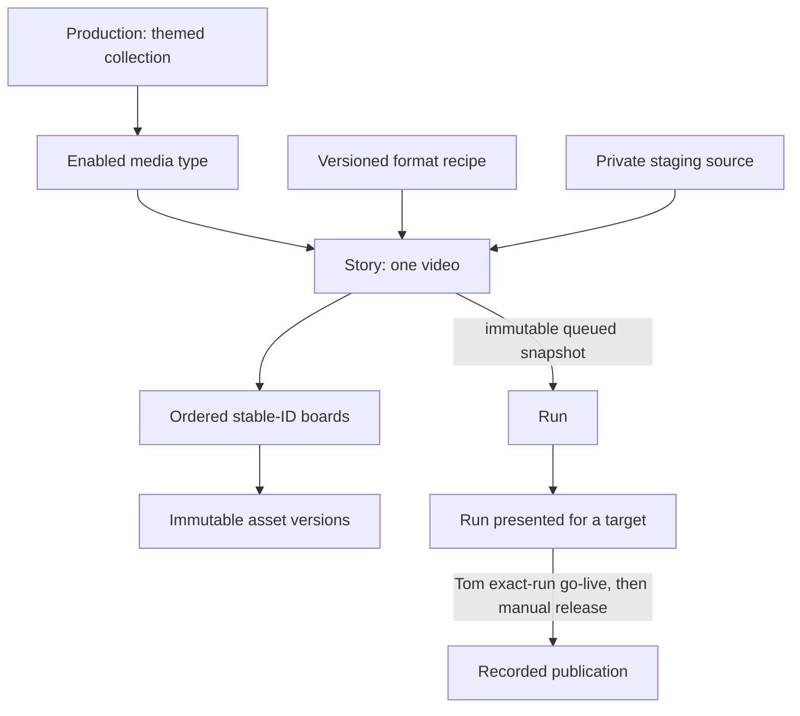

# Adversarial backlog review — 2026-11-05

Review story: https://work.haynesnetwork.com/work_packages/422. Documentation only;
no tracker writes, dispatch, model calls, runtime changes or production work.
Ready PR is the handoff; the coordinator reviews, merges and applies these proposals.
This document is a review artifact linked to that story, not a second work queue.

Quick navigation: [findings](#ranked-findings) · [field audit](#seven-field-audit-of-the-supplied-stories) · [existing tracker edits](#tracker-edits--existing-work-packages) · [new/split story proposals](#tracker-edits--proposed-missing-or-split-stories) · [doc corrections](#exact-documentation-corrections-for-the-coordinator-to-apply) · [questions](#questions-for-tom--headless-handoff-no-live-ask) · [coordinator guide](coordinator-guide.md).

## Evidence and limits

Reviewed the supplied 2026-11-05 field export and freshly fetched `main` at
`eaf0d9095ed7d7046dbd33dc25ca8831a91d6b7a`: AGENTS.md, the docs index, proposals
0002/0003, all four mockup files, manual runbook, all reference docs, E0 findings
including layered/S2V addenda, all `poc/*.py`, manifests and text evidence paths.
The export omits history and formal relation edges; a missing dependency below means
missing from the supplied fields, not proof the live tracker has no relation.
No live tracker, cluster, private media or external-link health was verified.
Infrastructure and dispatch facts supplied in the work order are accepted context,
not fresh readiness evidence. Nothing below marks a story groomed or accepted.

**24 findings: 3 CRITICAL, 12 HIGH, 7 MEDIUM, 2 LOW.** All 23 requested stories need
at least a policy/handoff patch. There are 39 proposed bounded follow-ups, R01–R39;
they were created in the tracker on 2026-11-05 as
[423](https://work.haynesnetwork.com/projects/haynes-studio/work_packages/423) to [461](https://work.haynesnetwork.com/projects/haynes-studio/work_packages/461); see [Review labels in the tracker](#review-labels-in-the-tracker).

## Review labels in the tracker

The 39 proposed stories were created on 2026-11-05 as Ungroomed items related to [422](https://work.haynesnetwork.com/projects/haynes-studio/work_packages/422). Each keeps its label in the subject, for example "E1.9 Canonical contracts and decision reconciliation (review R01)". The tracker fields of all 72 items (saga, epics and stories) now hold the replacement text below, with every label resolved to a link. The tracker is the source of truth from here on.

| Label | Work package | Tracker code | Title |
|---|---|---|---|
| R01 | [423](https://work.haynesnetwork.com/projects/haynes-studio/work_packages/423) | E1.9 | Canonical contracts and decision reconciliation |
| R02 | [424](https://work.haynesnetwork.com/projects/haynes-studio/work_packages/424) | E1.10 | CI and disposable test foundation |
| R03 | [425](https://work.haynesnetwork.com/projects/haynes-studio/work_packages/425) | E1.11 | Legacy service adapters and private-input recovery map |
| R04 | [426](https://work.haynesnetwork.com/projects/haynes-studio/work_packages/426) | E1.12 | Layered image/S2V method adapter |
| R05 | [427](https://work.haynesnetwork.com/projects/haynes-studio/work_packages/427) | E1.13 | Whole-frame image-to-video adapter |
| R06 | [428](https://work.haynesnetwork.com/projects/haynes-studio/work_packages/428) | E1.14 | Authorized private Winter Menu integration run |
| R07 | [429](https://work.haynesnetwork.com/projects/haynes-studio/work_packages/429) | E3.3 | Scoped core studio MCP server |
| R08 | [430](https://work.haynesnetwork.com/projects/haynes-studio/work_packages/430) | E3.4 | Asynchronous media/run HTTP and MCP operations |
| R09 | [431](https://work.haynesnetwork.com/projects/haynes-studio/work_packages/431) | E3.5 | CNPG studio database and least-privilege role |
| R10 | [432](https://work.haynesnetwork.com/projects/haynes-studio/work_packages/432) | E3.6 | Authentik OIDC application and scoped identity contract |
| R11 | [433](https://work.haynesnetwork.com/projects/haynes-studio/work_packages/433) | E3.7 | Reproducible API/web/worker images |
| R12 | [434](https://work.haynesnetwork.com/projects/haynes-studio/work_packages/434) | E3.8 | LAN deployment with replicas, NFS, ingress and PDBs |
| R13 | [435](https://work.haynesnetwork.com/projects/haynes-studio/work_packages/435) | E3.9 | Metadata/media backup configuration and recovery plan |
| R14 | [436](https://work.haynesnetwork.com/projects/haynes-studio/work_packages/436) | E3.10 | Isolated restore drill |
| R15 | [437](https://work.haynesnetwork.com/projects/haynes-studio/work_packages/437) | E3.11 | API/queue integration and app-replica recovery tests |
| R16 | [438](https://work.haynesnetwork.com/projects/haynes-studio/work_packages/438) | E6.9 | Playwright behavior and end-to-end suite |
| R17 | [439](https://work.haynesnetwork.com/projects/haynes-studio/work_packages/439) | E3.12 | API and MCP tool reference |
| R18 | [440](https://work.haynesnetwork.com/projects/haynes-studio/work_packages/440) | E6.10 | Operator runbook and user journey documentation |
| R19 | [441](https://work.haynesnetwork.com/projects/haynes-studio/work_packages/441) | E4.1 | Local model admission through the existing Wan lease |
| R20 | [442](https://work.haynesnetwork.com/projects/haynes-studio/work_packages/442) | E4.2 | Host one approved local multimodal model |
| R21 | [443](https://work.haynesnetwork.com/projects/haynes-studio/work_packages/443) | E7.1 | Versioned staging archive through MCP |
| R22 | [444](https://work.haynesnetwork.com/projects/haynes-studio/work_packages/444) | E7.2 | Authorized read-only subtitle source adapter |
| R23 | [445](https://work.haynesnetwork.com/projects/haynes-studio/work_packages/445) | E8.1 | Escalation package and dev-env interface contract |
| R24 | [446](https://work.haynesnetwork.com/projects/haynes-studio/work_packages/446) | E8.2 | One sanctioned responder integration drill |
| R25 | [447](https://work.haynesnetwork.com/projects/haynes-studio/work_packages/447) | E9.2 | Versioned format recipes and target-account metadata |
| R26 | [448](https://work.haynesnetwork.com/projects/haynes-studio/work_packages/448) | E9.3 | Candidate feedback and iteration contract |
| R27 | [449](https://work.haynesnetwork.com/projects/haynes-studio/work_packages/449) | E9.4 | Private manual release package and rights/disclosure checks |
| R28 | [450](https://work.haynesnetwork.com/projects/haynes-studio/work_packages/450) | E2.3 | Wardrobe/decal drift checks from E0 fixtures |
| R29 | [451](https://work.haynesnetwork.com/projects/haynes-studio/work_packages/451) | E2.4 | Matting and automatic size matching adapter |
| R30 | [452](https://work.haynesnetwork.com/projects/haynes-studio/work_packages/452) | E2.5 | Set occlusion masks and focal-prop layout validation |
| R31 | [453](https://work.haynesnetwork.com/projects/haynes-studio/work_packages/453) | E2.6 | Delivery scaling and fps conversion profile |
| R32 | [454](https://work.haynesnetwork.com/projects/haynes-studio/work_packages/454) | E5.3 | Bounded local shepherd stage workflow |
| R33 | [455](https://work.haynesnetwork.com/projects/haynes-studio/work_packages/455) | E5.4 | Local writer evaluation corpus and switch rubric |
| R34 | [456](https://work.haynesnetwork.com/projects/haynes-studio/work_packages/456) | E6.11 | Reusable asset library and promote UI |
| R35 | [457](https://work.haynesnetwork.com/projects/haynes-studio/work_packages/457) | E2.7 | Reusable set and doll motion asset records |
| R36 | [458](https://work.haynesnetwork.com/projects/haynes-studio/work_packages/458) | E3.13 | Product Wan video job interface |
| R37 | [459](https://work.haynesnetwork.com/projects/haynes-studio/work_packages/459) | E2.8 | One approved matting backend: profile, image and GitOps install |
| R38 | [460](https://work.haynesnetwork.com/projects/haynes-studio/work_packages/460) | E2.9 | One approved segmentation/detection backend: profile, image and GitOps install |
| R39 | [461](https://work.haynesnetwork.com/projects/haynes-studio/work_packages/461) | E2.10 | One approved upscaling backend: profile, image and GitOps install |

## Ranked findings

### CRITICAL

- **C1 — Planning is easily mistaken for execution authority.**
  https://work.haynesnetwork.com/work_packages/362 and all 23 stories are Ungroomed;
  old stops say “PR merged,” while this dispatch model gives merge to the coordinator.
  A fresh worker could start an unapproved GPU run, promote itself out of Ungroomed,
  merge its own PR or claim human acceptance. **Fix:** apply every replacement below;
  dispatch only after Tom/Meatball grooms and explicitly starts the bounded work.
  HTTP 422 on Ungroomed is a hold, not a reason to repair permissions. Worker stop is
  ready PR + handoff; installed and accepted are separate records.
- **C2 — D41 is a comment, not a buildable safety contract.**
  https://work.haynesnetwork.com/work_packages/409,
  https://work.haynesnetwork.com/work_packages/410 and
  https://work.haynesnetwork.com/work_packages/413 omit actionable authentication,
  replica and recovery tests. A cheap worker can deliver a LAN-trusting API or an
  in-memory queue that loses or duplicates GPU jobs after restart. **Fix:** source-only
  [409](https://work.haynesnetwork.com/work_packages/409)/[410](https://work.haynesnetwork.com/work_packages/410)/[413](https://work.haynesnetwork.com/work_packages/413) replacements plus R01, R09–R15; two stateless replicas across nodes,
  Postgres claims/fencing and external-job reconciliation, authenticated media and
  OIDC/scoped-key negative tests. No node drain or lease bypass as a test.
- **C3 — Go-live is only an identity checkbox in the export.**
  https://work.haynesnetwork.com/work_packages/412 and
  https://work.haynesnetwork.com/work_packages/390 omit D43/D44 enforcement.
  A worker could approve a run without the mandatory AI label or credit every upstream
  agent/image model. **Fix:** replace [412](https://work.haynesnetwork.com/work_packages/412); add R27. Bind approval to the exact finished
  run/hash and verified Tom subject, require disclosure/rights results, derive public
  credits only from video/sound provenance. Keep photo provenance privately for audit.
  No platform calls, channel creation or publishing in these stories.

### HIGH

- **H1 — Two incompatible domain models.**
  https://work.haynesnetwork.com/work_packages/378 through
  https://work.haynesnetwork.com/work_packages/382 precede
  https://work.haynesnetwork.com/work_packages/404 but target the old shot model;
  proposal 0003's product diagram still calls a production one video. A worker will
  create incompatible IDs, migrations and caches. **Fix:** R01 defines the translation
  first; [378](https://work.haynesnetwork.com/work_packages/378) preserves the legacy schema, [404](https://work.haynesnetwork.com/work_packages/404) owns the canonical board schema;
  update proposal prose by the exact doc patch below. D27/D28/D38/D39 win.
- **H2 — E1.1 cannot fit the proposed extraction session.**
  https://work.haynesnetwork.com/work_packages/378 combines packaging, all helpers,
  schema, CI, conversion, rendering and live ASR. PoC imports have CLI side effects
  (several scripts hide argv before importing `edit`); media paths are private.
  **Fix:** narrow [378](https://work.haynesnetwork.com/work_packages/378) to package/core entry points and schema; R02 owns test foundation,
  R03 the remaining compatibility adapters, R06 the live build. No wholesale move that
  breaks preserved `poc/` evidence.
- **H3 — Cache correctness and speed claims conflict.**
  https://work.haynesnetwork.com/work_packages/380 promises all audio changes avoid
  picture rendering, yet voice envelopes drive bounce and S2V. `edit.Fire` uses film
  time and an ordered RNG; layered clips use film frame offsets. A duration edit can
  invalidate later boards even when their text is unchanged. Two minutes on two threads
  is unproven; layered v2 took 408 s on the 24-vCPU worker.
  **Fix:** replace [380](https://work.haynesnetwork.com/work_packages/380): declare clocks/seeds, include every picture dependency, test
  downstream invalidation, limit reuse to picture-independent audio. R06 records
  timings without turning a historical target into a false completion claim.
- **H4 — E1.8 bundles several renderers and a long GPU run.**
  https://work.haynesnetwork.com/work_packages/406 assumes every layer × motion pair
  works and budgets “plus GPU time” without a cap. The proven S2V batch alone took
  about 105 min elapsed; compositing took 393 s. **Fix:** R04/R05 implement method
  adapters, [406](https://work.haynesnetwork.com/work_packages/406) orchestrates supported methods, R06 owns bounded live acceptance.
  Unsupported pairs fail explicitly; no silent whole-frame S2V support claim.
- **H5 — Delivery points at the obsolete store.**
  https://work.haynesnetwork.com/work_packages/381 and
  https://work.haynesnetwork.com/work_packages/382 still target local files/Wan PVC.
  `deliver.py` manually links a ledger consumed at Wan startup; a malformed ledger
  can crash that service. A worker could make the new app depend on this unbacked PVC.
  **Fix:** replace [381](https://work.haynesnetwork.com/work_packages/381)/[382](https://work.haynesnetwork.com/work_packages/382) and epic [374](https://work.haynesnetwork.com/work_packages/374): filesystem interface for offline tests,
  D39 NFS + Postgres for product delivery, read-only legacy import, no migration or
  writes to archived productions/Wan ledgers in source stories. R12–R14 own installation
  and backup evidence; original legacy records remain intact.
- **H6 — MCP is named but has no implementing story.**
  https://work.haynesnetwork.com/work_packages/374,
  https://work.haynesnetwork.com/work_packages/411 and
  https://work.haynesnetwork.com/work_packages/421 depend on nonexistent tools.
  Old names (`patch_shot`, `get_title_summary`) conflict with boards.
  **Fix:** R07 provides scoped board CRUD tools; R08 adds asynchronous voice/photo/run
  adapters and D42 uploads. [411](https://work.haynesnetwork.com/work_packages/411) and [421](https://work.haynesnetwork.com/work_packages/421) wait for the actual versioned tool contract.
- **H7 — Local hosting is an epic-shaped missing dependency.**
  https://work.haynesnetwork.com/work_packages/375 and
  https://work.haynesnetwork.com/work_packages/421 have no E4 stories; E4 still calls
  GPU placement undecided despite D2. A worker might borrow a household card or assume
  two 24 GB GPUs are a 48 GB pool. **Fix:** R19 extends the existing Wan lease path;
  R20 hosts one selected model within it. [421](https://work.haynesnetwork.com/work_packages/421) waits for endpoint, model digest, licence,
  memory/context limits and handover evidence, not merely “E4 merged.”
- **H8 — No image or installation chain.**
  https://work.haynesnetwork.com/work_packages/409 and
  https://work.haynesnetwork.com/work_packages/413 promise “deployed” inside three
  hours, without image, DB role, OIDC app, ingress, NFS, PDB or spread ownership.
  **Fix:** source-only stories plus R09–R12, with explicit haynes-ops worktrees,
  immutable image digests and scoped runtime acceptance; DB/OIDC/access changes wait
  for action-specific authorization. Chosen architecture is not blanket write authority.
- **H9 — Backups are asserted, restores absent.**
  https://work.haynesnetwork.com/work_packages/409 says backups configured; D39's
  CNPG backups do not establish gasha01 media backup or a consistent restore.
  **Fix:** R13 documents/configures metadata + media recovery together; R14 restores
  to a new isolated target and checks hashes and references. Existing originals are
  never overwritten. Keep installed and recovery-tested states separate.
- **H10 — UI story dependencies stop at Python functions.**
  https://work.haynesnetwork.com/work_packages/415,
  https://work.haynesnetwork.com/work_packages/416,
  https://work.haynesnetwork.com/work_packages/417,
  https://work.haynesnetwork.com/work_packages/418 and
  https://work.haynesnetwork.com/work_packages/419 lack callable operation contracts;
  [418](https://work.haynesnetwork.com/work_packages/418) also omits agent uploads (D42) and combines two large pages.
  **Fix:** explicit API/R08 dependencies below; narrow [418](https://work.haynesnetwork.com/work_packages/418) to the photo composer and
  split reusable library/promote UI into R34. Upload is authenticated bytes, never a
  server fetch of an arbitrary URL; no paid API key in studio.
- **H11 — Testing is nobody's deliverable.**
  https://work.haynesnetwork.com/work_packages/378 and
  https://work.haynesnetwork.com/work_packages/420 assume CI/UI tests exist.
  Only advisory Claude workflows exist at the reviewed SHA; there is no product
  package, test suite or image build. Mockup checks are historical, not app tests.
  **Fix:** R02 CI/fixtures, R15 integration/recovery tests, R16 Playwright contract and
  browser tests; per-story tests remain the implementer's job. No private media in CI,
  no tokens/services in unit tests, no advisory review as a required check.
- **H12 — E5 and E9 completion claims exceed their stories.**
  https://work.haynesnetwork.com/work_packages/376,
  https://work.haynesnetwork.com/work_packages/421 and
  https://work.haynesnetwork.com/work_packages/390 omit shepherd orchestration,
  evaluation rubric, formats, feedback and release preparation. A coordinator could
  close an epic after just drafting boards or storing approval.
  **Fix:** D40 replaces “zero Claude tokens”; R25–R27, R32/R33 fill the missing contracts.
  E5 remains incomplete until the local shepherd and bounded technical checks work;
  switching writers needs Tom's pre-agreed rubric and recorded verdict.

### MEDIUM

- **M1 — Seven-field compliance is superficial across all 23 stories.**
  https://work.haynesnetwork.com/work_packages/378 and
  https://work.haynesnetwork.com/work_packages/404 exemplify generic ownership/stops,
  absent handoffs and missing checkpoints. “About 3h” hides integration uncertainty.
  **Fix:** the field audit and all replacements below add explicit states, resources,
  exclusions, caps, checkpoints and review handoffs. Estimates are proposals, not quota.
- **M2 — Prototype defaults can become production decisions.**
  https://work.haynesnetwork.com/work_packages/404 and
  https://work.haynesnetwork.com/work_packages/405 use an unspecified pad/tolerance;
  the mockup uses 0.25 s and 25 fps, while the PoC delivers 24 fps and S2V is 16 fps.
  **Fix:** R01 pins units, padding, line offsets, rounding, capability matrix and fixture
  expectations; [405](https://work.haynesnetwork.com/work_packages/405) measures samples, R31 handles conversion. Do not infer approval
  of a production constant from illustrative mockup arithmetic.
- **M3 — E0 evidence is mistaken for complete prerequisite acceptance.**
  https://work.haynesnetwork.com/work_packages/387 and
  https://work.haynesnetwork.com/work_packages/406 reference findings story
  https://work.haynesnetwork.com/work_packages/395, absent from the export.
  NFS contention and upscaler quality were unmeasured in the first report; later
  findings amend the old “S2V premium only” conclusion. **Fix:** readiness is the
  three findings files plus coordinator verification of [395](https://work.haynesnetwork.com/work_packages/395)'s current holds. Use D24
  for talking boards. Log actual NFS IO during R06; no NAS load test or new thermal
  threshold from a suggested value in historical findings. Do not reopen E0 holds.
- **M4 — “Approval” and deletion mean several things.**
  https://work.haynesnetwork.com/work_packages/408,
  https://work.haynesnetwork.com/work_packages/412 and
  https://work.haynesnetwork.com/work_packages/420 conflate asset promotion, creative
  feedback, technical checks and formal go-live. [408](https://work.haynesnetwork.com/work_packages/408) permits discarding rejected files
  despite D17. **Fix:** promotion is explicit inclusion, no automatic purge; only
  go-live is formal release approval. [420](https://work.haynesnetwork.com/work_packages/420) records Tom's separate usability verdict;
  “notes given” does not mean accepted. Approving an older completed run remains legal
  after draft edits; approval never transfers to the new run.
- **M5 — Empty E7/E8 epics conceal external authorization dependencies.**
  https://work.haynesnetwork.com/work_packages/388 and
  https://work.haynesnetwork.com/work_packages/389 cannot be dispatched as sessions.
  “Read-only” subtitle discovery still needs a sanctioned source path; escalation
  needs a dev-env request contract and budget. **Fix:** R21–R24; archive staging first,
  source discovery and real responder launch stop at their external gates.
- **M6 — Broad E2 claims have no owners.**
  https://work.haynesnetwork.com/work_packages/373 promises cutouts, occlusion masks
  and layouts but [407](https://work.haynesnetwork.com/work_packages/407)/[408](https://work.haynesnetwork.com/work_packages/408) only generate/promote photos/assets. A worker may promote
  opaque photos as render-ready cutouts or use the superseded ECC threshold as truth.
  **Fix:** R28–R31/R35 and R37–R39 backend installation, kind/capability metadata in [382](https://work.haynesnetwork.com/work_packages/382), separate accepted photo/clip assets
  from render-ready layers. ECC is an imperfect proxy (later findings override early
  confidence); use observed drift fixtures and recorded overrides.
- **M7 — No durable operator, user, API or MCP reference owner.**
  https://work.haynesnetwork.com/work_packages/374 and
  https://work.haynesnetwork.com/work_packages/377 say “runbook updated” without a
  complete consumer path. **Fix:** R17/R18; operation owners also document their
  introduced commands/failure modes. Proven requires delivered evidence; source PRs
  are Expected until installed/exercised. Never paste credentials or full addresses.

### LOW

- **L1 — References resolve to the wrong generation or nowhere executable.**
  https://work.haynesnetwork.com/work_packages/378 says “PRs 1–6 merged” and links
  proposal 0002; [409](https://work.haynesnetwork.com/work_packages/409) still calls D39 a question. [395](https://work.haynesnetwork.com/work_packages/395) and a “local model via E4” have no
  supplied dispatch record. **Fix:** explicit full links, local evidence paths and
  artifact readiness below replace shorthand. `~/studio-jobs/...` and mutable
  `~/repos/haynes-ops/...` in PoC scripts are not portable artifact locators. R03 records
  pinned input recovery and workflow hashes. No local Markdown target in the reviewed
  inputs was identified as missing; remote/private accessibility remains unverified.
- **L2 — Historical docs contradict their own amendment headers.**
  https://work.haynesnetwork.com/work_packages/377 is affected by the old approval
  language in `questions.md`, v1 `review.md`, and runbook gates, plus proposal 0003's
  stale model/CPU prose. **Fix:** preserve history, add the exact precedence/doc patch
  below and the coordinator glossary. Current D29/D38/D41/D42 rules win; do not
  implement the old recommendations or mutate the interactive mockup in this review.

## Seven-field audit of the supplied stories

S = scope/exclusions; A = observable acceptance/state; D = readiness of dependencies;
O = ownership/resources; B = budget/checkpoint/concurrency/cost; H = handoff; X = stop.
`~` means present but insufficient; `—` absent. No unmarked story is dispatch-ready.
The replacements below supply all seven; they intentionally change source stories'
old runtime acceptance into separately owned integration/installation evidence.

| Work package | S | A | D | O | B | H | X | Specific repair / split |
|---|---|---|---|---|---|---|---|---|
| https://work.haynesnetwork.com/work_packages/378 | ~ | ~ | ~ | ~ | ~ | — | ~ | Package/schema only; R02/R03/R06 split CI, adapters, live build |
| https://work.haynesnetwork.com/work_packages/379 | ~ | ~ | ~ | ~ | ~ | ~ | ~ | Stage-set atomicity and concurrent commit tests; no runtime |
| https://work.haynesnetwork.com/work_packages/380 | ~ | ~ | ~ | ~ | ~ | ~ | ~ | Clock-aware keys, selective audio reuse; remove unproven speed gate |
| https://work.haynesnetwork.com/work_packages/381 | ~ | ~ | ~ | ~ | ~ | ~ | ~ | D39 delivery interface; R12/R14 installation and restore |
| https://work.haynesnetwork.com/work_packages/382 | ~ | ~ | ~ | ~ | ~ | ~ | ~ | Immutable IDs and kind capabilities; private recovery dependency |
| https://work.haynesnetwork.com/work_packages/404 | ~ | ~ | ~ | ~ | ~ | — | ~ | Canonical schema after R01; explicit timing/rules |
| https://work.haynesnetwork.com/work_packages/405 | ~ | ~ | ~ | ~ | ~ | — | ~ | Board mix, timing fixture, CPU client versus actual TTS service |
| https://work.haynesnetwork.com/work_packages/406 | ~ | ~ | ~ | ~ | ~ | — | ~ | Orchestration; R04/R05 adapters, R06 GPU acceptance |
| https://work.haynesnetwork.com/work_packages/407 | ~ | ~ | ~ | ~ | ~ | — | ~ | Separate Comfy lane; D42 photo import and stale races |
| https://work.haynesnetwork.com/work_packages/408 | ~ | ~ | ~ | ~ | ~ | — | ~ | Candidate/promote state; no automatic discard |
| https://work.haynesnetwork.com/work_packages/409 | ~ | ~ | ~ | ~ | ~ | — | ~ | API source; split auth/install/recovery; D39 already answered |
| https://work.haynesnetwork.com/work_packages/410 | ~ | ~ | ~ | ~ | ~ | — | ~ | Postgres queue + reconciled external lease; fake restart tests |
| https://work.haynesnetwork.com/work_packages/411 | ~ | ~ | ~ | ~ | ~ | — | ~ | Frontier path via actual MCP; fixed fixture and edit conflicts |
| https://work.haynesnetwork.com/work_packages/412 | ~ | ~ | ~ | ~ | ~ | — | ~ | D43/D44 disclosure, exact-run approval, identity negatives |
| https://work.haynesnetwork.com/work_packages/413 | ~ | ~ | ~ | ~ | ~ | — | ~ | Source shell + OIDC client contract; installation elsewhere |
| https://work.haynesnetwork.com/work_packages/414 | ~ | ~ | ~ | ~ | ~ | — | ~ | Combinable filters; exact-run approval and empty states |
| https://work.haynesnetwork.com/work_packages/415 | ~ | ~ | ~ | ~ | ~ | — | ~ | Explicit API dependency even if shell used mocks |
| https://work.haynesnetwork.com/work_packages/416 | ~ | ~ | ~ | ~ | ~ | — | ~ | Persist/reorder stable boards, voice endpoint, accessibility |
| https://work.haynesnetwork.com/work_packages/417 | ~ | ~ | ~ | ~ | ~ | — | ~ | Operation endpoints, stale asynchronous results, direction semantics |
| https://work.haynesnetwork.com/work_packages/418 | ~ | ~ | ~ | ~ | ~ | — | ~ | Photo composer only; R34 owns library/promote UI |
| https://work.haynesnetwork.com/work_packages/419 | ~ | ~ | ~ | ~ | ~ | — | ~ | Mock and real run states separated; bounded live test R06 |
| https://work.haynesnetwork.com/work_packages/420 | ~ | ~ | ~ | ~ | ~ | — | ~ | Phone fix budget separate from Tom scheduling/acceptance |
| https://work.haynesnetwork.com/work_packages/421 | ~ | ~ | ~ | ~ | ~ | — | ~ | R19/R20 hosting, R33 rubric, bounded evaluation; no forced switch |

## Tracker edits — existing work packages

Apply only after review; preserve status, history, source-key, parent and existing
holds. Re-read current items/history and reconcile newer changes first; export lock
versions are not safe write versions. For stories, replace Description with the seven
numbered fields and Acceptance with field 2 verbatim. Replace Constraints with:

> Proposal only until groomed and explicitly started. Public repo: text/code/hashes
> only; no media, subtitles, voices, weights, secrets or full email addresses. Outputs
> create-only in a new private job/run; no automatic purge. No paid inference,
> publishing, accounts or access changes without Tom's action-specific authorization.
> Cluster configuration only through haynes-ops GitOps. Household first: one shared
> ComfyUI image prompt at a time; Wan/Foley/local-model work through the one Wan
> compute lease and unknown-work checks. Session CPU at most 2 threads. A source PR
> proves neither installation nor Tom's acceptance. Worker opens a ready PR and stops;
> coordinator owns review and merge. Tom/authorized accepter owns Accepted.

This constraints text applies to every replacement and every proposed story below.
Each full block additionally names its actual permitted resources and stop. Future
Execution owner is the single session assigned at dispatch, never Tom by default.
Where R labels appear, substitute the searched/created item's full URL before applying;
never dispatch with an unresolved label. The coordinator guide defines artifact-ready.

### Saga — https://work.haynesnetwork.com/work_packages/362

Replace Repos: `thaynes43/haynes-studio; thaynes43/haynes-ops (GitOps only)`.
Replace roadmap/model paragraphs in Description:

> Production means a themed collection; media type is Short 9:16 or Video 16:9;
> story means one video, made from ordered boards; run means an immutable queued
> snapshot and its outputs. Legacy manifests and Wan production IDs are imported
> read-only with explicit mappings. Deliver E1 core, E3 authenticated API/MCP and E6
> browser tooling in usable increments, with E2 assets, E4 local hosting, E5 shepherd,
> E7 staging, E8 bounded escalation and E9 release preparation as their dependencies
> become ready. D29 removes script/per-board approval gates; D40 uses a frontier writer
> until a local harness passes. Acceptance still requires a usable private production
> and review loop. Live release, accounts, paid inference and access changes remain
> separately authorized. No batch/cadence promise is an approved quota. Current
> planning authority does not start any implementation story.

### E1 — https://work.haynesnetwork.com/work_packages/372

Replace Description:
> Preserve legacy manifest v1 compatibility while introducing the canonical
> production/media-type/story/board model (D27/D28/D38). E1 owns package/CLI, immutable
> library versions, measured pre-build board voices, atomic stages, clock-correct
> selective caching, supported Wan method adapters and create-only delivery/proxies.
> R01 fixes contracts before extraction. Product records/media follow D39/D41;
> local filesystem stores are test/CLI adapters, not the installed system of record.
> Proposal 0003 and its latest decisions supersede proposal 0002.

Replace Acceptance:
> Usable private CLI demo, after source tests and authorized integration: import
> Winter Menu r1–r4 read-only, build its board story into a new run, deliver master
> plus phone proxy, edit one board and show the documented invalidation set. Record
> CPU/GPU/wait timings and hashes; the historical under-two-minute target is reported
> as met or unmet, not assumed. Tom records his separate usability verdict. Source
> completion alone does not close E1; R03–R06 and delivery integration are prerequisites.

### E2 — https://work.haynesnetwork.com/work_packages/373

Replace Description:
> D42 board-photo generation remains on shared comfyui-0/talosm03, separate from
> leased Wan builds. Support authenticated external photo versions with full private
> provenance. Candidate generation and explicit promotion do not imply a render-ready
> cutout. Immutable asset kinds declare capabilities. R28–R31, R35 and R37–R39 own quality
> checks, matting/size matching, occlusion/layout aids, scale/fps conversion and reusable
> motion assets; none is delivered merely by implementing [407](https://work.haynesnetwork.com/work_packages/407)/[408](https://work.haynesnetwork.com/work_packages/408). No automatic purge.

Replace Acceptance:
> Usable prompt-to-library demo with a new invented doll/set and board photo, then
> the declared render-ready assets, cutouts/masks/layouts and motion/scale checks,
> with measured hand work and Tom's recorded favorites/quality feedback. Every missing
> capability remains an explicit open dependency; a generated opaque photo cannot
> satisfy the cutout/mask acceptance. No paid generation or household disruption.

### E3 — https://work.haynesnetwork.com/work_packages/374

Replace Description:
> Stateless replicated studio-api and MCP over production/media type/story/boards,
> immutable assets, notes, selections, runs and approvals. Metadata/queue state lives
> in studio on shared CNPG database/postgres16; hashed media in
> gasha01:/hdd-nfs-repl/data/studio (per-production and library folders). No app RBD/PVC
> state. People use Authentik OIDC; agents scoped MCP keys. A Postgres queue reconciles
> jobs through the existing Wan compute lease, never a competing GPU scheduler.
> E3 source depends on merged E1 model/library/build contracts, not E1 being Accepted;
> E1 live acceptance may consume the partial E3 installation without waiting for E3
> epic acceptance. ComfyUI is a separate polite image lane. R07–R15 and R17 own missing MCP,
> installation, backup/restore, HA testing and references. All manifests in haynes-ops.

Replace Acceptance:
> Usable LAN-only authenticated API/MCP, at least two stateless API/web replicas
> across nodes with PDBs, survives one app-node loss without losing accepted queued
> runs; talosw01 loss pauses builds while the tool remains available. Demonstrate one
> board patch and one queue call via scoped MCP, inspect checks/proxy, record tokens
> and reconcile job IDs after restart. Unauthorized CRUD/media fail. Separate source,
> installed, recovery-tested and Tom-accepted evidence; backup configuration alone
> does not prove recovery. Controlled app-pod failure only within authorized test scope.

### E4 — https://work.haynesnetwork.com/work_packages/375

Replace Description:
> D2 already selects the two 24 GB 3090s on talosw01. R19 extends the single Wan
> lease contract for model load/inference/unload; R20 selects and hosts one suitable
> local multimodal model with pinned digest/licence and bounded context. Each card
> has 24 GB; never assume a 48 GB shared address space or use a household card.
> Endpoint/model profile is configuration. Hosting is not proof of writing quality.

Replace Acceptance:
> Installed local text/vision endpoint with one bounded request of each kind and
> a documented model profile. A serialized local-model/Wan handover proves unloading,
> unknown-work refusal and queue resumption without disturbing household jobs. GPU
> memory/time caps and action-specific install authority are recorded. E5.2/R33
> separately evaluate whether the writer is reliable enough to switch.

### E5 — https://work.haynesnetwork.com/work_packages/376

Replace Description:
> D40 supersedes zero-Claude-token drafting: frontier agents draft boards through
> studio MCP until a bounded local writer harness passes a Tom-agreed rubric. All
> tokens/usage and known costs are recorded per production; unknown cost is marked
> unknown. The local shepherd follows saved format rules, orchestrates stages and
> technical checks, and escalates bounded failures through E8. It never edits format
> rules or judges comedy/taste. R32 owns missing orchestration; R33 owns evaluation
> fixtures/rubric. Script and photos iterate without creative approval gates (D29).

Replace Acceptance:
> Usable brief-to-reviewable-run flow with writer mode explicit, no unapproved
> paid inference and bounded retries. Human edits survive re-drafts. Local shepherd
> stages, check failures and escalations are recorded; Tom reviews taste separately.
> Frontier mode is valid initially. Local mode becomes default only after [421](https://work.haynesnetwork.com/work_packages/421)'s
> evaluation and Tom's switch verdict; a measured gap is useful evidence but does not
> satisfy the purely local end-state. Source board drafting alone does not close E5.

### E6 — https://work.haynesnetwork.com/work_packages/377

Replace Description:
> Implement the v6 stage/filmstrip/inspector and Productions/Editor hierarchy,
> button breadcrumbs, per-user saved selections, voices, photos, direction notes,
> library filters/promotion, queued immutable runs and comparison. Method is one
> layer badge and one motion badge. D29: only go-live is formal approval; no script,
> photo or per-board approval before Build. D41: OIDC, authenticated requests and
> replicated stateless app. D42 uploads are visible photo versions, without exposing
> paid credentials. Mockup timers/placeholders are not product services.

Replace Acceptance:
> Usable installed browser/phone flow: Tom creates/edits boards, auditions real
> voice, chooses/generates photos, queues a run while editing and reviews a finished
> playable short without an agent. Source/Playwright, integration, replica and recovery
> evidence precede the demo. Tom's explicit usability verdict is separate from tests
> and go-live. R16/R18/R34 and [420](https://work.haynesnetwork.com/work_packages/420) remain required; Publish stays disconnected.

### E7 — https://work.haynesnetwork.com/work_packages/388

Replace Description:
> R21 stores versioned original briefs/scripts/storyboards in an archive through
> scoped studio MCP for Tom and a frontier staging agent. R22 adds read-only subtitle
> discovery only after Tom names an authorized source/path. Source text stays private;
> use invented names, teams, logos and dialogue. D29 removes the old approved-script
> prerequisite: staging review is feedback, not a Build gate. No new source access.

Replace Acceptance:
> Usable archive-to-board flow through MCP with provenance, edit protection and
> original output, demonstrated first on a synthetic source. Real subtitle adaptation
> follows only when R22's sanctioned source is ready; Tom records creative feedback.
> Archive-only evidence does not claim subtitle discovery or close that remaining gap.

### E8 — https://work.haynesnetwork.com/work_packages/389

Replace Description:
> R23 defines a bounded escalation package and the sanctioned dev-env request/
> callback contract; R24 exercises one authorized responder through scoped MCP.
> Package: immutable run/board IDs, failed checks, private artifact references,
> allowed actions, budget/expiry and deduplication ID. dev-env chooses provider/model
> by capacity; studio cannot mint credentials, expand access or start arbitrary jobs.

Replace Acceptance:
> Usable authorized one-responder drill: after two bounded technical failures,
> one request is issued, responder fixes an allowed board through MCP, callback is
> idempotent and usage/cost or explicit unknown cost appears on the run/production.
> Denied, expired and duplicate requests stop safely. No drill until the external
> request path, scoped access and launch/usage cap are verified; contract-only is not
> installed or accepted escalation.

### E9 — https://work.haynesnetwork.com/work_packages/390

Replace Description:
> R25 stores versioned format recipes and target-account metadata; R26 provides
> candidate feedback/iteration; R27 prepares a private manual release package with
> rights/licence/disclosure checks. [412](https://work.haynesnetwork.com/work_packages/412) records Tom's exact-run go-live approval.
> D29 supersedes per-format creative approval gates; technical checks remain. D43:
> YouTube Shorts first, Tom owns/creates the channel, every video gets synthetic-content
> setting plus an AI-generated description line. D44: public description credits only
> actual video/sound generators and hardware from that run; other provenance remains
> private. Upload is manual after approval; integrations require a separate authorization.

Replace Acceptance:
> Usable private candidate/feedback/release-preparation demo with two explicit
> format recipes (one may be synthetic), existing or placeholder account metadata,
> checked labels/rights and immutable run approval. No live account or upload needed
> for the dry run. Tom reviews usability; only his explicit run-specific go-live
> permits a later manual release. Platform integration and live publication are excluded.

### E1.1 package/core CLI and legacy manifest schema — https://work.haynesnetwork.com/work_packages/378

1. **Scope:** Create studio package/CLI, import-safe timeline/core helpers, legacy manifest v1 schema and r1–r4 converter. Preserve poc/ entry points and behavior; exclude remaining service/delivery adapters (R03), canonical boards ([404](https://work.haynesnetwork.com/work_packages/404)), CI foundation (R02), live rendering and deployment.
2. **Acceptance:** Source + tested: clean install and CLI help; all four Winter Menu manifests convert/validate; recorded legacy timeline fields/frame totals match fixtures, including multi-line/cue cases. Unit tests run in R02 CI. No live transcript/render acceptance here.
3. **Dependencies:** R01 contract ratified and R02 test foundation merged; E0 findings/addenda reviewed and current [395](https://work.haynesnetwork.com/work_packages/395) holds checked. Public manifest/evidence JSON is available; private media is not required for these tests.
4. **Ownership:** One assigned session; haynes-studio studio/, package metadata, tests/, docs/; preserve poc/ and titles/ originals. No runtime resources.
5. **Budget:** 4 h cap; checkpoint at 90 min and 3 h; concurrency 1, CPU <=2 threads, zero GPU and $0 paid inference; usage allowance unknown, record at checkpoints.
6. **Artifacts and handoff:** Ready PR, schema/version map, fixture comparisons, install/CI summary and command docs; list deferred R03/R06 work.
7. **Stop:** Ready PR and handoff, or dependency/approval blocked, cap/context threshold, or explicit pause. No self-merge.

### E1.2 atomic stages and preflight — https://work.haynesnetwork.com/work_packages/379

1. **Scope:** Commit each multi-file stage as one complete artifact set using same-filesystem staging, create-only publication and a completion record; validate anchors, placements, cue trims/hashes and tolerances before rendering. Exclude garbage collection and runtime rollout.
2. **Acceptance:** Source + tested: forced failure after each stage write leaves no published incomplete set; retry/concurrent commit cannot overwrite a finished result. Invalid anchor/missing cue/hash fails within 5 s on the small fixture before any renderer call; paths name board/legacy shot and field.
3. **Dependencies:** [378](https://work.haynesnetwork.com/work_packages/378) and [404](https://work.haynesnetwork.com/work_packages/404) merged with versioned schemas; R02 fixtures/CI green. Atomic publication contract in R01 covers local and future NFS adapters.
4. **Ownership:** One assigned session; haynes-studio stage/validation code, tests/, runbook; no shared media mutation or cluster change.
5. **Budget:** 4 h cap; checkpoint at 90 min and 3 h; concurrency 1, CPU <=2, zero GPU/$0 paid; record unknown usage allowance.
6. **Artifacts and handoff:** Ready PR; failure-injection results, stage publication contract, errors and runbook changes.
7. **Stop:** Ready PR/handoff, blocked prerequisite, cap/context checkpoint or Tom pause; no self-merge.

### E1.3 cache and splice with explicit clocks — https://work.haynesnetwork.com/work_packages/380

1. **Scope:** Cache immutable board/legacy-shot picture segments and splice; key content hashes, versions/toolchain, method/settings, voice envelope/S2V audio, timing, pad, seeds, layout/camera and clock offsets. Distinguish board-local from film-time effects; invalidate downstream offsets when required. Exclude GPU generation and unproven speed guarantees.
2. **Acceptance:** Source + tested: edit one board and assert the documented invalidation set; reorder/duration/voice/toolchain edits never reuse stale pictures. Unchanged segments match decoded full-render fixture frames. Picture-independent mix/gain edits reuse picture; speech/bounce/S2V edits invalidate affected pictures. Document deterministic clock/seed handling.
3. **Dependencies:** [379](https://work.haynesnetwork.com/work_packages/379), [404](https://work.haynesnetwork.com/work_packages/404) and R03 merged; frozen timeline/cache fixtures in R02. R01 clock policy ratified; no performance measurement needed to dispatch source work.
4. **Ownership:** One assigned session; haynes-studio cache/render core, tests/, cache docs; new isolated local temp fixtures only.
5. **Budget:** 4 h cap; checkpoint at 90 min and 3 h; concurrency 1, CPU <=2, no live render/GPU, $0 paid; usage unknown.
6. **Artifacts and handoff:** Ready PR; key inventory and invalidation matrix, decoded synthetic fixture comparison, timing target deferred to R06.
7. **Stop:** Ready PR/handoff, unsupported contract, cap/context threshold or pause; no self-merge.

### E1.4 create-only delivery and proxy interface — https://work.haynesnetwork.com/work_packages/381

1. **Scope:** Implement delivery records/master/proxy using a configured private store interface, local test adapter and D39 path semantics. Preserve hash checks and create-only publication; exclude legacy Wan ledger writes, actual NFS install, DB deployment and media migration.
2. **Acceptance:** Source + tested: synthetic delivery produces verified master/proxy, H.264 phone proxy <25,000,000 bytes for a 60 s fixture, decodable with expected duration; interrupted/concurrent delivery cannot overwrite originals. Record links/hashes and verification results. Live integration belongs to R06/R12, not this source acceptance.
3. **Dependencies:** [378](https://work.haynesnetwork.com/work_packages/378), [379](https://work.haynesnetwork.com/work_packages/379), [404](https://work.haynesnetwork.com/work_packages/404) and R03 merged; R01 delivery/run IDs and D39 store contract fixed; R02 synthetic media generated only in temp directories.
4. **Ownership:** One assigned session; haynes-studio delivery/store adapters and tests/docs. No writes to ai/wan-video PVC or archived productions; no cluster change.
5. **Budget:** 4 h cap; checkpoint at 90 min and 3 h; concurrency 1, CPU <=2, <=60 s small synthetic encode only, zero GPU/$0 paid; usage unknown.
6. **Artifacts and handoff:** Ready PR; delivery schema, byte/duration checks, atomic conflict tests, legacy read-only mapping and docs.
7. **Stop:** Ready PR/handoff or cap/dependency/approval/pause; no self-merge or installation claim.

### E1.5 immutable library records and resolver — https://work.haynesnetwork.com/work_packages/382

1. **Scope:** Implement immutable versioned asset IDs, content-hash resolution, provenance/licence/labels and capabilities for cast/costume/set/prop/sound/voice/reference/motion assets. Prepare read-only legacy import map; distinguish opaque photo from keyed layer/mask. Local store is a CLI/test adapter, D39 is installed storage. Exclude automatic purge/generation and live migration.
2. **Acceptance:** Source + tested: library-ID-only Winter Menu metadata resolves through a synthetic store; same source import is idempotent, changed bytes create a new version, pinned IDs stay unchanged, wrong capabilities fail. Real-asset import requires the separate verified private input recovery in R03/R06.
3. **Dependencies:** [378](https://work.haynesnetwork.com/work_packages/378), [404](https://work.haynesnetwork.com/work_packages/404) and R01 library/provenance contract merged; R02 metadata fixtures. Legacy evidence hashes available; do not assume old session job_dir exists.
4. **Ownership:** One assigned session; haynes-studio library/resolver/import map, tests/docs; no mutation of private originals or DB/NFS runtime.
5. **Budget:** 4 h cap; checkpoint at 90 min and 3 h; concurrency 1, CPU <=2, zero GPU/$0 paid; usage unknown.
6. **Artifacts and handoff:** Ready PR; record schema, ID/version rules, idempotency evidence, private import instructions and unresolved input list.
7. **Stop:** Ready PR/handoff, dependency blocked or cap/context/pause; no self-merge.

### E1.6 canonical storyboard model — https://work.haynesnetwork.com/work_packages/404

1. **Scope:** Implement R01 canonical production -> media type -> story -> ordered stable-ID boards. Include lines/speakers, measured voice/version/input signature, silent hold, timing policy, versioned reference photos/provenance, layer x motion and editable direction. Preserve legacy adapter, exclude API/UI/render engines.
2. **Acceptance:** Source + tested: JSON Schema/Python agree; Winter Menu maps into one story without lost lines/cues/layout references; round-trip and invalid method/timing tests pass. Spoken duration uses measured voice plus explicit pad/rounding, silent board uses positive hold. No-line S2V rejected; unsupported method combinations distinguish unavailable from invalid.
3. **Dependencies:** [378](https://work.haynesnetwork.com/work_packages/378) merged and R01 ratified; public manifest/timeline fixtures from R02. No private media needed; model represents absent/stale pre-build assets explicitly.
4. **Ownership:** One assigned session; haynes-studio canonical models/schema/converter and tests/docs; no runtime or media changes.
5. **Budget:** 4 h cap; checkpoint at 90 min and 3 h; concurrency 1, CPU <=2, zero GPU/$0 paid; usage unknown.
6. **Artifacts and handoff:** Ready PR; schema examples, legacy-to-board ID/timing mapping, capability matrix and fixture evidence.
7. **Stop:** Ready PR/handoff, unresolved semantics, cap/context threshold or pause; no self-merge.

### E1.7 versioned pre-build board voice — https://work.haynesnetwork.com/work_packages/405

1. **Scope:** Create one measured board voice asset from ordered lines and stock cast/narrator voices using the existing sanctioned Kokoro path; retain per-line offsets and hashes for bounce/S2V. Version by input signature and ignore stale asynchronous completion. Exclude voice cloning, UI, video and service reconfiguration; CPU client is not a claim Kokoro is CPU-only.
2. **Acceptance:** Source + tested: frozen TTS responses give exact sample-derived seconds/line offsets; only edited board regenerates; concurrent edit/completion leaves old result versioned and stale. Winter Menu frozen audio durations agree within one stored 0.001 s rounding unit before frame rounding. Live timing may differ and is separately measured, never silently retoleranced.
3. **Dependencies:** [404](https://work.haynesnetwork.com/work_packages/404), [382](https://work.haynesnetwork.com/work_packages/382) and R03 merged; R01 timing/stock voice policy and R02 fake TTS fixtures fixed. Actual service readiness required only for an authorized later smoke.
4. **Ownership:** One assigned session; haynes-studio voice client/mixer/library records and tests/docs. No TTS deployment/model change; no unapproved live synthesis in source story.
5. **Budget:** 4 h cap; checkpoint at 90 min and 3 h; concurrency 1, CPU <=2, offline TTS fixtures, zero GPU/$0 paid; usage unknown.
6. **Artifacts and handoff:** Ready PR; voice signatures, offset/timing examples, fixture checks and playback/generation API requirements for R08.
7. **Stop:** Ready PR/handoff, dependency blocked, cap/context threshold or pause; no self-merge.

### E1.8 story build orchestration — https://work.haynesnetwork.com/work_packages/406

1. **Scope:** Assemble immutable board snapshots through supported method adapters, voice/mix, selective cache, checks and delivery/proxy. Capture actual video/sound model/toolchain/hardware provenance per run (D44); preserve full private provenance. Exclude implementing new methods, provisioning and live full-film generation.
2. **Acceptance:** Source + tested: mixed supported-method fixture story completes with per-board artifact IDs/timings/checks; one edit invalidates correctly; failed/unsupported method stops without false success; finished run remains immutable after edits. Provenance and proxy are complete. Usable Winter Menu build is R06 acceptance.
3. **Dependencies:** [380](https://work.haynesnetwork.com/work_packages/380), [381](https://work.haynesnetwork.com/work_packages/381), [382](https://work.haynesnetwork.com/work_packages/382), [404](https://work.haynesnetwork.com/work_packages/404), [405](https://work.haynesnetwork.com/work_packages/405), R04/R05 merged; E0 addenda and current [395](https://work.haynesnetwork.com/work_packages/395) holds checked. Supported matrix is pinned by R01, not inferred from UI badges.
4. **Ownership:** One assigned session; haynes-studio orchestration/run records and tests/docs; no actual GPU or production media writes.
5. **Budget:** 4 h cap; checkpoint at 90 min and 3 h; concurrency 1, CPU <=2, fake method clients, zero GPU/$0 paid; usage unknown.
6. **Artifacts and handoff:** Ready PR; supported-method matrix, orchestration failure tests, run provenance examples and R06 integration instructions.
7. **Stop:** Ready PR/handoff or cap/dependency/approval/pause; no self-merge or usable-runtime claim.

### E2.1 board reference generation and import — https://work.haynesnetwork.com/work_packages/407

1. **Scope:** Implement versioned board-photo generation via configured comfyui-0 image client plus validated external-photo import record (D42). Retain agent/model/prompt/source-asset hashes and externally-generated flag; freeze input signatures, mark stale on edits. Exclude MCP/HTTP upload transport (R08), paid SDKs, UI and service configuration.
2. **Acceptance:** Source + tested: fake generation/import both create immutable provenance-complete versions; altered prompt/assets during generation keep result stale; invalid bytes/hash/provenance rejected. Warm E0 ~1.5 min is a measured expectation, not a source test deadline. Real single-photo smoke is part of authorized integration.
3. **Dependencies:** [382](https://work.haynesnetwork.com/work_packages/382), [404](https://work.haynesnetwork.com/work_packages/404), R03 and R01 photo/provenance contract merged; R02 fake image client. D42 is settled: ComfyUI on talosm03, independent of Wan lane.
4. **Ownership:** One assigned session; haynes-studio photo/generation/import code and tests/docs; no live queue, model install, paid key or cluster mutation.
5. **Budget:** 4 h cap; checkpoint at 90 min and 3 h; concurrency 1, CPU <=2, offline fixture bytes only, zero GPU/$0 paid; usage unknown.
6. **Artifacts and handoff:** Ready PR; stale-race tests, import validation schema and R08 transport requirements; no photo bytes in git.
7. **Stop:** Ready PR/handoff, contract/cap/context/pause boundary; no self-merge.

### E2.2 candidates and explicit library promotion — https://work.haynesnetwork.com/work_packages/408

1. **Scope:** Generate cast/costume/set/prop candidates through the shared image client and explicitly promote immutable versions. Keep unpromoted candidates out of board pickers; retain rejected candidates unless a separately authorized user deletion occurs (D17). Exclude UI, automated taste selection and render-ready capability claims.
2. **Acceptance:** Source + tested: candidate -> promote is idempotent, provenance/capabilities survive, version pins unchanged; rejected/unpromoted entries absent from normal pickers but retained privately. Synthetic promoted asset is usable by board-photo client. Creative quality verdict is separate.
3. **Dependencies:** [382](https://work.haynesnetwork.com/work_packages/382) and [407](https://work.haynesnetwork.com/work_packages/407) merged; R01 promotion/capability contract and R02 fake generation fixtures ready.
4. **Ownership:** One assigned session; haynes-studio candidate/promotion code and tests/docs; no live generation, purge or cluster change.
5. **Budget:** 4 h cap; checkpoint at 90 min and 3 h; concurrency 1, CPU <=2, zero GPU/$0 paid; usage unknown.
6. **Artifacts and handoff:** Ready PR; promotion/rejection state table and idempotency tests; contract for R34 UI.
7. **Stop:** Ready PR/handoff, cap/dependency/context/pause; no self-merge.

### E3.1 authenticated API and Postgres source — https://work.haynesnetwork.com/work_packages/409

1. **Scope:** Implement stateless CRUD for canonical entities/library/notes/selections, migrations and content-hash media/store boundary for D39. Authenticate human OIDC and scoped agent calls via R01 contract; optimistic version checks protect edits. Include D42 upload metadata shape, not generation/run orchestration. Exclude image builds, live DB role/OIDC/ingress/NFS setup and backup configuration (R09–R14).
2. **Acceptance:** Source + tested: Winter Menu metadata round-trips with stable versions; isolated Postgres tests prove persistence and conflict rejection; OpenAPI describes errors/auth. Unauthenticated and wrong-scope CRUD/media denied, traversal rejected, selections isolated per subject. No process-local business state or app volume required. Installation/HA/recovery evidence is R12–R15.
3. **Dependencies:** [404](https://work.haynesnetwork.com/work_packages/404), [382](https://work.haynesnetwork.com/work_packages/382) and R01 contracts ratified; R02 CI/isolated DB fixture ready. D39/D41 settle storage/access; no need to re-ask those decisions. Live credentials are not a source prerequisite.
4. **Ownership:** One assigned session; haynes-studio API/store/migrations/tests/docs. No haynes-ops/runtime changes in this source story.
5. **Budget:** 4 h cap; checkpoint at 90 min and 3 h; concurrency 1, CPU <=2, one isolated DB suite, zero GPU/$0 paid; usage unknown. Split remaining endpoints at cap, never stretch to deployment.
6. **Artifacts and handoff:** Ready PR; migration/reversal plan, OpenAPI, auth/conflict test results and image/deployment requirements for R09–R12.
7. **Stop:** Ready PR/handoff, unresolved security contract or cap/context/pause; no self-merge/install/acceptance claim.

### E3.2 durable run queue source — https://work.haynesnetwork.com/work_packages/410

1. **Scope:** Persist immutable snapshots, queue order, transitions, claims/heartbeats/fencing and external Wan IDs in Postgres. One active Wan lane through existing lease; estimates by method/chunks plus wait. Reconcile ambiguous submit/poll/restart before retry; no exactly-once inference claim without external evidence. Exclude lease redesign, deployment and live GPU trials.
2. **Acceptance:** Source + tested: two queued runs retain frozen inputs and order; two fake workers cannot own one claim; API/worker restart loses no accepted run. Lost submit/slow poll/expired claim reconcile existing external ID instead of blindly resubmitting. Unknown engine work holds; unavailable talosw01 pauses builds, not CRUD. Estimates label uncertainty.
3. **Dependencies:** [409](https://work.haynesnetwork.com/work_packages/409) and [406](https://work.haynesnetwork.com/work_packages/406) merged; R01 queue/fencing contract and R02 Postgres/fake lease tests ready. Local-model admission operations are excluded; queue source uses the agreed Wan profile and fake engine.
4. **Ownership:** One assigned session; haynes-studio queue/API/worker source, migrations/tests/docs. No live DB, GPU or haynes-ops change.
5. **Budget:** 4 h cap; checkpoint at 90 min and 3 h; concurrency 1, CPU <=2, one fake-worker integration suite, zero GPU/$0 paid; usage unknown.
6. **Artifacts and handoff:** Ready PR; state/reconciliation diagram, failure tests, lease boundary and R15 live validation checklist.
7. **Stop:** Ready PR/handoff, unsafe ambiguity, cap/context/pause; no self-merge or GPU retry outside authorization.

### E5.1 frontier board-draft application — https://work.haynesnetwork.com/work_packages/411

1. **Scope:** Apply a frontier agent draft through scoped studio MCP using versioned board patches, agent-drafted provenance and per-production usage. Preserve user edits; do not overwrite changed boards on re-draft. D40 frontier first; exclude local model hosting, paid calls, autonomous sessions and creative approval gates.
2. **Acceptance:** Source + tested: recorded synthetic brief/draft applies through real MCP contract to API; re-draft edits only targeted unchanged boards, conflicts name the board, Tom edits preserved. Token/usage fields allow explicit unknown cost. Sanctioned live frontier draft is a separate bounded staging/demo step, not an implicit API call.
3. **Dependencies:** [409](https://work.haynesnetwork.com/work_packages/409) and R07 merged, R01 draft/version/usage contract ready; no E4 dependency for frontier mode. Coordinator supplies an authorized dev-env staging path for any live demonstration.
4. **Ownership:** One assigned session; haynes-studio draft applicator/MCP integration tests/docs; no model session launch, credentials or runtime mutation.
5. **Budget:** 4 h cap; checkpoint at 90 min and 3 h; concurrency 1, CPU <=2, frozen frontier fixtures, zero GPU/$0 new paid calls; usage allowance unknown.
6. **Artifacts and handoff:** Ready PR; conflict cases, provenance/usage examples and bounded staging work-order example.
7. **Stop:** Ready PR/handoff, missing sanctioned path for dependent live work, cap/context/pause; no self-merge.

### E9.1 exact-run go-live record and disclosure gate — https://work.haynesnetwork.com/work_packages/412

1. **Scope:** Record only verified Tom subject approval of a specific finished immutable run/hash. Require rights/licence and AI-disclosure result; D43 synthetic-content setting plus AI-generated description line for every video. D44 descriptions name actual video/sound generators and hardware only, derived from run provenance; retain other provenance privately. Exclude platform APIs, account creation, upload and live publishing.
2. **Acceptance:** Source + tested: Tom claim may approve a finished eligible fixture run; wrong subject/agent scope, unfinished run, missing rights/provenance/AI label fail. Older completed run can be approved after draft edits; approval never transfers to another run. Correct unpublished/approved filters. No platform request emitted; public description omits script/board/photo creators while keeping required AI label.
3. **Dependencies:** [409](https://work.haynesnetwork.com/work_packages/409) merged; R01 verified approver/scope and release-check contract fixed. Real rights/release evidence is required before any usable go-live; source tests use explicit fixture results, not fabricated real approvals.
4. **Ownership:** One assigned session; haynes-studio approval/check/description source, tests/docs. No actual approval on Tom behalf or identity/access configuration change.
5. **Budget:** 4 h cap; checkpoint at 90 min and 3 h; concurrency 1, CPU <=2, zero GPU/$0 paid; usage unknown.
6. **Artifacts and handoff:** Ready PR; approval authorization negatives, per-run invariants, disclosure/credit test matrix and manual-release boundary; R27 supplies the real rights/release evidence before actual go-live.
7. **Stop:** Ready PR/handoff, unresolved approver identity/rights gate, cap/context/pause; no self-merge or live approval.

### E6.1 web shell source and OIDC client boundary — https://work.haynesnetwork.com/work_packages/413

1. **Scope:** Build v6 Productions/Editor shell, single button breadcrumb, Backstage themes, user menu/placeholders and per-user selection persistence through API. Include OIDC session/expiry/error UX against agreed contract. Stateless app; exclude deployment, new identity provisioning, business feature pages and administrative powers.
2. **Acceptance:** Source + tested: 400x860 and 1280x900 shell routes/back-forward/theme/selection work, no page overflow, keyboard focus preserved; blocked/malformed local storage falls back. Expired login prompts sign-in, data scoped by API identity; placeholders grant no admin ability. R12/R15 later prove installed replicas/OIDC.
3. **Dependencies:** [409](https://work.haynesnetwork.com/work_packages/409) source/OpenAPI and R01 stack/OIDC contract merged; R02 browser test seed ready. Contract mock permitted during source work only; does not replace backend readiness or installation evidence.
4. **Ownership:** One assigned session; haynes-studio web/ shell and tests/docs. No haynes-ops, ingress, Authentik or runtime changes.
5. **Budget:** 4 h cap; checkpoint at 90 min and 3 h; concurrency 1, CPU <=2, browser workers 1, zero GPU/$0 paid; usage unknown.
6. **Artifacts and handoff:** Ready PR; source/browser checks, phone/desktop comparison evidence stored privately if images, only paths/hashes in git; installation requirements.
7. **Stop:** Ready PR/handoff or dependency/cap/context/pause; no self-merge or deployed claim.

### E6.2 productions review source — https://work.haynesnetwork.com/work_packages/414

1. **Scope:** Implement production/media-type/story review routes, combinable publication/approved filters, read-only boards and exact-run approval UI through API; play finished artifacts. Exclude account integration, real approval, run queue controls and editorial redesign.
2. **Acceptance:** Source + tested: real API fixtures cover empty/new productions, used-media-only lists, unpublished + approved together and old-run approval after edits. Non-Tom cannot approve. Phone/desktop navigation and error states pass. Publication remains fixture/manual metadata, never inferred from approval.
3. **Dependencies:** [413](https://work.haynesnetwork.com/work_packages/413), [409](https://work.haynesnetwork.com/work_packages/409) and [412](https://work.haynesnetwork.com/work_packages/412) merged with OpenAPI; R02 fixtures. Real playable artifact uses private authorized test store only; offline tests generate disposable bytes.
4. **Ownership:** One assigned session; haynes-studio web/production-review feature and tests/docs; no real go-live or cluster mutation.
5. **Budget:** 4 h cap; checkpoint at 90 min and 3 h; concurrency 1, CPU <=2, browser workers 1, zero GPU/$0 paid; usage unknown.
6. **Artifacts and handoff:** Ready PR; filter/auth/run identity cases and phone/desktop validation summary.
7. **Stop:** Ready PR/handoff, cap/dependency/context/pause; no self-merge.

### E6.3 editor creation flow — https://work.haynesnetwork.com/work_packages/415

1. **Scope:** Implement Editor landing, choose/create production, add only missing media types, choose/create story and navigate to empty storyboard. Exclude board editing, model jobs and deployment.
2. **Acceptance:** Source + tested: create production -> add Short -> create story persists through API/reload; correct button breadcrumb, empty states, duplicate-name/validation/conflict errors and back-forward context. Used and missing media types shown correctly at phone/desktop widths.
3. **Dependencies:** [413](https://work.haynesnetwork.com/work_packages/413) and [409](https://work.haynesnetwork.com/work_packages/409) merged with production/media/story CRUD OpenAPI. Shell mocks alone are insufficient for acceptance; R02 browser fixture ready.
4. **Ownership:** One assigned session; haynes-studio web/editor-entry feature and tests/docs; no runtime changes.
5. **Budget:** 4 h cap; checkpoint at 90 min and 3 h; concurrency 1, CPU <=2, browser workers 1, zero GPU/$0 paid; usage unknown.
6. **Artifacts and handoff:** Ready PR; creation/reload/error/navigation test results and route mapping.
7. **Stop:** Ready PR/handoff or cap/dependency/context/pause; no self-merge.

### E6.4 stage and board timeline — https://work.haynesnetwork.com/work_packages/416

1. **Scope:** Implement selected-board stage, stable board ID/timecode, actual voice playback/waveform data, ordered filmstrip and add/remove/reorder controls with running length. Exclude inspector business forms, photo generation and live builds.
2. **Acceptance:** Source + tested: board mutations/reorder persist with stable IDs; time ranges derive from measured voice/hold under schema policy. Deleted/unknown selection recovers; two stories with same board display number do not leak context. Keyboard reorder/focus and phone filmstrip work without page overflow.
3. **Dependencies:** [415](https://work.haynesnetwork.com/work_packages/415), [404](https://work.haynesnetwork.com/work_packages/404), [405](https://work.haynesnetwork.com/work_packages/405) and R08 voice/media endpoints merged; [409](https://work.haynesnetwork.com/work_packages/409) board mutations use optimistic versions. R02 disposable audio fixtures ready.
4. **Ownership:** One assigned session; haynes-studio web/storyboard-stage/timeline feature, tests/docs; no live TTS/GPU or runtime changes.
5. **Budget:** 4 h cap; checkpoint at 90 min and 3 h; concurrency 1, CPU <=2, browser workers 1, zero GPU/$0 paid; usage unknown.
6. **Artifacts and handoff:** Ready PR; reorder/timing/context/accessibility cases; private visual evidence locators/hashes only.
7. **Stop:** Ready PR/handoff or cap/dependency/context/pause; no self-merge.

### E6.5 board inspector — https://work.haynesnetwork.com/work_packages/417

1. **Scope:** Implement script/speakers, cast/narrator voice generation/playback, derived timing or silent hold, exclusive layer/motion badge groups and editable Direction notes with always-visible add box. Notes are editable text, not arbitrary executable commands; structured cues remain the render contract. Exclude new renderer capabilities and live services.
2. **Acceptance:** Source + tested: fields persist through API, failed save retains draft, async voice response cannot erase newer edits or mark stale input current; regeneration updates timing. No-line S2V disabled and API rejects bypass. Notes add/edit/remove by keyboard. Draft survives component redraw and polling.
3. **Dependencies:** [416](https://work.haynesnetwork.com/work_packages/416), [405](https://work.haynesnetwork.com/work_packages/405) and R08 voice/job endpoint contracts merged; R01 direction/cue boundary fixed. R02 fake asynchronous completion/conflict fixtures ready.
4. **Ownership:** One assigned session; haynes-studio web/board-inspector feature and tests/docs; no live model generation or cluster changes.
5. **Budget:** 4 h cap; checkpoint at 90 min and 3 h; concurrency 1, CPU <=2, browser workers 1, zero GPU/$0 paid; usage unknown.
6. **Artifacts and handoff:** Ready PR; persistence/stale-race/method/error cases and changed fields API mapping.
7. **Stop:** Ready PR/handoff or cap/dependency/context/pause; no self-merge.

### E6.6 reference-photo composer — https://work.haynesnetwork.com/work_packages/418

1. **Scope:** Implement board photo asset chips/prompt/generate, immutable version picker and stale state; show D42 external-upload provenance/status without exposing credentials. Open library with board filter through R34 route contract. Exclude reusable library/promote page (R34), new upload authority and paid generation.
2. **Acceptance:** Source + tested: chosen assets/prompt create a photo job; edit during response keeps stale version; generate/imported versions selectable and provenance visible to authorized user. Opening Assets passes production/story/board context and returns selection safely. Real generation is integration, not a timer simulation acceptance.
3. **Dependencies:** [417](https://work.haynesnetwork.com/work_packages/417), [407](https://work.haynesnetwork.com/work_packages/407), [408](https://work.haynesnetwork.com/work_packages/408) and R08 merged; Library route/filter contract ratified in R01 before either UI branch (run serially if shared files). R02 fake photo/upload fixtures ready.
4. **Ownership:** One assigned session; haynes-studio web/photo-composer feature and tests/docs. No real external upload/model call or runtime mutation.
5. **Budget:** 4 h cap; checkpoint at 90 min and 3 h; concurrency 1, CPU <=2, browser workers 1, zero GPU/$0 paid; usage unknown.
6. **Artifacts and handoff:** Ready PR; version/stale/import/navigation cases; library integration requirements for R34.
7. **Stop:** Ready PR/handoff, cap/dependency/context/pause; no self-merge.

### E6.7 queued runs and compare — https://work.haynesnetwork.com/work_packages/419

1. **Scope:** Implement one Build/Queue action in workspace header, run list with wait/progress/uncertain estimate, finished playback and side-by-side comparison by stable board ID. Poll/reconnect durable API while drafts remain editable. Exclude scheduler implementation and live full-video generation.
2. **Acceptance:** Source + tested: queue two fixture runs while editing, snapshots stay different/immutable and complete in order; compare additions/removals/reorder plus photo/voice versions. Failure/paused/stale status and reconnect preserve draft; no duplicate queue from a retried request. R06/R15 supply installed/live evidence.
3. **Dependencies:** [417](https://work.haynesnetwork.com/work_packages/417), [410](https://work.haynesnetwork.com/work_packages/410), [406](https://work.haynesnetwork.com/work_packages/406) and R08 run/check/media endpoints merged. R02 durable queue browser fixtures ready; full GPU work is not required for source dispatch.
4. **Ownership:** One assigned session; haynes-studio web/run-compare feature and tests/docs. No real GPU run or cluster change.
5. **Budget:** 4 h cap; checkpoint at 90 min and 3 h; concurrency 1, CPU <=2, browser workers 1, zero GPU/$0 paid; usage unknown.
6. **Artifacts and handoff:** Ready PR; queue/edit/reconnect/compare/error cases and API operation mapping.
7. **Stop:** Ready PR/handoff or cap/dependency/context/pause; no self-merge.

### E6.8 installed phone/accessibility acceptance demo — https://work.haynesnetwork.com/work_packages/420

1. **Scope:** Perform bounded phone/accessibility pass and demonstrate installed board-to-finished-short flow for Tom. Fix only small in-scope UI defects; preserve additional findings as searched follow-up proposals. Exclude redesign, infrastructure changes, new paid calls and publishing.
2. **Acceptance:** Usable + human review: source/CI, installed/auth/HA and browser evidence linked; keyboard and 400x860/1280x900 pass documented journey. Tom independently performs or watches the agreed flow, records accepts or specific notes. Notes/pending availability mean acceptance pending, not Accepted. Go-live is separate and Publish stays disconnected.
3. **Dependencies:** [413](https://work.haynesnetwork.com/work_packages/413)–[419](https://work.haynesnetwork.com/work_packages/419), R34 merged; R12 installed, R15/R16 passed, R18 docs and R06 private finished run ready. Tom agrees demo window before expensive work; source merge alone is not readiness.
4. **Ownership:** One assigned session; haynes-studio narrow UI fixes/tests/docs and authorized read/demo of installed app; no cluster configuration or real go-live.
5. **Budget:** 3 h cap, checkpoint at 60 min and 2 h; concurrency 1, CPU <=2/browser workers 1; reuse R06 outputs, zero new GPU/$0 paid. Human scheduling is external; stop at cap rather than waiting indefinitely.
6. **Artifacts and handoff:** Ready PR if fixes/docs change; durable demo checklist, version/environment, tests, Tom verdict verbatim or pending, remaining blockers/full tracker links.
7. **Stop:** Ready handoff when demo complete or awaiting Tom; cap/context/pause stops. Coordinator merges; authorized accepter handles status. Never invent sign-off.

### E5.2 bounded local writer harness evaluation — https://work.haynesnetwork.com/work_packages/421

1. **Scope:** Implement configured local writer adapter, schema/tool-constrained bounded context and repair loop for board drafting through MCP. Run frozen R33 brief/frontier/edit corpus; compare rubric metrics, retain frontier fallback. Exclude hosting, fresh paid frontier baselines, other director stages and automatic writer switch.
2. **Acceptance:** Tested + evaluation evidence: local pass/fail by R33 agreed metrics, per-brief results, usage/time and failure cases; switch remains frontier unless agreed bar and Tom switch verdict recorded. Gap/no-switch is a valid tested story result, not purely local epic acceptance. Two repairs maximum per brief, then report failure.
3. **Dependencies:** [411](https://work.haynesnetwork.com/work_packages/411) and R07 merged; R19/R20 installed endpoint/profile/handover evidence and R33 Tom-agreed rubric/corpus ready. Model responds through sanctioned lease path; no generic E4-complete shortcut.
4. **Ownership:** One assigned session; haynes-studio writer harness/eval/tests/docs; one authorized local-model evaluation lane on talosw01 under existing scheduler/lease. No deployment or paid API.
5. **Budget:** 4 h cap; checkpoint at 90 min and 3 h; concurrency 1, CPU <=2; <=5 briefs, <=2 repairs each, <=45 min total leased GPU wall including load/unload, $0 paid. Endpoint profile supplies token/context caps before dispatch; unknown usage is reported.
6. **Artifacts and handoff:** Ready PR; corpus/rubric version, per-case scores/failures, reproducible settings/digests and recommendation/actual Tom verdict separated.
7. **Stop:** Ready PR/evaluation handoff, GPU unavailable/unknown work, budget/context limit, missing rubric/authority or pause. No self-merge, spontaneous model switch or larger eval.

## Tracker edits — proposed missing or split stories

**Not created and not started.** R labels are paste/apply handles for this review.
For each, search under the full parent epic URL, reuse any canonical equivalent,
otherwise propose an Ungroomed story with origin = review story
https://work.haynesnetwork.com/work_packages/422 and source-key
`studio:review:20261105:rNN` (NN from label, lowercase in the key). Parent/repo fields
must match Ownership; cross-repo source/ops PRs are linked, not hidden in a UI story.
Copy the common Constraints above, all seven fields below, and field 2 into Acceptance.
A prerequisite is ready only at its named state; see coordinator guide.

### R01 — Canonical contracts and decision reconciliation

Parent: https://work.haynesnetwork.com/work_packages/372. Source-key: `studio:review:20261105:r01`.

1. **Scope:** Ratify legacy-to-board vocabulary, schema versions/IDs, timing units/pad/frame rounding/line offsets, cache clocks, method capability matrix, direction-versus-executable-cue boundary, provenance, approval identity and API/UI/MCP boundaries. Pin Python/API and web stack choice. Exclude implementation and new creative gates.
2. **Acceptance:** Source/design reviewed: one contract document, JSON examples and invalid cases resolve every field used by [378](https://work.haynesnetwork.com/work_packages/378)/[404](https://work.haynesnetwork.com/work_packages/404) and mockup. Coordinator ratifies architecture; unresolved owner choices explicitly held, not guessed. Proposed defaults are labelled proposals, including format length as advisory until Tom rules.
3. **Dependencies:** No implementation prerequisites. Read D25–D44 and E0 addenda; coordinator verifies [395](https://work.haynesnetwork.com/work_packages/395) holds and current tracker. Tom settles only unresolved product/security choices, not already-set D39/D41 placement.
4. **Ownership:** One assigned session; haynes-studio docs/design and schema example text only; no runtime.
5. **Budget:** 3 h cap, checkpoint at 60 min and 2 h; concurrency 1, CPU <=2, zero GPU/$0 paid; usage quota unknown.
6. **Artifacts and handoff:** Ready design PR, decision/dissent table, endpoint/tool operations list and dependency-ready contract SHA.
7. **Stop:** Ready PR or unresolved owner choice/cap/context/pause; no implementation or self-merge.

### R02 — CI and disposable test foundation

Parent: https://work.haynesnetwork.com/work_packages/372. Source-key: `studio:review:20261105:r02`.

1. **Scope:** Add locked development/test dependencies, serial unit/contract CI and isolated Postgres/browser fixture setup. Generate synthetic media only at test runtime outside checkout. Define separate source and optional live suites; no runtime credentials in CI. Exclude product implementation and image publication.
2. **Acceptance:** Tested: clean runner executes a tiny representative unit/DB/browser smoke; workflow failures are meaningful, test output sanitized, worker/thread limits <=2 and browser workers 1. Contributor docs name commands/checks. Advisory Claude check never required; branch-rule writes need separate authorization.
3. **Dependencies:** R01 test/stack contracts ratified; repository advisory workflows already present. CI setup must not require future package implementation; extend command targets as features land.
4. **Ownership:** One assigned session; haynes-studio .github/workflows, test config/fixtures, dependency locks and contributor docs; no secrets, branch settings or cluster.
5. **Budget:** 4 h cap, checkpoint 90 min/3 h; concurrency 1, CPU <=2, one suite at a time, zero GPU/$0 paid; usage unknown.
6. **Artifacts and handoff:** Ready PR, clean-run evidence and fixture lifecycle/thread policy; exact check names for coordinator.
7. **Stop:** Ready PR or runner/dependency/cap/context/pause boundary; no self-merge.

### R03 — Legacy service adapters and private-input recovery map

Parent: https://work.haynesnetwork.com/work_packages/372. Source-key: `studio:review:20261105:r03`.

1. **Scope:** Extract remaining speech/image/delivery client boundaries without import-time CLI parsing; retain poc/ compatibility and pin graph/tool hashes instead of reading mutable reference checkouts. Document read-only recovery of legacy assets by ledger ID/hash into new private job. Exclude live import/rendering and cluster changes.
2. **Acceptance:** Source + tested: fake TTS/ASR/image/store calls preserve legacy contract; all retained entry points import/help safely. Recovery map resolves each r1–r4 input to private locator plus expected hash or marks missing; no claim files exist until separately verified.
3. **Dependencies:** [378](https://work.haynesnetwork.com/work_packages/378) and R01 merged; R02 fake service fixtures ready. Read legacy manifest/evidence JSON and runbook, never assume a previous session HOME survives.
4. **Ownership:** One assigned session; haynes-studio adapters/tests/docs, preserve poc/ scripts and original titles. No private media copied in this source session.
5. **Budget:** 4 h cap, checkpoint 90 min/3 h; concurrency 1, CPU <=2, zero GPU/$0 paid; usage unknown.
6. **Artifacts and handoff:** Ready PR, compatibility matrix, pinned workflow inputs and recovery checklist for R06.
7. **Stop:** Ready PR, missing recoverable-input metadata, cap/context or pause; no self-merge.

### R04 — Layered image/S2V method adapter

Parent: https://work.haynesnetwork.com/work_packages/372. Source-key: `studio:review:20261105:r04`.

1. **Scope:** Implement layered rendering adapter using E0 set/doll clips, measured line offsets, timed S2V (no ping-pong), 16-to-delivery fps and compositing; consume R35 motion assets and existing decal/key capability. Support declared matrix only; exclude new models, quality automation and live generation.
2. **Acceptance:** Source + tested: synthetic speaking/non-speaking layers stay on board clock; trim/extend/hold policies explicit, frames/samples conserved, unsupported input fails. Cache respects input/tool hashes and per-board voice. No full-film or creative acceptance claim.
3. **Dependencies:** [380](https://work.haynesnetwork.com/work_packages/380), [382](https://work.haynesnetwork.com/work_packages/382), [405](https://work.haynesnetwork.com/work_packages/405), R03 and R35 merged; R01 method contract; E0 layered/S2V addenda. Typed external Wan profile supplied by R36 before installed use; fakes suffice for source tests.
4. **Ownership:** One assigned session; haynes-studio layered adapter/compositor tests/docs, no GPU/runtime.
5. **Budget:** 4 h cap, checkpoint 90 min/3 h; concurrency 1, CPU <=2, small disposable fixtures only, zero GPU/$0 paid; usage unknown.
6. **Artifacts and handoff:** Ready PR, supported input/output profile, sync/frame tests and R06 run instructions.
7. **Stop:** Ready PR or unresolved profile/cap/context/pause; no self-merge.

### R05 — Whole-frame image-to-video adapter

Parent: https://work.haynesnetwork.com/work_packages/372. Source-key: `studio:review:20261105:r05`.

1. **Scope:** Implement whole-frame I2V adapter and clip assembly with explicit long-board chain/stretch/trim policy, checks and provenance. Exclude unproved whole-frame S2V, GPU job provisioning, automatic method switching and creative quality claims.
2. **Acceptance:** Source + tested: disposable clips assemble to exact target frames and voice duration; boundary duplicate handling tested; unsupported method fails. Preserve initial photo/hash and per-clip provenance, never hide a missing clip with success.
3. **Dependencies:** [380](https://work.haynesnetwork.com/work_packages/380), [382](https://work.haynesnetwork.com/work_packages/382), R03 and R01 method/clock contract merged; R02 synthetic clip fixtures. R36 typed Wan interface required before installed use.
4. **Ownership:** One assigned session; haynes-studio whole-frame adapter/tests/docs; no live GPU/runtime.
5. **Budget:** 3 h cap, checkpoint 60 min/2 h; concurrency 1, CPU <=2, zero GPU/$0 paid; usage unknown.
6. **Artifacts and handoff:** Ready PR, capability/length policies, decoded-frame checks and R06 handoff.
7. **Stop:** Ready PR, unavailable method contract, cap/context/pause; no self-merge.

### R06 — Authorized private Winter Menu integration run

Parent: https://work.haynesnetwork.com/work_packages/372. Source-key: `studio:review:20261105:r06`.

1. **Scope:** Verify R03 private inputs read-only, run installed CLI/adapters on one new Winter Menu board story, deliver/proxy and check selective edit. Use existing clips for cache comparison when possible. Record real CPU/GPU/wait/IO timings and unmet speed/quality goals. Exclude model provisioning, stress tests, thermal changes and publication.
2. **Acceptance:** Usable/private tested: new run decodes, timeline/transcript/loudness checks and hashes pass; second snapshot edit demonstrates documented cache invalidation, proxy <25 MB, original archives untouched. Record methods and actual video/sound provenance. Tom taste feedback separately recorded or pending; no “Proven” upgrade without delivered result.
3. **Dependencies:** [406](https://work.haynesnetwork.com/work_packages/406), [407](https://work.haynesnetwork.com/work_packages/407), R08, R12 and R36 installed/ready; R03 input hashes verified, current [395](https://work.haynesnetwork.com/work_packages/395) holds checked. Tom/coordinator explicitly authorize GPU/worker window and job/media budget. No missing private asset substituted silently.
4. **Ownership:** One assigned session; haynes-studio evidence/runbook only; new private job under studio NFS, Wan lease serial lane, at most one Comfy prompt, authorized ai/studio-render CPU worker. No config changes.
5. **Budget:** 4 h elapsed cap; checkpoint 60 min/3 h; concurrency 1, <=150 min total Wan GPU wall incl retries/load/cooldown; <=2 photo prompts/5 min image compute, no image retry loop; worker <=24 vCPU nice 10 and <=22 workers, session <=2 threads. Coordinator sets byte/inode budget/reserve after capacity check; stop before run if unset. $0 paid.
6. **Artifacts and handoff:** Ready evidence PR; private locators/hashes, ledger/input map, exact commands/timings/checks, failure/retry record and Tom verdict separated.
7. **Stop:** Delivered evidence/ready PR, lease busy/unknown work, missing input/authority/capacity, any cap/context/pause. No self-merge or extra production batch.

### R07 — Scoped core studio MCP server

Parent: https://work.haynesnetwork.com/work_packages/374. Source-key: `studio:review:20261105:r07`.

1. **Scope:** Expose versioned compact production/story/board summaries and optimistic patch/notes/asset-reference operations over API with scoped agent keys. No media returned by default. Exclude queued generation/build tools (R08), key provisioning, arbitrary shell and go-live authority.
2. **Acceptance:** Source + tested: real MCP client fixture discovers schema and patches a board through API; invalid scope/key/conflict rejected, compact bounded result documented. Agent cannot approve/go-live, access unrelated production, fetch unscoped media or run arbitrary code.
3. **Dependencies:** [409](https://work.haynesnetwork.com/work_packages/409) and R01 operation/auth/key/usage contracts merged; R02 auth fixtures. No hosting or UI dependency.
4. **Ownership:** One assigned session; haynes-studio MCP adapter/tests/docs; no secrets or new grants/runtime.
5. **Budget:** 4 h cap, checkpoint 90 min/3 h; concurrency 1, CPU <=2, zero GPU/$0 paid; usage unknown.
6. **Artifacts and handoff:** Ready PR, tool schema/version, negative auth tests and concise client example for [411](https://work.haynesnetwork.com/work_packages/411).
7. **Stop:** Ready PR or unresolved auth/path/cap/context/pause; no self-merge.

### R08 — Asynchronous media/run HTTP and MCP operations

Parent: https://work.haynesnetwork.com/work_packages/374. Source-key: `studio:review:20261105:r08`.

1. **Scope:** Wire existing voice/photo/candidate/queue modules into authenticated idempotent API jobs and MCP status/check/upload tools. D42 upload accepts bounded decoded image bytes plus provenance, not arbitrary URL fetch; server computes hash, prevents path traversal and stores create-only. Exclude paid generation, raw graph execution, deployment and UI.
2. **Acceptance:** Source + tested: voice/photo/build jobs return IDs and compact status; retries do not duplicate accepted jobs; failed/stale results retain provenance. Agent photo upload versions board and flags external origin; wrong scope, malformed/oversize bytes, missing provenance and traversal fail. Studio holds no paid API key.
3. **Dependencies:** [405](https://work.haynesnetwork.com/work_packages/405), [407](https://work.haynesnetwork.com/work_packages/407), [408](https://work.haynesnetwork.com/work_packages/408), [410](https://work.haynesnetwork.com/work_packages/410), R07 and R01 limits/contracts merged. R02 fake service fixtures; no live image/model call needed.
4. **Ownership:** One assigned session; haynes-studio API/MCP operation adapters/tests/docs; no service/access configuration or live media.
5. **Budget:** 4 h cap, checkpoint 90 min/3 h; concurrency 1, CPU <=2, zero GPU/$0 paid; usage unknown; split extra tools if cap reached.
6. **Artifacts and handoff:** Ready PR, HTTP/OpenAPI + tool parity table, upload/error/idempotency tests; backend-ready evidence for UI.
7. **Stop:** Ready PR or unresolved limits/auth/cap/context/pause; no self-merge.

### R09 — CNPG studio database and least-privilege role

Parent: https://work.haynesnetwork.com/work_packages/374. Source-key: `studio:review:20261105:r09`.

1. **Scope:** GitOps provision studio database/role on existing database/postgres16, managed secret references and migration job strategy. Exclude dedicated cluster, app feature migrations, copied credentials and unrelated DB settings.
2. **Acceptance:** Installed when authorized: GitOps reconciles database/role; intended app role can use studio only and unrelated DB access is denied. Document backup inclusion and migration execution/readback; no credential value in evidence. Source-only remains a separate state until reconciled.
3. **Dependencies:** [409](https://work.haynesnetwork.com/work_packages/409) migration/role requirements merged; R01 schema/security contract; Tom authorizes role/credential provisioning through existing owner process. Stop if identity cannot perform action; no borrowed credentials.
4. **Ownership:** One assigned session; haynes-ops own worktree, only new studio DB/role/secret-reference manifests under existing CNPG conventions; database/postgres16 scoped readiness reads and explicitly authorized creation only via GitOps.
5. **Budget:** 3 h cap, checkpoint 60 min/2 h; concurrency 1, CPU <=2, no GPU/$0 paid; one migration operator at a time.
6. **Artifacts and handoff:** Ready haynes-ops PR + studio evidence link; manifests, reconciliation/permission checks, backup coverage and rollback plan without data loss.
7. **Stop:** Ready source PR or authorized install evidence as work order specifies; missing approval/cap/context/pause stops before provisioning. Coordinator merges.

### R10 — Authentik OIDC application and scoped identity contract

Parent: https://work.haynesnetwork.com/work_packages/374. Source-key: `studio:review:20261105:r10`.

1. **Scope:** GitOps configure studio OIDC app/provider/redirect/logout/scopes via existing Authentik conventions and secret owner; map verified subject to Tom approver and agents to separate scoped-key path. Exclude accounts, wider access and storing secrets in source.
2. **Acceptance:** Installed when authorized: intended login/logout/expired session works, invalid issuer/audience/state/redirect rejected, non-Tom cannot approve. Document stable subject mapping privately; no full email or credentials in public evidence.
3. **Dependencies:** R01 and [409](https://work.haynesnetwork.com/work_packages/409) OIDC contract; Tom authorizes Authentik app/secret/subject configuration and confirms identity. An agreed Tom-authorized LAN origin is required for source configuration. Actual redirect activation waits for app deployment; source manifests may precede installed login.
4. **Ownership:** One assigned session; haynes-ops own worktree and studio Authentik app/provider/secret references only. No existing users/grants edited; no secret extraction.
5. **Budget:** 3 h cap, checkpoint 60 min/2 h; concurrency 1, CPU <=2, zero GPU/$0 paid.
6. **Artifacts and handoff:** Ready haynes-ops PR, public redacted config/validation plan, private identity/secret provisioning handoff and rollback.
7. **Stop:** Ready PR or unresolved identity/origin/approval/cap/context/pause; coordinator merges only authorized configuration.

### R11 — Reproducible API/web/worker images

Parent: https://work.haynesnetwork.com/work_packages/374. Source-key: `studio:review:20261105:r11`.

1. **Scope:** Add pinned reproducible build definitions and GitHub Actions for API/MCP, web and CPU worker artifacts as appropriate to selected stack. Publish immutable digests to existing authorized registry. Exclude deployment, new registry/accounts and inference-model weights.
2. **Acceptance:** Built + tested: clean image builds run non-secret health/import smoke, contain correct revision/locked deps and no private media/keys; record digests and runtime user/entry points. Source-only if registry publication lacks authorization; no invented image digest.
3. **Dependencies:** [409](https://work.haynesnetwork.com/work_packages/409), [413](https://work.haynesnetwork.com/work_packages/413) and [406](https://work.haynesnetwork.com/work_packages/406) entry points merged; R02 test foundation and R01 stack pinned. Existing registry/package permissions verified before push, no new access setup.
4. **Ownership:** One assigned session; haynes-studio build files/workflows/locks/docs and authorized repository registry packages only; no cluster.
5. **Budget:** 4 h cap, checkpoint 90 min/3 h; concurrency 1, build parallelism <=2, no GPU/$0 paid; explicit storage budget/reserve and source checkpoint before image builds, stop if unavailable.
6. **Artifacts and handoff:** Ready PR, image digest/revision map, build/smoke evidence and deploy entry points.
7. **Stop:** Ready PR/build evidence or unavailable registry/capacity/approval/cap/context/pause; no self-merge.

### R12 — LAN deployment with replicas, NFS, ingress and PDBs

Parent: https://work.haynesnetwork.com/work_packages/374. Source-key: `studio:review:20261105:r12`.

1. **Scope:** GitOps install API/MCP/web with >=2 stateless replicas each across nodes, PDBs, probes/resources, D39 NFS mounts, LAN-only ingress/TLS and required service/network routes. Workers remain talosw01-bound; no app-local state volume. Exclude public exposure, direct cluster config and node failure tests.
2. **Acceptance:** Installed: exact R11 digests reconcile; OIDC/API/scoped media smoke passes, replica placement/PDB/probes/NFS paths verified. Losing worker availability reports paused queue while CRUD remains healthy (failure injection R15). Record that NFS is outside cluster and not protected by replica count.
3. **Dependencies:** R09 ready; R11 built digests; R10 source config and Tom-approved LAN origin/network/NFS permissions ready. Coordinate redirect activation with the OIDC owner; source configuration is sufficient for pickup, while login acceptance waits for this rollout. Tom authorizes ingress/access/mount changes. No unresolved origin.
4. **Ownership:** One assigned session; haynes-ops own worktree, only studio workloads/services/ingress/network/storage/PDB manifests; existing gasha01 studio share, no NAS reconfiguration without explicit owner step.
5. **Budget:** 4 h cap, checkpoint 90 min/3 h; concurrency 1, CPU <=2 locally, zero GPU/$0 paid. Declare disruptive work if applicable; no node drains.
6. **Artifacts and handoff:** Ready ops PR plus install evidence when authorized; rollout/health gates, digests, resource/replica table and exact rollback to prior manifests.
7. **Stop:** Ready PR/install handoff, missing authorizations/share/path, unhealthy rollout/cap/context/pause; coordinator merges; no public-access workaround.

### R13 — Metadata/media backup configuration and recovery plan

Parent: https://work.haynesnetwork.com/work_packages/374. Source-key: `studio:review:20261105:r13`.

1. **Scope:** Confirm studio participates in existing CNPG backup chain and define/configure authorized gasha01 media backup plus consistent metadata-to-content-hash recovery. Pin retention/RPO/RTO proposals with owner. Exclude restore into originals, new backup credentials and treating NFS replication as backup.
2. **Acceptance:** Installed/configured when authorized: both stores have documented backup coverage, actual successful backup IDs/timestamps and protected access, plus ordered restore procedure and consistency checks. Tom settles recovery objectives/retention; no recovery-tested claim before R14.
3. **Dependencies:** R09/R12 installed path/DB and existing backup owner evidence; Tom/NAS operator authorizes media backup destination/retention and any access. If media backup route absent, stop with exact missing owner step.
4. **Ownership:** One assigned session; haynes-ops backup manifest changes only under approved ownership; haynes-studio recovery docs; no direct NAS/admin credential workaround.
5. **Budget:** 4 h cap, checkpoint 90 min/3 h; concurrency 1, CPU <=2 locally, zero GPU/$0 paid; backup byte/time cap set from measured source size before execution.
6. **Artifacts and handoff:** Ready ops/docs PRs, redacted backup evidence, objectives/coverage table and R14 isolated target plan.
7. **Stop:** Ready PR/configured evidence or backup/owner/size cap/dependency/context/pause boundary; no destructive retention change.

### R14 — Isolated restore drill

Parent: https://work.haynesnetwork.com/work_packages/374. Source-key: `studio:review:20261105:r14`.

1. **Scope:** Restore a bounded synthetic studio snapshot and content-hashed media to a new private target, check referential consistency/approvals/run snapshots and rehearse app reconnection. Exclude production overwrite, live credential copying and new cluster-wide privileges.
2. **Acceptance:** Recovery-tested: selected backup restores within recorded elapsed time, all selected file hashes/DB references match, no approval transfers or stale queued-job resubmission. Record achieved RPO/RTO against R13 objectives; originals unchanged. Incomplete coverage stays explicit.
3. **Dependencies:** R13 actual backup evidence and Tom-approved isolated target/byte/time cap ready; R12 image/connection contract. No existing production target reused; coordinate shared DB restore resource owner.
4. **Ownership:** One assigned session; authorized new restore DB/role and private media folder via haynes-ops; haynes-studio evidence/docs. Scope no existing production data writes.
5. **Budget:** 3 h cap, checkpoint 60 min/2 h; concurrency 1, CPU <=2 locally, <=one small synthetic restore; explicit byte/inode budget/reserve required, zero GPU/$0 paid.
6. **Artifacts and handoff:** Ready evidence PR, restore commands/timestamps/backup IDs/hash checks and cleanup/rollback ownership; no secret output.
7. **Stop:** Checks recorded/ready PR, any target collision/missing approval/capacity/cap/context/pause; never overwrite to make drill pass.

### R15 — API/queue integration and app-replica recovery tests

Parent: https://work.haynesnetwork.com/work_packages/374. Source-key: `studio:review:20261105:r15`.

1. **Scope:** Add integration tests for OIDC/scoped calls/media/conflicts, durable queue restart/ambiguous submission, and installed one-app-pod recovery. Simulate worker/node unavailability in tests; do not drain a real node or terminate household/Wan work.
2. **Acceptance:** Tested + installed evidence: source tests cover two API workers/claims and slow poll; sanctioned one-app-pod replacement retains selections/queued snapshots and available CRUD. Verify placement/replicas/PDB; simulator covers talosw01 unavailable. Actual node-loss acceptance must identify residual untested infrastructure assumptions rather than claim a drain occurred.
3. **Dependencies:** [409](https://work.haynesnetwork.com/work_packages/409)/[410](https://work.haynesnetwork.com/work_packages/410)/R08 tests merged; R12 installed, R09 isolated DB setup; Tom/coordinator authorize narrowly scoped app-pod test and activity declaration. GPU jobs faked; no real model generation.
4. **Ownership:** One assigned session; haynes-studio integration tests/evidence and only explicitly authorized studio test app-pod runtime disruption; haynes-ops PR if test manifests needed.
5. **Budget:** 4 h cap, checkpoint 90 min/3 h; concurrency 1, CPU <=2, one suite/test disruption at a time, zero GPU/$0 paid.
6. **Artifacts and handoff:** Ready PR, request/queue IDs and sanitized test evidence, source versus installed coverage and one-node-loss limitations.
7. **Stop:** Ready PR/evidence or health/authority/cap/context/pause boundary; end activity declaration; no repeated disruptive loop.

### R16 — Playwright behavior and end-to-end suite

Parent: https://work.haynesnetwork.com/work_packages/377. Source-key: `studio:review:20261105:r16`.

1. **Scope:** Automate v6 behaviors against app: routes/history/themes/selections, CRUD/reorder, stale voice/photo responses, upload versions, run snapshot/compare and approval negatives. Separate fake-contract CI tests from installed journey. Exclude pixel copying of SVG art, real GPU generation and redesign.
2. **Acceptance:** Tested: serial browser suite at 400x860/1280x900, keyboard focus/reorder, no page overflow, blocked storage/reload, two stories sharing board numbers, combined filters, two queued snapshots/old-run approval and disconnected Publish. Installed OIDC-to-private-playback journey uses R06 fixtures and records real API versus fake boundaries.
3. **Dependencies:** R02 browser runner ready; [413](https://work.haynesnetwork.com/work_packages/413)–[419](https://work.haynesnetwork.com/work_packages/419) and R34 merged for full suite; per-feature tests added earlier by implementers. R12/R15 and R06 artifact needed only for installed journey.
4. **Ownership:** One assigned session; haynes-studio web/e2e tests/docs; private throwaway authenticated test user/fixture provided through sanctioned path, no credential logs.
5. **Budget:** 4 h cap, checkpoint 90 min/3 h; concurrency 1, CPU <=2, browser workers 1, zero new GPU/$0 paid; no looped load tests.
6. **Artifacts and handoff:** Ready PR, behavior-to-test matrix, both viewport results, private screenshot/video locators/hashes only and installed-test limitations.
7. **Stop:** Ready PR/evidence, missing test identity/media, cap/context/pause; no self-merge.

### R17 — API and MCP tool reference

Parent: https://work.haynesnetwork.com/work_packages/374. Source-key: `studio:review:20261105:r17`.

1. **Scope:** Publish versioned API/OpenAPI and MCP references from implemented contracts: auth/scope, entity IDs, version conflicts, upload provenance, async jobs, errors, limits and compact examples. Exclude invented endpoints and user-interface copy redesign.
2. **Acceptance:** Source/docs tested: every documented operation/tool exists at pinned version; examples validate against schemas with synthetic values, no media/secret/full address. Clear 401/403/conflict/retry and external-key ownership guidance; API/tool parity gaps named.
3. **Dependencies:** [409](https://work.haynesnetwork.com/work_packages/409), R07/R08 and [412](https://work.haynesnetwork.com/work_packages/412) merged; R01 vocabulary pinned; run contracts and examples available. No runtime access needed.
4. **Ownership:** One assigned session; haynes-studio docs/reference and contract example text; no executable/model/runtime changes.
5. **Budget:** 3 h cap, checkpoint 60 min/2 h; concurrency 1, CPU <=2, zero GPU/$0 paid; usage unknown.
6. **Artifacts and handoff:** Ready docs PR, contract/version links, schema example check and omissions list.
7. **Stop:** Ready PR or contract mismatch/cap/context/pause; no self-merge.

### R18 — Operator runbook and user journey documentation

Parent: https://work.haynesnetwork.com/work_packages/377. Source-key: `studio:review:20261105:r18`.

1. **Scope:** Document create/edit/voice/photo/build/compare flow, privacy/go-live boundary, installed health/start-stop/recovery pointers, capacity/lease holds and private artifact handling. Distinguish Expected/Proven/Changed. Exclude account setup, new access and claiming synthetic demos are delivered media.
2. **Acceptance:** Source/docs reviewed + exercised where evidence exists: newcomer follows exact installed version and R16 journey; operator can locate backup/restore and paused-run steps. Each Proven step links actual evidence; Tom-facing instructions reviewed by coordinator, usability verdict separate.
3. **Dependencies:** R12–R16 and R17 current evidence; The final human demo consumes this guide, not vice versa. Missing runtime evidence leaves step Expected without pretending complete usability.
4. **Ownership:** One assigned session; haynes-studio docs/process/reference and index only, private screenshots referenced by hash/path; no runtime changes.
5. **Budget:** 3 h cap, checkpoint 60 min/2 h; concurrency 1, CPU <=2, zero new GPU/$0 paid.
6. **Artifacts and handoff:** Ready docs PR, versioned walkthrough/runbooks and evidence/remaining-gaps table.
7. **Stop:** Ready PR, unavailable evidence/cap/context/pause; no self-merge or acceptance on Tom behalf.

### R19 — Local model admission through the existing Wan lease

Parent: https://work.haynesnetwork.com/work_packages/375. Source-key: `studio:review:20261105:r19`.

1. **Scope:** Extend sanctioned Wan admission/load/infer/unload contract for one configured local-model profile. Enforce unknown-work checks, external job identity, timeout and handover; no second scheduler/lock and no change to thermal/power policy. Exclude selecting/hosting model and household GPUs.
2. **Acceptance:** Source + tested: fake local-model/Wan handover admits only one owner, ambiguous calls reconcile ID; unload completes before two-card Wan job. Holds/timeouts cannot orphan inference outside lease. Deployment remains R20-authorized integration.
3. **Dependencies:** R01 lease contract, [410](https://work.haynesnetwork.com/work_packages/410) source and current haynes-ops Wan API code inspected in fresh authorized worktree; coordinator approves external interface changes. Existing GPU placement is D2, not an open choice.
4. **Ownership:** One assigned session; haynes-ops Wan API/lease code/tests and studio client contract docs; no direct deployed patches.
5. **Budget:** 4 h cap, checkpoint 90 min/3 h; concurrency 1, CPU <=2, fake GPUs only, $0 paid; no live GPU in source session.
6. **Artifacts and handoff:** Ready ops PR, admission/reconciliation tests, compatible API version and R20 rollout/handover plan.
7. **Stop:** Ready PR or incompatible external API/approval/cap/context/pause; coordinator merges.

### R20 — Host one approved local multimodal model

Parent: https://work.haynesnetwork.com/work_packages/375. Source-key: `studio:review:20261105:r20`.

1. **Scope:** GitOps first roll out the merged R19 Wan admission change with its own health/rollback gate, then host one licence-reviewed pinned local multimodal model/profile on talosw01 under that admission; configurable endpoint/context/token limits and load/unload. No broad model search/benchmark, household card or two-card memory-pool assumption.
2. **Acceptance:** Installed + tested when authorized: bounded text and vision smoke respond, peak memory fits selected 24 GB card allocation, Wan handover resumes without unknown work; model/digest/licence/limits and cold-load times recorded. Does not certify writing quality ([421](https://work.haynesnetwork.com/work_packages/421)).
3. **Dependencies:** R19 compatible tested source merged and [410](https://work.haynesnetwork.com/work_packages/410) client ready; this story performs the authorized R19 rollout before model hosting, so prior R19 installation is not required; Tom authorizes model/profile/download size/GPU window and GitOps rollout. Capacity/source preservation and approved weight source verified before download. Stop for a model decision if no approved profile.
4. **Ownership:** One assigned session; haynes-ops R19 Wan admission image/config rollout, studio model workload/model manifest and endpoint config, no credentials; private model/cache volume within approved budget; talosw01 Wan lease only.
5. **Budget:** 4 h cap, checkpoint 60 min/3 h; concurrency 1, <=30 min total leased GPU wall, <=one text/one vision/one handover trial, CPU <=2 locally. Explicit download byte/inode/reserve cap before work, $0 paid.
6. **Artifacts and handoff:** Ready ops PR + private smoke evidence, exact profile/digests/licence and R33/[421](https://work.haynesnetwork.com/work_packages/421) endpoint handoff.
7. **Stop:** Ready PR/install handoff, missing approval/space/profile/lease, failed handover/cap/context/pause; no alternate card/provider.

### R21 — Versioned staging archive through MCP

Parent: https://work.haynesnetwork.com/work_packages/388. Source-key: `studio:review:20261105:r21`.

1. **Scope:** Store original briefs/scripts and storyboard drafts as versioned archive records linked to production/format; expose scoped MCP import/read/apply with edit conflicts and provenance. Use synthetic content for implementation. Exclude subtitle discovery, autonomous creative agents and approval gates before Build.
2. **Acceptance:** Source + tested: frontier fixture stages/revises/retrieves an original draft and applies boards without overwriting user changes; local shepherd can read pinned archive version. Scoped access enforced; no source subtitle text or media in public repo.
3. **Dependencies:** [409](https://work.haynesnetwork.com/work_packages/409), R07, [411](https://work.haynesnetwork.com/work_packages/411) and R25 format reference contract ready; source-level format ID can be fixture but real archive acceptance waits R25.
4. **Ownership:** One assigned session; haynes-studio archive models/migrations/MCP/tests/docs; isolated DB only, no runtime/source access changes.
5. **Budget:** 4 h cap, checkpoint 90 min/3 h; concurrency 1, CPU <=2, zero GPU/$0 paid; usage unknown.
6. **Artifacts and handoff:** Ready PR, archive/version examples and synthetic staging-to-board evidence.
7. **Stop:** Ready PR or contract/cap/context/pause; no self-merge.

### R22 — Authorized read-only subtitle source adapter

Parent: https://work.haynesnetwork.com/work_packages/388. Source-key: `studio:review:20261105:r22`.

1. **Scope:** Add bounded read-only discovery/read adapter for one Tom-designated HaynesTower or Bazarr path; retain private source provenance and produce original staging output, never verbatim reenactment. Exclude new accounts/mounts/grants and bulk scraping.
2. **Acceptance:** Tested: synthetic source fixture exercises discovery/access-denied/path bounds; when separately authorized, one source scene is read privately and original draft staged for Tom feedback. Real access/readiness and creative verdict recorded separately; fixture pass does not claim installed subtitle access.
3. **Dependencies:** R21 merged; Tom identifies existing authorized source/path and permitted read scope. If no sanctioned route, stop before accessing source; do not infer permission from source availability.
4. **Ownership:** One assigned session; haynes-studio source adapter/tests/docs; one authorized private source read and new private staging folder only. Any config/access addition is a separate approved ops story.
5. **Budget:** 3 h cap, checkpoint 60 min/2 h; concurrency 1, CPU <=2, one scene only, zero GPU/$0 paid; any frontier draft uses specifically sanctioned session allowance, unknown usage reported.
6. **Artifacts and handoff:** Ready PR, sanitized provenance/source locator, private source hash and original-output evidence; no subtitle file/quoted source content in git.
7. **Stop:** Ready PR/evidence or missing source authority/path/cap/context/pause; no self-merge or access workaround.

### R23 — Escalation package and dev-env interface contract

Parent: https://work.haynesnetwork.com/work_packages/389. Source-key: `studio:review:20261105:r23`.

1. **Scope:** Define and implement package validation/deduplication for immutable run/board/check IDs, private artifact refs, allowed actions, usage cap/expiry, callback and cancellation. Use fake transport. Exclude real responder launch, credentials or choosing an unsanctioned provider.
2. **Acceptance:** Source + tested: two technical failures yield one bounded request; duplicate/expired/over-budget requests and callback retries safe. External dev-env owner confirms supported request/network/cost contract or story records explicit hold. No “installed escalation” from fixture pass.
3. **Dependencies:** [409](https://work.haynesnetwork.com/work_packages/409), [410](https://work.haynesnetwork.com/work_packages/410) and R07/R08 contracts merged; designated dev-env coordinator supplies supported API/version and scope. If absent, contract review can finish but dependent real integration remains held.
4. **Ownership:** One assigned session; haynes-studio escalation source/tests/docs; no dev-env operator/runtime/access changes.
5. **Budget:** 4 h cap, checkpoint 90 min/3 h; concurrency 1, CPU <=2, fake transport/no launches, zero GPU/$0 paid.
6. **Artifacts and handoff:** Ready PR, versioned package/examples, negative tests and exact external missing prerequisite/owner.
7. **Stop:** Ready PR or unresolved sanctioned interface/cap/context/pause; no alternate channel or self-merge.

### R24 — One sanctioned responder integration drill

Parent: https://work.haynesnetwork.com/work_packages/389. Source-key: `studio:review:20261105:r24`.

1. **Scope:** Exercise R23 using one deliberate synthetic technical failure and one authorized responder that patches through scoped MCP; record callback/status/usage. Exclude real creative production, new grant, paid API fallback and repeated dispatch.
2. **Acceptance:** Usable integration: one request/one responder/one allowed patch, duplicate request launches none, expired scope denied, callback correlated to immutable run and usage/cost or unknown cost recorded. No secret or private artifact dumped into task logs.
3. **Dependencies:** R23 contract and external request/network/key provisioning ready; R12 MCP installed; Tom/coordinator authorizes one launch, provider/model and session usage/time allowance. No launch if cap or sanctioned route unavailable.
4. **Ownership:** One assigned coordinator/worker owner for drill; haynes-studio evidence/tests only and one authorized dev-env responder child, scoped MCP fixture production. No runtime config changes.
5. **Budget:** 3 h cap, checkpoint 60 min/2 h; max concurrency 2 only while the single authorized responder runs; responder <=30 min and explicitly set inference allowance, CPU <=2/session, zero GPU/$0 new paid API. Unknown allowance blocks launch.
6. **Artifacts and handoff:** Ready evidence PR, sanitized request/callback IDs, scope/dedup tests, usage/cost fields and actual allowed patch evidence.
7. **Stop:** Ready PR/evidence, denied/missing route/authority/usage cap, any cap/context/pause; no second responder or provider fallback.

### R25 — Versioned format recipes and target-account metadata

Parent: https://work.haynesnetwork.com/work_packages/390. Source-key: `studio:review:20261105:r25`.

1. **Scope:** Implement immutable format recipes for frame/length, method grammar, cast/costume/voice/audio/check rules and existing/placeholder target-account metadata. Only Tom with staging agent authors recipes; shepherd reads. D29 forbids creative approval gates; platform constraints represented separately. Exclude account creation, OAuth hooks and publishing.
2. **Acceptance:** Source + tested: two explicit recipes validate and pin to stories/runs, edits create new versions, shepherd cannot edit them. Invalid method/target rejected; length advice follows R01 pending Tom ruling, not an invented Build block. No external account/network call.
3. **Dependencies:** [404](https://work.haynesnetwork.com/work_packages/404), [382](https://work.haynesnetwork.com/work_packages/382), [409](https://work.haynesnetwork.com/work_packages/409) and R01 format/length/rights contract merged; D25/D29/D43 applied. Second format is a synthetic recipe for source tests until Tom chooses an actual usable one.
4. **Ownership:** One assigned session; haynes-studio format/account-metadata models/API/tests/docs; no platform credentials/accounts/runtime config.
5. **Budget:** 4 h cap, checkpoint 90 min/3 h; concurrency 1, CPU <=2, zero GPU/$0 paid.
6. **Artifacts and handoff:** Ready PR, versioned recipe fixtures and author/read-only tests; actual second-format decision remains explicit.
7. **Stop:** Ready PR or unresolved recipe requirement/cap/context/pause; no self-merge.

### R26 — Candidate feedback and iteration contract

Parent: https://work.haynesnetwork.com/work_packages/390. Source-key: `studio:review:20261105:r26`.

1. **Scope:** Expose run-to-target candidate records and feedback that creates/targets a new draft revision while preserving old run and approval. Reuse existing story review UI minimally; no second top-level candidates page. Exclude ratings automation, winner selection by model and release.
2. **Acceptance:** Source + tested: feedback pins run/board IDs, user edits preserved, approved run frozen, next draft/run references previous candidate without inheriting approval. Empty target/feedback failures shown. Tom taste remains human feedback.
3. **Dependencies:** [412](https://work.haynesnetwork.com/work_packages/412), [414](https://work.haynesnetwork.com/work_packages/414), [419](https://work.haynesnetwork.com/work_packages/419) and R25 merged; R01 revision/candidate vocabulary fixed. R16 browser fixtures available.
4. **Ownership:** One assigned session; haynes-studio candidate/feedback API and narrow story-review UI/tests/docs; no production generation or runtime changes.
5. **Budget:** 4 h cap, checkpoint 90 min/3 h; concurrency 1, CPU <=2/browser workers 1, zero GPU/$0 paid.
6. **Artifacts and handoff:** Ready PR, feedback/revision schema and preserved-run/conflict/UI tests.
7. **Stop:** Ready PR or cap/dependency/context/pause; no self-merge.

### R27 — Private manual release package and rights/disclosure checks

Parent: https://work.haynesnetwork.com/work_packages/390. Source-key: `studio:review:20261105:r27`.

1. **Scope:** Prepare private manual YouTube Shorts package for a chosen run: verified rights/licences for actual model/assets, mandatory AI setting/description line, D44 video/sound-only credits, exact-run go-live evidence. Exclude channel creation, OAuth/platform API, upload/scheduling or paid inference.
2. **Acceptance:** Source + tested plus private package: missing licence/source rights/AI label/provenance blocks eligibility; public credits exactly match actual video/sound generators/hardware and omit upstream script/photo creators. Label required for every run. Tom alone may record actual go-live; absent approval means package ready but release held.
3. **Dependencies:** [412](https://work.haynesnetwork.com/work_packages/412), R25/R26 and installed finished run/provenance ready; Tom confirms channel/account ownership privately before real release, no full address in git. Licence checks use authoritative current sources during execution, uncertain rights go to Tom.
4. **Ownership:** One assigned session; haynes-studio release/check source/tests/docs and new private package folder; no platform/network mutation, account or credential access.
5. **Budget:** 4 h cap, checkpoint 90 min/3 h; concurrency 1, CPU <=2, zero GPU/$0 paid; one run/package only.
6. **Artifacts and handoff:** Ready PR with redacted check report, licence/source links and package hashes/private locator, actual approval pending/recorded separately.
7. **Stop:** Ready PR/package or unresolved rights/label/identity/cap/context/pause; never publish from this story.

### R28 — Wardrobe/decal drift checks from E0 fixtures

Parent: https://work.haynesnetwork.com/work_packages/373. Source-key: `studio:review:20261105:r28`.

1. **Scope:** Implement bounded technical checks for declared costume attributes and decal drift/lost-track evidence using synthetic or privately referenced E0 cases. Keep ECC as a proxy, not sole quality truth; record per-case override reasons. Exclude automatic taste approval, new model hosting and broad vision research.
2. **Acceptance:** Source + tested: known sleeve/text failures and acceptable low-ECC cases classified against explicit Tom-reviewed labels; output check/confidence/artifact refs, uncertain cases escalate. No silent per-clip threshold relaxation or deletion. Real accuracy limited to reported fixture set.
3. **Dependencies:** [382](https://work.haynesnetwork.com/work_packages/382)/R01 costume/check contract; E0 layered/S2V findings and private fixture availability/hash/labels verified; R20 only if approved local VLM required. Fake VLM suffices for source plumbing, not accuracy claims.
4. **Ownership:** One assigned session; haynes-studio technical-check modules/tests/docs, private read-only fixtures outside repo; no media committed or runtime model change.
5. **Budget:** 4 h cap, checkpoint 90 min/3 h; concurrency 1, CPU <=2; if authorized VLM used <=10 cases/15 min leased GPU wall, $0 paid. No live evaluation without fixture/capacity/lease approval.
6. **Artifacts and handoff:** Ready PR, labelled case/metric table and thresholds/limits/override evidence; media only private locators/hashes.
7. **Stop:** Ready PR/evidence or unlabelled fixture/model/lease/cap/context/pause; no general quality/creative acceptance claim.

### R29 — Matting and automatic size matching adapter

Parent: https://work.haynesnetwork.com/work_packages/373. Source-key: `studio:review:20261105:r29`.

1. **Scope:** Implement one approved matting backend and source-size normalization for still/cast layers; declare render-ready alpha capability. Prefer studio-owned worker, not unreviewed Comfy custom node. Exclude service deployment, manual pixel fixes and choosing unlicensed weights.
2. **Acceptance:** Source + tested: known synthetic edge/green-eye/size fixtures retain protected features, alpha/shape/scale recorded, deterministic version/hash input; failure leaves candidate unpromoted as render-ready. Quality-tested: one authorized private cast fixture against installed R37 backend records retained eyes/hair and hand corrections; missing/failed trial leaves quality acceptance pending and E2 open, never claims zero hand keying.
3. **Dependencies:** [382](https://work.haynesnetwork.com/work_packages/382) and R01 capability contract; R37 licence-reviewed backend/profile and bounded fixtures named before dispatch; installed readiness is needed for the real quality check. R37 supplies approved profile and authorized backend installation; source adapter tests alone do not prove its private quality.
4. **Ownership:** One assigned session; haynes-studio matting client/normalizer/tests/docs, no Comfy or cluster configuration changes; private fixtures read-only and one create-only quality output when authorized; heavy CPU trial only on approved studio-render, any GPU only under Wan lease.
5. **Budget:** 4 h cap, checkpoint 90 min/3 h; concurrency 1, session CPU <=2 on tiny fixtures; one authorized private quality fixture, <=10 min leased GPU wall if selected backend needs it, or approved studio-render <=24 vCPU/nice 10. Byte/inode/reserve cap before private trial, $0 paid. No trial before R37 installed profile and resource window are ready.
6. **Artifacts and handoff:** Ready PR, backend/licence/profile refs, alpha/size tests, private quality trial hashes/result or explicit pending gap; quality acceptance cannot be marked complete without its trial.
7. **Stop:** Ready PR or absent approved backend/fixture/cap/context/pause; no node installation workaround.

### R30 — Set occlusion masks and focal-prop layout validation

Parent: https://work.haynesnetwork.com/work_packages/373. Source-key: `studio:review:20261105:r30`.

1. **Scope:** Implement mask/layout contract and one bounded approved segmentation/detection adapter for a set foreground/focal prop; validate layout occlusion and visibility. Exclude universal auto-layout, new model deployment and broad detector research.
2. **Acceptance:** Source + tested: synthetic known masks/props produce correct occlusion and reject hidden faces/prop, invalid mask dimensions fail; record uncertainty requiring a user hint. Quality-tested: one authorized private set fixture through installed R38 backend records occlusion/focal visibility and hand work. Missing/failed private trial leaves quality acceptance pending and E2 open; no zero-measuring claim from a fake detector.
3. **Dependencies:** [382](https://work.haynesnetwork.com/work_packages/382), R01 layout/mask contract and R29 normalization ready; R38 provides approved detection backend/profile before source pickup and installed evidence before private quality validation.
4. **Ownership:** One assigned session; haynes-studio mask/layout adapter and tests/docs, no runtime configuration changes; one authorized private set fixture and create-only output only, heavy CPU on approved studio-render and GPU through Wan lease; no media in git.
5. **Budget:** 4 h cap, checkpoint 90 min/3 h; concurrency 1, session CPU <=2 on small fixtures; one authorized private quality fixture, <=10 min leased GPU wall if needed, or studio-render <=24 vCPU/nice 10. Byte/inode/reserve cap and R38 installed profile required before trial, $0 paid.
6. **Artifacts and handoff:** Ready PR, expected masks/geometry as code/text, visibility tests and private trial hashes/result or explicit pending gap; quality acceptance remains open without the trial.
7. **Stop:** Ready PR or backend/fixture/cap/context/pause; no claimed production quality without evidence.

### R31 — Delivery scaling and fps conversion profile

Parent: https://work.haynesnetwork.com/work_packages/373. Source-key: `studio:review:20261105:r31`.

1. **Scope:** Implement explicit 16-to-24 fps/sample alignment and delivery-size scaling profile; compare existing Lanczos baseline with one licence-approved available local upscaler if installed. Exclude model installation/research and GPU benchmark/load tests.
2. **Acceptance:** Source + tested: synthetic motion/audio fixture has exact delivery frames and duration, no S2V timing drift; conversion/tool/model hashes recorded. Private visual comparison records quality or gap, never declares Lanczos softness solved without evidence. Unavailable upscaler stays an installation dependency.
3. **Dependencies:** R01 delivery timing profile, R04/R05 source and R02 fixtures; R39 supplies approved upscale profile and installed model before live comparison, plus an authorized lease window/capacity. A private core-build trial may use the proven baseline without claiming upscale-quality closure.
4. **Ownership:** One assigned session; haynes-studio scale/fps modules/tests/docs; approved private comparison job only, no cluster model installs.
5. **Budget:** 4 h cap, checkpoint 90 min/3 h; concurrency 1, CPU <=2 on small fixtures; optional approved comparison <=one 5 s clip/10 min leased GPU wall; $0 paid.
6. **Artifacts and handoff:** Ready PR, frame/sample comparisons, profile hashes and Tom quality feedback separate; explicitly mark deferred backend install if absent.
7. **Stop:** Ready PR/evidence or missing model/authority/cap/context/pause; no extra method sweep.

### R32 — Bounded local shepherd stage workflow

Parent: https://work.haynesnetwork.com/work_packages/376. Source-key: `studio:review:20261105:r32`.

1. **Scope:** Implement fixed stages over archived/edited boards: match assets, voice/photo readiness, queue build, checks and escalation via R23; local model only for schema-bounded technical decisions. Retry each failed stage at most twice, never edit format or decide comedy. Exclude local writer training, open-ended planning and automatic release.
2. **Acceptance:** Source + tested: durable fixture workflow resumes after interruption, preserves human edits and run pins, technical failure escalates once with usage and allowed actions. One authorized single-board installed smoke may prove orchestration; full epic usable loop still needs R06/E6/E8 evidence.
3. **Dependencies:** [406](https://work.haynesnetwork.com/work_packages/406), [410](https://work.haynesnetwork.com/work_packages/410), [411](https://work.haynesnetwork.com/work_packages/411), R08, R20, R21, R23, R25 and R28 merged/installed as appropriate; source fixtures can precede install but usable smoke cannot. No circular dependency on E5.2 writer reliability.
4. **Ownership:** One assigned session; haynes-studio shepherd workflow/tests/docs; only new private fixture production and authorized local-model lane for optional smoke; no configuration change.
5. **Budget:** 4 h cap, checkpoint 90 min/3 h; concurrency 1, CPU <=2, fake stage clients first; optional authorized smoke <=one board/20 min total leased GPU wall, <=2 repairs per stage, $0 paid.
6. **Artifacts and handoff:** Ready PR, durable stage/state tests, usage/escalation evidence, source versus smoke/epic acceptance gaps.
7. **Stop:** Ready PR, missing recipe/model/authority/cap/context/pause; no unattended production batch.

### R33 — Local writer evaluation corpus and switch rubric

Parent: https://work.haynesnetwork.com/work_packages/376. Source-key: `studio:review:20261105:r33`.

1. **Scope:** Freeze <=5 original/synthetic briefs, sanctioned frontier draft/edit baselines, schema/tool/method validity metrics, edit-preservation cases and qualitative rubric. Agree pass bar with Tom before evaluation; use fixtures rather than buying frontier baselines. Exclude harness implementation, model hosting and default-writer switch.
2. **Acceptance:** Source/eval design reviewed: per-case expected invariants and scoring script/examples reproduce rubric; frontier usage/provenance present or unknown explicitly. Tom records thresholds/creative rubric decision; no universal quality claim from small corpus. [421](https://work.haynesnetwork.com/work_packages/421) held for missing agreement.
3. **Dependencies:** [411](https://work.haynesnetwork.com/work_packages/411) fixture drafts and R01 board/tool contracts merged; coordinator supplies existing sanctioned drafts/edits and Tom rubric review. Local hosting need not be installed to prepare corpus.
4. **Ownership:** One assigned session; haynes-studio evaluation code/text fixtures/docs; no private media/subtitles or new frontier call.
5. **Budget:** 3 h cap, checkpoint 60 min/2 h; concurrency 1, CPU <=2, zero GPU/$0 paid; unknown baseline cost labelled.
6. **Artifacts and handoff:** Ready PR, corpus/rubric version, scoring command and Tom threshold verdict/pending clearly distinguished.
7. **Stop:** Ready PR or missing rubric approval/cap/context/pause; no model switch or fresh paid baseline.

### R34 — Reusable asset library and promote UI

Parent: https://work.haynesnetwork.com/work_packages/377. Source-key: `studio:review:20261105:r34`.

1. **Scope:** Implement library browse/search/kinds and removable production/story/board filters, selected target board, generate/promote UI using [408](https://work.haynesnetwork.com/work_packages/408). Include voice/reference versions with capability labels. Exclude photo composer implementation, deletion/purge and new backend generation.
2. **Acceptance:** Source + tested: open Assets from board defaults to its assets, remove board filter widens to production then all; context survives navigation/reload, adding correct asset marks photo stale. Candidate stays out of picker until explicit promotion; imported photos/version/provenance supported. Phone/keyboard usable.
3. **Dependencies:** [418](https://work.haynesnetwork.com/work_packages/418), [408](https://work.haynesnetwork.com/work_packages/408), R08 and [413](https://work.haynesnetwork.com/work_packages/413) merged; route/filter contract agreed with [418](https://work.haynesnetwork.com/work_packages/418) at R01, not a circular implementation dependency. R02 browser/contract fixture patterns ready; full cross-feature suite follows implementation. Run serially with shared web shell.
4. **Ownership:** One assigned session; haynes-studio web/library/generate-promote feature/tests/docs; no live GPU, media purge or runtime config.
5. **Budget:** 4 h cap, checkpoint 90 min/3 h; concurrency 1, CPU <=2/browser workers 1, zero GPU/$0 paid.
6. **Artifacts and handoff:** Ready PR, filter/context/promotion/stale tests and phone/desktop evidence locators/hashes.
7. **Stop:** Ready PR or cap/dependency/context/pause; no self-merge.

### R35 — Reusable set and doll motion asset records

Parent: https://work.haynesnetwork.com/work_packages/373. Source-key: `studio:review:20261105:r35`.

1. **Scope:** Add immutable motion-clip records/profile metadata for set loops and per-doll/expression clips with fps, trim/loop/hold policy, source still hashes and key/decal versions. Resolve existing E0 clips read-only. Exclude new GPU generation, broad motion library and live migration.
2. **Acceptance:** Source + tested: repeated board use resolves same pinned clip; setting/seed/source/key-version changes require new identity, S2V timed clips cannot be reused as arbitrary ping-pong loops. Fixture tests validate capabilities and missing/corrupt hash errors.
3. **Dependencies:** [382](https://work.haynesnetwork.com/work_packages/382), [404](https://work.haynesnetwork.com/work_packages/404) and R01 motion/clock contract merged; E0 clipmap/record text available via R03 recovery mapping. No private media needed for this source story.
4. **Ownership:** One assigned session; haynes-studio motion library/import records/tests/docs; no private original writes or runtime changes.
5. **Budget:** 3 h cap, checkpoint 60 min/2 h; concurrency 1, CPU <=2, zero GPU/$0 paid.
6. **Artifacts and handoff:** Ready PR, motion schema/examples, immutable resolution and loop/timed capability tests; R06 verifies actual private media availability.
7. **Stop:** Ready PR or unavailable record contract/cap/context/pause; no self-merge.

### R36 — Product Wan video job interface

Parent: https://work.haynesnetwork.com/work_packages/374. Source-key: `studio:review:20261105:r36`.

1. **Scope:** Expose or verify sanctioned typed I2V/S2V/Foley operations from existing Wan API generate path, with stable job IDs/status/results and per-type profile/timeouts. Preserve single lease, unknown-work checks and existing safety policies; remove need for product clients to import/mutate api.make_graph inside pod exec. Exclude local-model hosting, thermal tuning and new video models.
2. **Acceptance:** Source + tested, installed separately when authorized: typed fake jobs validate profiles, retry/poll reconciles prompt/job ID and slow engine read is not immediate failure; unsupported profile denied, no arbitrary graph API. Actual endpoint version/readiness and compatible client contract recorded before R06. No GPU run in source-only acceptance.
3. **Dependencies:** R01 method/API contract and existing E0 endpoint/code evidence reviewed in authorized haynes-ops worktree. Studio clients can use agreed fakes during source development; no completed client is prerequisite here. Endpoint installation is required before live product use. Does not require the local-model lease extension.
4. **Ownership:** One assigned session; haynes-ops Wan API/tests/GitOps manifests and studio client contract docs; no direct deployed script patches or lease bypass.
5. **Budget:** 4 h cap, checkpoint 90 min/3 h; concurrency 1, CPU <=2, fake engine/no live GPU, $0 paid. Any maintenance rollout is explicitly authorized with queue drained and activity declared.
6. **Artifacts and handoff:** Ready ops PR, typed profile/version/test matrix and installation/health/rollback plan; no new model weights.
7. **Stop:** Ready PR or unsafe API assumption/maintenance hold/cap/context/pause; coordinator merges only within authorized rollout scope.

### R37 — One approved matting backend: profile, image and GitOps install

Parent: https://work.haynesnetwork.com/work_packages/373. Source-key: `studio:review:20261105:r37`.

1. **Scope:** Select one local matting backend from licence-compatible candidates using official model/service sources; ratify a pinned profile, build one studio-owned image and GitOps workload through haynes-ops. Expose the fixed artifact-in/artifact-out contract for R29. Exclude broad model sweeps, shared Comfy custom-node changes, paid calls and household GPUs.
2. **Acceptance:** Built/installed only when authorized: profile has model/weight/tool hashes, licence and request/resource limits; one small synthetic or authorized private fixture returns expected matting output with provenance. Record actual quality limits, image digest, health and rollback. Model availability is not proof of R29 quality acceptance.
3. **Dependencies:** R01 interface contract and R12 storage/network pattern ready. Tom/coordinator authorizes one selected model/licence/profile, download/worker placement and any GPU window before install; source profile review precedes consumer-adapter source pickup. If no approved candidate fits scope, stop with the exact decision and no install.
4. **Ownership:** One assigned session; haynes-studio backend image/profile and fixture client docs; haynes-ops own worktree for only the matting worker manifests. CPU service on approved worker, any GPU solely talosw01 Wan lease; no new credentials/grants or NAS path.
5. **Budget:** 4 h cap, checkpoint 60 min/3 h; concurrency 1, build/fixture workers <=2 locally; <=one fixture/10 min GPU wall only if separately authorized, no heavy CPU in session. Explicit weight/image byte and inode budget/reserve required before download/build; $0 paid. Large model or missing capacity stops, not an open research session.
6. **Artifacts and handoff:** Ready linked source/ops PRs, official licence/model refs, profile/image digests, installed-versus-source state and one bounded smoke result; handoff to R29.
7. **Stop:** Ready PR/profile handoff, or missing approved model/licence/space/access/worker window, health/cap/context/pause boundary. Coordinator merges; no alternate access route or automatic follow-on.

### R38 — One approved segmentation/detection backend: profile, image and GitOps install

Parent: https://work.haynesnetwork.com/work_packages/373. Source-key: `studio:review:20261105:r38`.

1. **Scope:** Select one local segmentation/detection backend from licence-compatible candidates using official model/service sources; ratify a pinned profile, build one studio-owned image and GitOps workload through haynes-ops. Expose the fixed artifact-in/artifact-out contract for R30. Exclude broad model sweeps, shared Comfy custom-node changes, paid calls and household GPUs.
2. **Acceptance:** Built/installed only when authorized: profile has model/weight/tool hashes, licence and request/resource limits; one small synthetic or authorized private fixture returns expected segmentation/detection output with provenance. Record actual quality limits, image digest, health and rollback. Model availability is not proof of R30 quality acceptance.
3. **Dependencies:** R01 interface contract and R12 storage/network pattern ready. Tom/coordinator authorizes one selected model/licence/profile, download/worker placement and any GPU window before install; source profile review precedes consumer-adapter source pickup. If no approved candidate fits scope, stop with the exact decision and no install.
4. **Ownership:** One assigned session; haynes-studio backend image/profile and fixture client docs; haynes-ops own worktree for only the segmentation/detection worker manifests. CPU service on approved worker, any GPU solely talosw01 Wan lease; no new credentials/grants or NAS path.
5. **Budget:** 4 h cap, checkpoint 60 min/3 h; concurrency 1, build/fixture workers <=2 locally; <=one fixture/10 min GPU wall only if separately authorized, no heavy CPU in session. Explicit weight/image byte and inode budget/reserve required before download/build; $0 paid. Large model or missing capacity stops, not an open research session.
6. **Artifacts and handoff:** Ready linked source/ops PRs, official licence/model refs, profile/image digests, installed-versus-source state and one bounded smoke result; handoff to R30.
7. **Stop:** Ready PR/profile handoff, or missing approved model/licence/space/access/worker window, health/cap/context/pause boundary. Coordinator merges; no alternate access route or automatic follow-on.

### R39 — One approved upscaling backend: profile, image and GitOps install

Parent: https://work.haynesnetwork.com/work_packages/373. Source-key: `studio:review:20261105:r39`.

1. **Scope:** Select one local upscaling backend from licence-compatible candidates using official model/service sources; ratify a pinned profile, build one studio-owned image and GitOps workload through haynes-ops. Expose the fixed artifact-in/artifact-out contract for R31. Exclude broad model sweeps, shared Comfy custom-node changes, paid calls and household GPUs.
2. **Acceptance:** Built/installed only when authorized: profile has model/weight/tool hashes, licence and request/resource limits; one small synthetic or authorized private fixture returns expected upscaling output with provenance. Record actual quality limits, image digest, health and rollback. Model availability is not proof of R31 quality acceptance.
3. **Dependencies:** R01 interface contract and R12 storage/network pattern ready. Tom/coordinator authorizes one selected model/licence/profile, download/worker placement and any GPU window before install; source profile review precedes consumer-adapter source pickup. If no approved candidate fits scope, stop with the exact decision and no install.
4. **Ownership:** One assigned session; haynes-studio backend image/profile and fixture client docs; haynes-ops own worktree for only the upscaling worker manifests. CPU service on approved worker, any GPU solely talosw01 Wan lease; no new credentials/grants or NAS path.
5. **Budget:** 4 h cap, checkpoint 60 min/3 h; concurrency 1, build/fixture workers <=2 locally; <=one fixture/10 min GPU wall only if separately authorized, no heavy CPU in session. Explicit weight/image byte and inode budget/reserve required before download/build; $0 paid. Large model or missing capacity stops, not an open research session.
6. **Artifacts and handoff:** Ready linked source/ops PRs, official licence/model refs, profile/image digests, installed-versus-source state and one bounded smoke result; handoff to R31.
7. **Stop:** Ready PR/profile handoff, or missing approved model/licence/space/access/worker window, health/cap/context/pause boundary. Coordinator merges; no alternate access route or automatic follow-on.

## Exact documentation corrections for the coordinator to apply

The index and implementation map are changed in this PR. The following are proposed
follow-up patches to historical/design docs; they do not change Tom's decisions.

| File/section | Exact replacement or insertion |
|---|---|
| `docs/proposals/0003-studio-plan.md`, Product model diagram and definitions | Replace hierarchy/definitions with: “Production is a themed collection. It contains only its enabled media types (Short 9:16, Video 16:9); each type contains stories. A story is one video's editable ordered boards. A board is one intended clip, with versioned voice/photo, script, method and direction. A run is an immutable queued story snapshot and its outputs. Legacy production/revision IDs map to run/delivery IDs explicitly; they are never overwritten. Candidate is a run presented for a target account; drop is an actual publication, separately recorded after Tom's exact-run go-live.” Replace the old Mermaid block with the complete diagram immediately below; remove the script-approval edge. |
| Same file, Infrastructure / CPU | “ai/studio-render already exists on talosw01 under D18: <=24 vCPUs, low priority, <=22 workers, media at /studio. Session pods stay at <=2 threads. Do not wait for E3 to create this worker.” |
| Same file, Image generation | “D42 keeps board images on shared comfyui-0/talosm03 as a separate lane. One prompt in flight; household first. External reference uploads through authenticated API/MCP become immutable provenance-complete versions. Studio makes no paid API call.” |
| Same file, epic table / E1, E5, E6 | E1: “Canonical story/board model with explicit legacy adapter, cached supported-method builds and create-only delivery.” E5: “Frontier board writer initially (D40), local harness after evaluation, local shepherd for technical pipeline stages; no creative judgment.” E6: “v6 production/media/story/board UX, measured pre-build assets, editable drafts during queued immutable runs; go-live only.” |
| Same file, requirements and staging question | Replace blanket zero-cloud-token claim with: “Media factory uses local models by default. D40 frontier staging/writing and sanctioned D42 external photos are allowed in their existing session scope; record usage. Pay-per-token APIs still require Tom's cap/key. D29 removes script and per-board approval; only go-live is formal.” Mark the text-pass question answered by D29; leave format length policy open. |
| `docs/design/studio-ui-mockup/questions.md`, before Original questions | Insert: “Historical questions/defaults below are superseded by D29–D44 and review.md v3–v6. Current UI uses technical layer/motion badges, drafts remain editable during builds, and there is no script/per-board approval. 0.25 s pad and 25 fps display are prototype defaults. R01 owns production timing; format length enforcement remains a grooming choice.” |
| `docs/process/manual-short-poc.md`, opening and old Gates 1/2 | Insert before stages: “Historical evidence remains Proven/Changed for its actual run. Current D29: iterate script/images together; script/cast/keyframe approval is not a prerequisite to generation or Build. Only publication requires formal go-live.” Replace imperative gate text with “Historical script/cast feedback step; no current stop.” Preserve past verdicts/timings. |
| Same file, image fallback | Replace built-in-image prohibition with: “D42 permits a frontier image-capable agent in its sanctioned subscription session to upload a reference photo with agent/model/prompt/source-asset/hash provenance. Studio itself accepts uploads only. Pay-per-token image calls require Tom's separate approval, cost cap and provisioned key.” |
| `docs/reference/doll-format.md`, Motion | Prefix: “Historical OP345 rigid-still baseline. For current doll talking boards D24 selects layered S2V; D38 exposes layer/motion choices and capability validation. Keep this baseline for legacy rendering tests, not as a prohibition on S2V mouth motion.” |
| `poc/README.md`, helper table | Add rows for `decal.py` (tracked lettering), `layered_film.py` (full layered/timed S2V assembly), and current `s2v.py --lightning` profile. State that typed product Wan operations belong to R36, not in-pod monkeypatching; historical helpers remain unchanged. |

The exact replacement Mermaid block for proposal 0003's product model:

## Dependency graph corrections and incomplete epic coverage

[Coordinator guide](coordinator-guide.md#order-and-parallel-work) gives the dispatch order.
Read dependencies as artifact/state gates, not whole-epic Accepted barriers or ordinal labels. E3 source starts from merged E1 model/build contracts; E1 live acceptance can consume the partial E3 installation without requiring E3 epic acceptance. No circular edge
is required by the proposed graph. Important corrections:

- R01 -> R02 -> [378](https://work.haynesnetwork.com/work_packages/378) -> [404](https://work.haynesnetwork.com/work_packages/404); [379](https://work.haynesnetwork.com/work_packages/379) waits for both models; [382](https://work.haynesnetwork.com/work_packages/382) waits for [404](https://work.haynesnetwork.com/work_packages/404).
  Thus [404](https://work.haynesnetwork.com/work_packages/404) need not wait for all E1.1–E1.5, as the old implementation map implied.
- [405](https://work.haynesnetwork.com/work_packages/405)/[407](https://work.haynesnetwork.com/work_packages/407)/[408](https://work.haynesnetwork.com/work_packages/408) are source libraries; R08 supplies operations that [416](https://work.haynesnetwork.com/work_packages/416)–[419](https://work.haynesnetwork.com/work_packages/419) actually call.
  [415](https://work.haynesnetwork.com/work_packages/415) explicitly needs [409](https://work.haynesnetwork.com/work_packages/409) even if [413](https://work.haynesnetwork.com/work_packages/413) used a mock.
- [406](https://work.haynesnetwork.com/work_packages/406) waits for cache, voices, delivery and method adapters. R06 waits for installed
  typed Wan interface R36 and app/storage, not just source merge. [410](https://work.haynesnetwork.com/work_packages/410)'s fake-lease
  source tests do not depend on a live E4 model, avoiding an E3↔E4 cycle.
- R19 -> R20 supplies [421](https://work.haynesnetwork.com/work_packages/421)'s missing model prerequisite; R33 fixes evaluation bar first.
  [411](https://work.haynesnetwork.com/work_packages/411) uses frontier mode and R07; it does not wait for E4/[421](https://work.haynesnetwork.com/work_packages/421). R32 shepherd is distinct
  from [421](https://work.haynesnetwork.com/work_packages/421) writer. E8 integration R24 waits for an externally sanctioned request path.
- R10 needs an agreed LAN origin; R12 needs R10 **source configuration**, not installed
  login. Deploy then activate/test redirects as a serial handoff, avoiding an OIDC /
  ingress readiness cycle. R14 restores into a new isolated target, never production.
- [418](https://work.haynesnetwork.com/work_packages/418)/R34 agree a route contract first, then implement serially ([418](https://work.haynesnetwork.com/work_packages/418) -> R34). Neither
  waits for the other implementation at source pickup. R31 refines scaling after
  method adapters; source methods can use the proven explicit baseline meanwhile.

Empty E4/E7/E8 get R19–R24 minimum stories. E3 also needs R07–R17/R36; E2 needs
R28–R31/R35; E5 needs R32/R33 beyond drafting; E9 needs R25–R27 beyond approval.
R37–R39 supply the missing backend profile/image/install owners for R29–R31.
Each accepts only one approved model/profile, not an open model search. Existing
compatible installed services may satisfy those prerequisites with evidence; search
before creating duplicate deployment stories. Source adapters cannot close an
installation or private-quality gap. No epic closes merely because its initial source stories merged.

## Questions for Tom — headless handoff, no live ask

These are recommendations for grooming, not decisions made by this review.

1. **Format length:** advisory in editor, hard Build limit, or display total only?
   Recommend advisory until format/platform release checks (R01/R25); D29 provides no
   creative gate. A real platform maximum can still block release preparation.
2. **Local writer bar:** all structural/security invariants plus >=4 of 5 briefs
   acceptable without substantive rewrite, or a stricter bespoke creative rubric?
   Recommend the first as a small pilot rubric, with Tom labelling examples and
   keeping frontier default until his verdict; the sample cannot establish broad
   reliability. R33/[421](https://work.haynesnetwork.com/work_packages/421) stop before claiming a switch if the bar is not agreed.
3. **Media recovery target/owner:** NAS owner supplies existing backup/restore route
   targeting <=24 h data loss and <=4 h restore, or plan a stricter recovery story?
   Recommend first documenting/measuring the existing route against those proposed
   targets (R13/R14); none of these numbers is a proven current capability. If no
   sanctioned media-backup route exists, keep installed recovery acceptance open.

Other execution gates (model profile/download, GPU windows, identity, source access,
responder budget and release rights) are listed in the guide. They must be settled
when the matching bounded story is groomed; no fresh approval is inferred here.

## Review handoff

Source baseline: `eaf0d9095ed7d7046dbd33dc25ca8831a91d6b7a`.
This review changes documentation only. Built: not applicable. Deployed: no.
Accepted: pending coordinator/Meatball review; no Tom acceptance claimed.
Validation: local Markdown targets/anchors, 23 complete existing-story blocks,
39 complete proposed-story blocks, dispatch-table coverage and dependency DAG checked;
`git diff --check` passed. Independent native Sol review found a lease/hosting readiness deadlock and missing quality-trial GPU allowance; both corrected before PR. The dependency check also moved the library UI onto R02 fixtures instead of waiting on its own downstream end-to-end suite. No product tests, model calls or live service checks.
PR URL/branch/commit are recorded by the ready PR; working branch is
`agent/haynes-studio-1105-000530`. Stop: ready PR opened. Next safe step is coordinator
review, merge and search-first tracker reconciliation, not worker dispatch.
