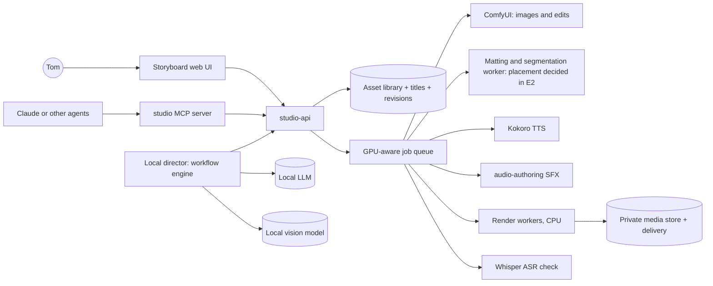

# Proposal 0002: an agentic studio that runs on local models

Status: **superseded by [proposal 0003](0003-studio-plan.md)** after grooming round 1
(2026-11-03). Kept as history: its analysis of where the assistance went still holds,
but several assumptions changed. Wan now makes every cut, the local model is a shepherd
rather than a director, and formats, accounts, staging and escalation through dev-env v2
are new. Written 2026-11-03, after The Winter Menu's revision 4 (Tom: "That's great").

## Tom's goals (2026-11-03)

> "My biggest worry is how much you had to assist with the process. I want to build
> haynes-studio in a way that most of this can be done with my local LLMs on my GPUs and
> have a story board tool that saves reusable assets to be carried across shorts. This
> tool should be agentic so the process we followed here can be replicated in a way that
> requires fewer tokens but still allow agents to step in, provide assets, make small
> corrections, etc."

So:

1. **Local first.** Routine production runs on Tom's GPUs with local models. Claude
   (or another large model) is a consultant, not the engine.
2. **A storyboard tool** where titles, shots and revisions live, and Tom can see, edit
   and approve.
3. **Reusable assets.** Dolls, sets, voices and sounds are made once and carried across
   shorts.
4. **Agentic, at low token cost.** The Winter Menu's process runs as a workflow. Agents
   (local or Claude) step in through a small tool surface to provide an asset or make
   a correction, without re-reading the whole project.

## Where the assistance actually went

Grouped from the [Winter Menu run log](../../titles/the-winter-menu/run-log.md), by
what would remove it:

| Kind of work | Examples from the run | What removes it | Who does it after |
|---|---|---|---|
| **Building tools** (most of the effort) | the keying script and three rounds on it, the occlusion edge, the layout code, talk bounce, fire, multi-line shots, close-ups, limiter, delivery | Write it once, properly, as product code (E1, E2) | nobody, per short |
| **Mechanical, but manual** | measuring the log edge with a ruler overlay, eye-protect boxes, size-matching edits, placing dolls by numbers, setting tolerances | Models and rules: matting, segmentation, face detection, auto-layout per shot type, timing from speech (E2) | tools |
| **Judgment on text** | drafting lines, sizing lines to shots, rewording for clarity ("Bibs on, ladies.") | Local LLM with the format's rules and the cast library as context (E5) | local LLM, Tom approves |
| **Judgment on images** | picking candidates, spotting a doll painted into a set, a face hidden behind a ponytail | Local vision model plus measurable checks (face visible, prop visible, occlusion) (E5) | local VLM, flags to Tom |
| **Judgment by ear** | voices, the crow, comic timing | Cannot be automated; needs Tom with playback (E6) | Tom, in the storyboard |
| **Taste** | "the ending doesn't land", "it's the eaters who wear bibs" | Tom's notes, turned into manifest changes by an agent (E5, E6) | Tom plus agent |

Most assistant tokens went into the first two rows, and both disappear with real
tooling. What remains for a model is small, structured decisions that a local LLM can
handle when given tight context and a fixed output schema.

## Architecture

- **studio-api** (an in-cluster service): titles, revisions, shots, and the asset
  library. A **GPU-aware job queue** knows which models are warm, never queues behind
  household work, and respects the Wan lease. Media lives in its own private store with
  backups, not on the Wan PVC.
- **Asset library:** each asset is a versioned record with its source prompts, seeds and
  hashes, so it can be regenerated.
  - **Doll:** identity, look and costume prompt parts, expression set, cutouts, voice,
    facing.
  - **Set:** plate, occlusion mask, focal prop and animated elements such as fire,
    plus default layouts.
  - **Sound:** file, trim and level.
  - **Voice:** a Kokoro voice with a sample line.
  A short references assets by ID, so the Yellowbirds can star in the next short.
- **Title manifest v1:** the format proven in the Winter Menu (shots, lines, `after_line`
  cues and moves, layouts, shot types, camera, motion, beds, master) becomes a
  versioned schema. Revisions are diffs of manifests.
- **Render engine:** the `poc/` editor, rebuilt as product code:
  - atomic stages;
  - per-shot rendering with a cache, so a one-line change re-renders one shot, not
    45 s;
  - fail-fast validation of everything before a long render;
  - automatic phone review proxies.
- **studio MCP server:** the agent surface. A few coarse, token-cheap tools such as
  `get_title_summary`, `get_shot`, `patch_shot`, `propose_line`, `attach_asset`,
  `generate_asset`, `render_preview`, `render`, `get_checks` and `leave_note`. They
  return compact JSON, and images only on request (a thumbnail, not a dump). Claude,
  a local agent or a script all use the same tools.
- **Local director:** a workflow engine that runs the Winter Menu process as code.
  - Its stages are: brief → script → shot plan → match assets from the library (or
    generate) → auto-layout → voices and cues → render → checks → Tom's review.
  - It calls the local LLM only for bounded decisions (draft or fix a line, pick a shot
    type, choose a cue), each with a fixed JSON schema and a small context: the
    format's rules, the cast cards, and the shot in question.
  - It calls the local vision model to score candidates and previews against
    checklists ("is every face visible", "is a doll painted into the set").
  - When a check fails twice or confidence is low, it **escalates**: a note on the
    storyboard for Tom, or a task for an agent through MCP, carrying only the context
    that step needs.
- **Storyboard web UI:** Tom's surface.
  - Titles and revisions, with shots on a timeline.
  - Drag-to-place layout on a live 9:16 frame.
  - Expression and voice pickers with **playback**, plus cue audition.
  - Motion controls and short motion previews.
  - Render, compare revisions side by side, leave notes, approve gates.
  - Browse the asset library.

## Local models: roles and where they run

| Role | Candidate | Size | Notes |
|---|---|---|---|
| Writer and planner (lines, shot plans, manifest patches) | a 30B-class instruct model, quantized (Qwen3-30B-A3B class) | about 18 to 20 GB | structured JSON output; the director keeps context small |
| Vision judge | Qwen3-VL 8B class | about 8 to 10 GB | candidate picks, preview checks; ComfyUI already loads a Qwen3-VL 8B as a text encoder |
| Matting and segmentation | BiRefNet or RMBG for cutouts; a segmentation model for set occlusion masks | under 2 GB | replaces hand keying and ruler-measured edges. **Not available today:** our ComfyUI image ships no third-party custom nodes by design (`docs/reference/services.md`), so this needs either a reviewed node added to the image through haynes-ops (a policy change) or a small studio matting worker (preferred: CPU-capable, owned by the studio, no change to the shared ComfyUI). Decided in E2. |
| Images | Qwen-Image 2.1 and Edit (as now) | in ComfyUI | proven in this run |
| Voices, ASR, SFX | Kokoro, the Whisper pod, Stable Audio Small SFX (as now) | in place | proven |

**Where the LLM and VLM run is the main open decision:**

- **A.** Time-share the dual 3090s with Wan (talosw01). The queue loads the studio
  models when Wan is idle and unloads them before video work. No new hardware, but
  there are model-swap delays, and the queue must own the lease properly.
- **B.** Share Muse's `llama-server` on 3090 B (talosw04) with an extra slot. Cheapest,
  but that card serves Jarvis and Phone Assist and has a 250 W power gate. A studio
  batch would slow the household assistants. **Not recommended.**
- **C.** Add a dedicated GPU for the studio. Cleanest isolation, but it costs hardware.

The recommendation is **A** for now, with the director designed so the model endpoints
are configuration, so C can drop in later.

## How an agent steps in, cheaply

- Every artifact has an ID and a short summary. An agent asks for
  `get_title_summary(title)` (about a page of JSON) rather than reading files.
- Corrections are **patches**, such as `patch_shot(title, rev, shot, {"lines[5].text":
  "Bibs on, ladies."})`. The engine re-renders only the shots affected.
- Providing an asset means `attach_asset(kind, file or prompt, tags)`. The library
  derives the cutouts and masks itself.
- Every step's checks are machine-readable, so an agent sees what failed and why,
  without watching a video.
- Target: a revision like r4 (one line changed) takes **one patch call and one render
  call**, rather than this session's minutes of hand work.

## Epics (proposed order)

Each one ends in something Tom can use and demo.

### E1. Studio core: library, manifest v1 and fast render engine

**Usable end state:** `studio make <title>` builds a short from a manifest v1 and the
asset library, with per-shot caching, atomic stages, fail-fast checks and a phone proxy.
**Demo:** rebuild The Winter Menu r4 from manifest v1. Then change the bib line and show
that only the vote shot re-renders, in under 2 minutes rather than 9.

Proposed stories:

1. **Package and schema.** Move `poc/` into a `studio` Python package with a CLI and
   unit tests. Define manifest v1 as a JSON Schema covering everything r1 to r4 used.
   *Acceptance:* the tests pass; all four Winter Menu manifests validate after an
   automatic conversion; the rebuilt r4 matches the delivered r4's timeline and checks.
2. **Atomic stages and fail-fast validation.** Each stage writes to a temp location and
   commits at the end. Validation covers placements, anchors, cues and asset hashes
   before any render. *Acceptance:* a stage killed mid-way leaves no partial output; a
   bad anchor fails in under 5 s.
3. **Per-shot render cache and splice.** Each shot is rendered separately and keyed by
   its inputs, then spliced. *Acceptance:* the bib-line demo re-renders one shot, and
   the final output matches a full render frame for frame in unchanged shots.
4. **Delivery v2.** Includes a phone proxy, a delivery record, and the existing
   create-only and ledger guarantees. *Acceptance:* every delivery yields a sendable
   proxy under 25 MB for 60 s.
5. **Asset library v0** (files plus records, local). Import the Yellowbirds, the
   campsite and the sounds as library assets with provenance. *Acceptance:* a new
   manifest refers to dolls by library ID, with no file paths.

### E2. Automated asset pipelines on local models

**Usable end state:** add a new doll or set with no manual pixel work. **Demo:** a fifth
Yellowbird and a new set (a lake shore) go from prompt to library with cutouts,
expressions, an occlusion mask and default layouts, and Tom only picks favorites.

- A matting model, replacing chroma keys and eye-protect boxes. It runs in a studio
  matting worker (preferred) or as a reviewed ComfyUI node added through haynes-ops;
  ComfyUI has no such node today.
- Edits automatically size-matched to their base.
- Segmentation of a set's foreground occluder into a mask, replacing ruler-measured
  polylines.
- Focal-prop detection, so layouts keep it visible.
- A procedural animated-element library: fire first, then water shimmer and falling
  snow.

### E3. studio-api, job queue and MCP server

**Usable end state:** a private in-cluster service, deployed through haynes-ops GitOps,
holds titles, revisions and the library, and runs jobs through a GPU-aware queue. The
MCP server exposes the agent tools. **Demo:** Claude makes the r4-style bib fix through
MCP in one patch call and one render call, with the token count recorded against this
session's.

### E4. Local model hosting

**Usable end state:** the studio's writer LLM and vision model run on the chosen GPUs
(option A, B or C above), loaded and unloaded by the queue without disturbing Wan or the
household. **Demo:** the LLM and VLM answer through studio-api, and a Wan job and a
studio job hand the GPUs over cleanly.

### E5. The local director

**Usable end state:** from a one-paragraph brief, the director produces a reviewable
revision 1 using only local models and the library, escalating to Tom or an agent only
when checks fail. **Demo:** a new short with the Yellowbirds cast, reaching first review
with **zero Claude tokens**, with escalations logged.

- Workflow stages as code, with bounded LLM calls (fixed schemas, small context).
- A vision-model checklist for candidates and previews.
- Tom's notes turned into manifest patches (the r1 to r4 loop).
- Escalation policy and an agent hand-off through MCP.

### E6. Storyboard web UI

**Usable end state:** Tom builds, edits, auditions, renders, compares and approves in
the browser and on his phone. **Demo:** Tom takes a director-made revision 1 to a
finished short without an agent.

- Shot timeline, drag layout, expression and voice pickers with playback, cue
  audition.
- Motion controls with motion previews.
- Revision compare, notes and approval gates.
- Asset library browser.
- Private access (see the decisions below).

### E7 onwards (after the core)

- **Ideas to scripts:** subtitle-source discovery (read-only), pitches.
- **Batches and winners:** galleries, ratings, feedback.
- **Release:** gated, with licence checks for every model, and nothing published
  without Tom.

## Order and what it buys

E1 removes the tool-building row; E2 the mechanical row. E3 makes every step callable
cheaply. E4 and E5 move the judgment rows to local models. E6 gives Tom the
ear-and-taste loop without an agent in the middle. E6 could start as a thin read-only
viewer after E3, if Tom wants to see the storyboard sooner.

## Decisions for Tom

1. **Where the local LLM and VLM run:** time-share the Wan 3090s (recommended), share
   Muse's card, or add a GPU.
2. **UI access:** LAN-only, or behind Authentik so it works away from home (the PoC
   links did not work off the LAN).
3. **Media store:** a dedicated studio volume with backups (recommended), separate from
   the Wan PVC.
4. **Stack for the API and UI:** Python (FastAPI) for the API, to share code with the
   render engine, and a light TypeScript front end. Or an existing preference.
5. **Claude's role after E5:** escalation-only, or also a scheduled reviewer of each
   batch.
