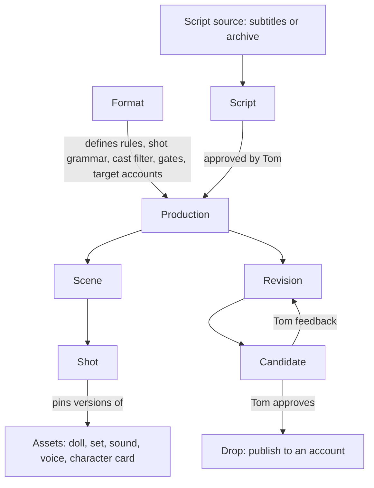

# Proposal 0003: the studio plan after grooming round 1

Status: **the current plan, for grooming.** It supersedes
[0002](0002-agentic-studio.md) (kept as history). Nothing here is started; Tom decides when
each epic runs. Decisions come from Tom in the 2026-11-03 session, and are also recorded on
[saga 362](https://work.haynesnetwork.com/work_packages/362).

## Decisions so far

| # | Decision | Tom's words or summary |
|---|---|---|
| D1 | The Winter Menu r4 is formally signed off | "Yes" |
| D2 | **The two 3090s on talosw01 are the studio's GPUs.** The studio's scheduler owns them for Wan video, Foley and the studio's local models. They are two 24 GB cards, not a 48 GB pool | "The dual 3090s are for this"; "We have 48Gb on the server, two cards" |
| D3 | The storyboard UI is home/LAN-only for now; wider access later | "Home for now expand later" |
| D4 | **Storage:** the app's pod uses Rook Ceph RBD; **media lives on NFS on gasha01** in a studio folder; the database is **CNPG with backups** | |
| D5 | Users: **Tom plus agents** (scoped agent keys), no human logins in v1 | "Me + agents for now" |
| D6 | **Every scene/cut is a Wan clip**, strung together to the desired length. At minimum the set moves; doll hair and wobble may move as if someone is playing with them; expressions change only at cuts, which keeps continuity | "Wan should be used for each scene / cut which we string together" |
| D7 | Talking shots: the PoC tests **all three methods**: whole-frame image-to-video, layered, and speech-to-video | "All three here" |
| D8 | **The factory runs almost entirely locally.** Making media uses zero cloud tokens by default; token use is recorded per production | "use it as a factory to churn out media without burning tons of Claude Code usage" |
| D9 | **Long-term end state:** an unattended factory whose **only human gate is publishing**. The studio presents candidates per account (YouTube, TikTok and others); Tom reviews, gives feedback and asks for iterations. Until a format is hardened, every gate stops for Tom; gates are per-format settings | "the only thing I gate is dropping the videos live" |
| D10 | **Formats are first-class.** Bouncing dolls is format 1; more follow what's trending | |
| D11 | **Script sources:** adaptations of classic movie scenes via their subtitles, and content Tom stages ahead of time in the studio's archive | |
| D12 | **Escalation goes through dev-env v2 to a responder agent.** dev-env v2 chooses the model and provider by capacity at the time | "Escalate using dev-env v2 to a responder agent" |
| D13 | **Not limited to shorts.** Long-form comes later: production → scenes → shots, length-agnostic | |
| D14 | **Creative staging is Tom's, with a frontier model** through dev-env v2. **The local LLM is a shepherd:** it moves pre-approved content through the pipeline and runs technical checks; it never judges what will land | "the local LLM simply Shepards pre-approved content" |
| D15 | **Immutable asset versions**, pinned per production; anything approved for live is frozen | "we don't go back and modify things that are approved for live" |
| D16 | The library is **scoped by labels and filters** (format, account, production, character), in one store | |
| D17 | **Nothing is purged automatically**; deletion is a user action in the studio | |
| D18 | **CPU:** render workers are capped at **24 vCPUs** on talosw01, at low priority (the VM has 40 vCPUs; the 48-thread host keeps 8 for Ceph and nas01). **Until E3 delivers that dedicated low-priority worker and AGENTS.md is amended, the 2-thread rule still applies to all CPU work, E0 included** | "24 ok?" |
| D19 | **One haynes-studio monorepo** for all code; deployment manifests in haynes-ops (GitOps) | |
| D20 | **Tom accepts** epics and stories | "I do" |
| D21 | **Re-do the PoC as a video-generation workflow** before building, because it may change the plan | "re-do the PoC using a video gen workflow with the new tools" |
| D22 | **Speech-to-video looks great** (mouth movement OK). **Layered suits dolls.** Whole-frame is **not rejected**: Tom critiqued one clip (shot 1 with Foley: jacket not continuous, eyes wrong), not the method. **Lettering breaks in both Wan methods** | "speech-to-video looked great"; "I didn't say whole frame never will work" (2026-11-03) |
| D23 | **Layered is the better default for the doll format:** it "moves more like dolls and less is off". Not perfect: wardrobe inconsistency (sleeves) and one doll's lettering moving must be caught automatically | "The layered looks better, moves more like dolls and less is off" (2026-11-04) |

## The product model

- **Format:** style rules, shot grammar (shot types, motion, camera), a default asset label
  filter, voice and sound rules, length range, target accounts, and **gate settings** (which
  steps stop for Tom).
- **Production:** one piece of media (a short now, long-form later). It is split into
  scenes and shots and pins every asset version and toolchain digest it used.
- **Revision → Candidate:** each render is a revision. A candidate is a revision presented
  for an account.
- **Drop:** a publish to an account, gated by Tom, frozen afterwards.
- **Asset:** an immutable version with labels and provenance (prompts, seeds, hashes). Kinds
  are doll, set, sound, voice and character card.
- **Feedback:** Tom's notes, tied to a revision or shot, which become patches.

## Who does what

| Actor | Role | Runs on |
|---|---|---|
| Tom | Taste: stages scripts and content, reviews candidates, approves drops | the storyboard and the staging room |
| Frontier agent (through dev-env v2) | Tom's creative partner in the **staging room**: adapts subtitle scenes, writes and refines scripts, storyboards | dev-env v2 session plus the studio MCP |
| **Local shepherd** (local multimodal LLM) | Turns approved content into a production plan within the format's rules, drives the pipeline, runs **technical** checks (faces visible, drift, cutouts, transcripts). No creative judgment | studio GPUs |
| Responder agent (through dev-env v2) | Fixes what the shepherd escalates, through the studio MCP, within a budget | dev-env v2 chooses |
| Claude (building) | Builds the studio, story by story | dev-env sessions |

## The per-shot video pipeline (to be validated by E0)

1. **Keyframe:** compose the shot's first frame from library assets (set, dolls with the
   shot's expressions, layout), as in the PoC.
2. **Clip:** Wan generates the shot on the studio's 3090s by one of three methods:
   - **Whole-frame:** image-to-video of the keyframe, so dolls and set move together.
   - **Layered:** Wan animates the set, and separately each doll on a plain background. A
     matting step cuts the moving dolls out, and the compositor adds syllable-synced bounce
     and scripted moves.
   - **Speech-to-video:** a Wan speech-to-video model takes the keyframe plus the line's
     audio, so the motion follows the speech.
3. **Lengthen:** shots longer than one clip are extended by chaining clips (last frame into
   the next) or by slowing the clip down, whichever E0 shows works.
4. **Scale up** to the delivery size (1080x1920 for vertical).
5. **Sound:** Kokoro lines, plus video-conditioned Foley (ControlFoley) or library cues, then
   mixing and mastering (loudness target and limiter).
6. **Assemble** the shots, run the checks (frames, loudness, peaks, transcript, VLM technical
   checks, drift), and present a candidate.

## Infrastructure

- **GPUs:** both 3090s on talosw01, owned by the studio's scheduler. **The scheduler is the
  Wan API's compute lease, extended through haynes-ops**, not a second scheduler beside it.
  Every GPU user takes that one lease and its unknown-work checks: Wan video, Foley, and the
  local model's load, inference and unload. So the local model never holds a card outside
  the lease. A doll format keeps the model resident on one card while it holds the lease for
  that card. Wan jobs that need both cards cause it to be unloaded first. Household services (ComfyUI on the 2000 Ada, Muse's
  card, the voice A2000s) are never touched.
- **Image generation** stays on the shared ComfyUI (Qwen-Image 2.1 int8), polite to Home
  Assistant, unless E0 or E2 shows the 3090s should take it.
- **CPU:** up to 24 vCPUs for render workers on talosw01, low priority, once E3 provides the
  worker and AGENTS.md is amended. Until then, 2 threads.
- **Storage:** the app's pod on Rook Ceph RBD; media on the gasha01 NFS studio folder (path
  to be confirmed); CNPG Postgres with backups; nothing auto-purged.
- **Access:** LAN-only UI. Agents use scoped keys through the studio MCP; responder pods
  reach the MCP through a sanctioned dev-env v2 path.
- **Code:** the haynes-studio monorepo. Images are built by GitHub Actions, and haynes-ops
  holds every deployed manifest.

## Requirements across every epic

- **Zero cloud tokens to produce media by default.** Every escalation and its cost is
  recorded on the production.
- **Immutable and pinned:** asset versions, toolchain digests per render, frozen drops.
- **Create-only outputs; nothing auto-purged;** user-driven deletion with protection for
  approved or published items.
- **Shared-GPU and CPU politeness:** household first, the Wan lease respected, the 24 vCPU
  cap, low priority.
- **Licences** recorded per model and asset from day one: some matting models are
  non-commercial; Stable Audio, Kokoro and Qwen terms still need checking.
- **Originality (AGENTS.md):** subtitle adaptations take only the situation. Names, teams,
  logos and dialogue are invented and original, and a subtitle file is never reenacted
  verbatim. Subtitle text stays private, as source material.
- **Rights and disclosure:** subtitle-based adaptations and each platform's rules on
  AI-generated content are checked before any drop.

## Epics (revised)

The OpenProject epics from proposal 0002 (372 to 377) carry amendment comments pointing here.
New epics are filed for E0, E7, E8 and E9.

| Epic | What it delivers | Depends on |
|---|---|---|
| **E0 Video-generation PoC** (new, first) | The Winter Menu remade with a Wan clip per cut, testing all three talking-shot methods, with findings that decide E1 to E5's design | nothing |
| E1 Core (372) | Production/scene/shot model, manifest v2 (clip shots, methods, formats), length-agnostic render engine with per-shot cache, atomic stages, fail-fast checks, delivery with proxies | E0 findings |
| E2 Asset pipelines (373) | Matting service (studio-owned), occlusion masks, automatic size matching, character cards, immutable versioned library with labels | E0 findings, E1 |
| E3 API, storage, queue, MCP (374) | studio-api on Ceph RBD, CNPG with backups, gasha01 NFS media; a GPU scheduler owning the 3090s (Wan, Foley, local model); MCP with scoped agent keys | E1 |
| E4 Local model hosting (375) | One multimodal local model on a 3090, loaded and unloaded by the scheduler | E3 |
| E5 Local shepherd (376, renamed) | Moves approved content through the pipeline with technical checks only, and escalates through E8 | E3, E4 |
| E6 Storyboard UI (377) | Productions, shots, keyframes, clips, playback, revisions, notes, deletion, LAN-only | E3 |
| **E7 Staging room and script sources** (new) | Tom and a frontier agent (dev-env v2) adapt subtitle scenes and stage archive scripts through the studio MCP; read-only subtitle discovery on HaynesTower or Bazarr | E3 |
| **E8 Escalation through dev-env v2** (new) | Escalation packages, a sanctioned way to request a responder, MCP access for responders, cost logging | E3, the dev-env v2 saga |
| **E9 Formats, accounts, candidates and drops** (new) | Format definitions with gate settings, accounts, candidate review per account, feedback into revisions, a publishing gate with rights and disclosure checks. Platform integrations only with Tom's explicit approval | E1, E3, E6 |
| Later | Trend watching, long-form tooling, batches at scale | |

## E0 results (2026-11-03)

Run in the driving session at Tom's direction, with a Sonnet worker for the haynes-ops model
PR. Full measurements are in
[`titles/the-winter-menu/video-e0/findings.md`](../../titles/the-winter-menu/video-e0/findings.md).
In short:
- **The method is per shot:** layered for doll talking shots (identity holds, bounce is
  synced), whole-frame for ambient and simple shots, speech-to-video as a premium shot (about
  4x the GPU, and it lip-syncs).
- **Drift checks are mandatory:** faces, props, groups, set objects, lettering, and chaining
  compounds it.
- **Lettering needs rigid decals.**
- **Prompts never mention hands, and camera moves go to the compositor.**
- **The scheduler needs job-type cost models, per-type timeouts, two-GPU CFG split, a
  thermal policy (cooldown cost more than rendering) and prompt-ID interrupts.**
- **Set loops and per-expression doll clips are reusable library assets.**
- **An upscaler and fps conversion are needed.**
- **ControlFoley works over HTTP (83 s per 5 s window).**
- **Ear and taste stay with Tom.**
- **Tom's comparison (D23): layered is the doll default.** His two defects both trace to
  checks the pipeline lacked (see the layered findings): a **wardrobe check at casting**
  (two dolls were cast in sleeveless or half-sleeved jackets in r1 and nobody caught it), and a
  **decal gate that erases the generated lettering first and rejects weak tracks** (D's
  reaction clip slid and doubled letters at ECC 0.72).

These amend E1 (per-shot methods, an animated-layer compositor), E2 (motion assets, drift
tools, upscaler, decals, a per-doll chroma colour), E3 (real Wan job types: image-to-video,
S2V and Foley-on-clip, plus the scheduler requirements) and E5 (drift checks with re-roll
and method-switch policies).

## E0: the video-generation PoC

**Goal:** remake The Winter Menu (r4 script and cast) so that every cut is a Wan clip, and
learn what the plan must change.

**Acceptance:**
- A delivered private video exists.
- A findings report covers these questions, with measurements, and records Tom's verdict:
  1. **Identity:** do doll faces and costumes survive Wan per method?
  2. **Length:** how long can a clip run before drifting, and how are longer shots made?
  3. **Talking shots:** which of the three methods works for them?
  4. **Size and quality:** what are native size and upscaling quality against 1080x1920?
  5. **Time:** how long does each shot take on the two 3090s?
  6. **Foley:** is ControlFoley useful on the clips?
  7. **Storage:** does writing to gasha01 NFS contend with nas01?
- The plan is updated from the findings.

**Proposed stories** (each one bounded and in its own session):

1. **E0.1 Wan image-to-video path.** Extend the Wan API (haynes-ops `wan-video`) with a
   sanctioned image-to-video job: an image upload, portrait sizes, a frame count, a
   prompt and a seed, all under the existing compute lease and unknown-work checks. It is
   tested in CI and deployed by GitOps. Nothing bypasses the API.
2. **E0.2 Whole-frame shots.** Compose a keyframe per cut from the r4 assets, render each cut
   with image-to-video, lengthen the long shots, scale up, then mix in the r4 audio and
   assemble. Records drift, time and quality per shot.
3. **E0.3 Layered shots.** Wan animates the campfire set as a loop, and each doll on a flat
   chroma background. Chroma-key each frame (the PoC keyer, or a matting model trial), then
   composite with syllable-synced bounce and moves. This measures whether a matting service
   is required.
4. **E0.4 Speech-to-video.** Provision a Wan speech-to-video model through haynes-ops (models
   manifest, after a disk check on the Wan volume). Check it fits one 24 GB card and runs in
   **the Wan pod's ComfyUI** (`ai/deploy/wan-video`, container `app`), never the shared
   household ComfyUI. Then render the talking shots from keyframe plus line audio, through a
   sanctioned Wan API job under the same compute lease as E0.1.
5. **E0.5 Foley, assembly and findings.** Run ControlFoley on the chosen clips, assemble the
   best version per method and deliver it. Write the findings report, get Tom's verdict, and
   update this plan.

## OpenProject

- Saga [362](https://work.haynesnetwork.com/work_packages/362); the manual PoC epic
  [366](https://work.haynesnetwork.com/work_packages/366) (its stories are accepted).
- **E0** [387](https://work.haynesnetwork.com/work_packages/387) with stories
  [391](https://work.haynesnetwork.com/work_packages/391) (Wan image-to-video API),
  [392](https://work.haynesnetwork.com/work_packages/392) (whole-frame),
  [393](https://work.haynesnetwork.com/work_packages/393) (layered),
  [394](https://work.haynesnetwork.com/work_packages/394) (speech-to-video) and
  [395](https://work.haynesnetwork.com/work_packages/395) (Foley, best-of, findings).
- E1 [372](https://work.haynesnetwork.com/work_packages/372) (stories 378 to 382 wait for E0),
  E2 [373](https://work.haynesnetwork.com/work_packages/373),
  E3 [374](https://work.haynesnetwork.com/work_packages/374),
  E4 [375](https://work.haynesnetwork.com/work_packages/375),
  E5 [376](https://work.haynesnetwork.com/work_packages/376),
  E6 [377](https://work.haynesnetwork.com/work_packages/377),
  E7 [388](https://work.haynesnetwork.com/work_packages/388),
  E8 [389](https://work.haynesnetwork.com/work_packages/389),
  E9 [390](https://work.haynesnetwork.com/work_packages/390).

## Questions for grooming round 2 (one at a time)

- E0 pass/fail thresholds: what drift or face change is acceptable?
- What exactly a format definition contains, and who authors it (Tom plus the frontier
  agent?).
- Staging-room flow: where scripts live and how a subtitle scene becomes an approved script.
- Database model details and the gasha01 NFS folder path.
- Publishing: which accounts and platforms first, and the disclosure stance.
- Whether image generation should move to the 3090s for consistency with Wan.
