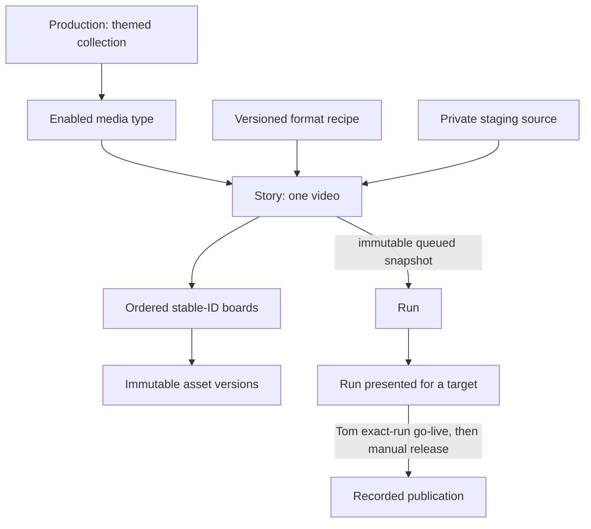

# Proposal 0003: the studio plan after grooming round 1

Status: **the current plan, for grooming.** It supersedes
[0002](0002-agentic-studio.md) (kept as history). Nothing here is started; Tom decides when
each epic runs. Decisions come from Tom in the 2026-11-03 session, and are also recorded on
[saga 362](https://work.haynesnetwork.com/work_packages/362).

## Decisions so far

| # | Decision | Tom's words or summary |
|---|---|---|
| D1 | The Winter Menu r4 is formally signed off | "Yes" |
| D2 | **The two 3090s on talosw01 are the studio's GPUs.** The studio's scheduler owns them for Wan video, Foley and the studio's local models. They are two 24 GB cards, not a 48 GB pool | "The dual 3090s are for this"; "We have 48Gb on the server, two cards" |
| D3 | The storyboard UI is home/LAN-only for now; wider access later | "Home for now expand later" |
| D4 | **Storage:** the app's pod uses Rook Ceph RBD (*superseded by D41: app pods keep no volume*); **media lives on NFS on gasha01** in a studio folder; the database is **CNPG with backups** | |
| D5 | Users: **Tom plus agents** (scoped agent keys), no human logins in v1 (*login amended by D41: humans sign in with Authentik OIDC*) | "Me + agents for now" |
| D6 | **Every scene/cut is a Wan clip**, strung together to the desired length. At minimum the set moves; doll hair and wobble may move as if someone is playing with them; expressions change only at cuts, which keeps continuity | "Wan should be used for each scene / cut which we string together" |
| D7 | Talking shots: the PoC tests **all three methods**: whole-frame image-to-video, layered, and speech-to-video | "All three here" |
| D8 | **The factory runs almost entirely locally.** Making media uses zero cloud tokens by default; token use is recorded per production | "use it as a factory to churn out media without burning tons of Claude Code usage" |
| D9 | **Long-term end state:** an unattended factory whose **only human gate is publishing**. The studio presents candidates per account (YouTube, TikTok and others); Tom reviews, gives feedback and asks for iterations. Until a format is hardened, every gate stops for Tom; gates are per-format settings | "the only thing I gate is dropping the videos live" |
| D10 | **Formats are first-class.** Bouncing dolls is format 1; more follow what's trending | |
| D11 | **Script sources:** adaptations of classic movie scenes via their subtitles, and content Tom stages ahead of time in the studio's archive | |
| D12 | **Escalation goes through dev-env v2 to a responder agent.** dev-env v2 chooses the model and provider by capacity at the time | "Escalate using dev-env v2 to a responder agent" |
| D13 | **Not limited to shorts.** Long-form comes later: production → scenes → shots, length-agnostic | |
| D14 | **Creative staging is Tom's, with a frontier model** through dev-env v2. **The local LLM is a shepherd:** it moves pre-approved content through the pipeline and runs technical checks; it never judges what will land (*D40 lets a local LLM draft boards once its harness proves reliable*) | "the local LLM simply Shepards pre-approved content" |
| D15 | **Immutable asset versions**, pinned per production; anything approved for live is frozen | "we don't go back and modify things that are approved for live" |
| D16 | The library is **scoped by labels and filters** (format, account, production, character), in one store | |
| D17 | **Nothing is purged automatically**; deletion is a user action in the studio | |
| D18 | **CPU:** render workers are capped at **24 vCPUs** on talosw01, at low priority (the VM has 40 vCPUs; the 48-thread host keeps 8 for Ceph and nas01). **The worker exists:** `ai/studio-render` (haynes-ops, 2026-11-04) at Tom's direction ("why are we still using 2 cores instead of 24"); session pods keep 2 threads | "24 ok?" |
| D19 | **One haynes-studio monorepo** for all code; deployment manifests in haynes-ops (GitOps) | |
| D20 | **Tom accepts** epics and stories | "I do" |
| D21 | **Re-do the PoC as a video-generation workflow** before building, because it may change the plan | "re-do the PoC using a video gen workflow with the new tools" |
| D22 | **Speech-to-video looks great** (mouth movement OK). **Layered suits dolls.** Whole-frame is **not rejected**: Tom critiqued one clip (shot 1 with Foley: jacket not continuous, eyes wrong), not the method. **Lettering breaks in both Wan methods** | "speech-to-video looked great"; "I didn't say whole frame never will work" (2026-11-03) |
| D23 | **Layered is the better default for the doll format:** it "moves more like dolls and less is off". Not perfect: wardrobe inconsistency (sleeves) and one doll's lettering moving must be caught automatically | "The layered looks better, moves more like dolls and less is off" (2026-11-04) |
| D24 | **Layered speech-to-video is the default for doll talking shots:** each speaking doll gets a Wan2.2 S2V clip on green from her shot's voice track (4-step lightning LoRA), composited like any layer. Worth about 1.5 h of extra GPU per 45 s short: the quality is much better and the earlier flaws (letters, sleeves) were not noticed | "Absolutely worth it the quality is much better I didn't notice any of the flaws we had before" (2026-11-04) |
| D25 | **A format definition is a saved recipe**, written and revised by Tom with a frontier agent in the staging room; the local shepherd only reads and follows it, never edits it. It holds: frame size and length range; shot types and the method for each (per D23/D24); cast rules, including a costume spec per team so wardrobe drift is checkable; voice and audio style; the checks a candidate must pass and which gates still stop for Tom (D9); and the accounts it may publish to | "Yes that's a good start" (2026-11-04) |
| D26 | **The storyboard is the approval surface.** The script-to-video process (pick, draft, revise, approve) stands, but it is shown as a storyboard: one panel per clip, each with the reference photo that goes with that clip. A reviewer should be able to judge the whole video from the storyboard alone with high confidence, then press one button to build it. So reference photos are made before the build, and the storyboard, not a separate script, is what gets versioned and approved. AGENTS.md review gates 1 and 2 (script before any assets, then keyframes) get revised to match when E6 lands; whether a text-only pass still comes before the photos is part of the open panel question | "I want to visualize it as a story board with a reference photo that goes along with each clip … before pressing a button to build the video" (2026-11-04) |
| D27 | **Storyboard editing UX.** A story is an ordered set of **boards** (Tom's term: one board per clip). The user adds and removes boards to build a video of whatever length they like. On each board the user edits the script and the reference photo, the photo through prompts that combine asset photos from the library with text. An agent can fill boards in instead, for the user to review. Once a render is kicked off, the studio shows an estimate of how long it will take. Open: how free length squares with a format's length range (D25), and whether a text-only pass still comes before the photos (D26) | "The user should be able to edit scripts and reference photos (via prompts that include asset photos and text) here or an agent can fill it in for a user to review … add and remove boards from the story … some estimate on how long the render would take once the user kicks it off" (2026-11-04) |
| D28 | **UI shape: a hierarchy, kept simple.** Two top-level sections. **Productions** groups themed media (for example Yellowbirds), then media type (Shorts, Videos), where published, in-development and pending-approval media is reviewed; a breadcrumb bar forms on the way down. **Editor** has child tabs **Board** (the story/board editor, opened from any media) and **Assets** (the reusable library, plus asset generation whose results are promoted to the library). Build progress and review fold into the pages people work in, with no separate Candidates, Formats or Render sections. Settings (theme, user, admin) live under the user-name dropdown as on haynesnetwork.com. Mobile works through the hierarchy, without a big top bar. Scope is only what makes the PoC video; on-screen text stays essential; questions go in a supporting markdown doc | "we shouldn't have so many top level tabs … KISS and keep text on the screen to what is essential" (2026-11-04) |
| D29 | **The only approval is go-live:** Tom's sign-off before anything reaches a live social platform. Script and images iterate together, with no script gate before photos and no per-board approval before Build, so the creative process stays loose. Supersedes the per-board approval in D26/D27 and the "every gate stops for Tom" part of D9; the storyboard stays the review surface | "No the only approval is the go-live approval for hitting a live social platform the script and images can iterate together let's not dampen the creative process by making it too ridged" (2026-11-04) |
| D30 | **Runs can be queued while editing.** The user can tweak boards and queue a new build while one runs, then compare the runs | "Why not? You can make tweaks and queue up a new run to see how they compare." (2026-11-04) |
| D31 | **Media status is filters, not buckets:** the media lists filter by published/unpublished and approved (for go-live), alone or combined | "we can have filters so you can see what is unpublished, what is approved, what is both" (2026-11-04) |
| D32 | **Selections persist across pages.** Context carries over: in the Editor for a production, the asset library opens scoped to that production's assets, with filters to widen it. Filters and choices survive navigation, for good flow | "We need to make sure we persist user selections across pages … Stuff like that to make it easy to use, good flow" (2026-11-04) |
| D33 | **Voice audio is a pre-build board asset, like the reference photo.** Each board's voice track is rendered while iterating, cheaply and before any build, and can be played and regenerated. The board's duration comes from that audio, not from a typed number. The quick things (photo, voice) are iterated before the expensive speech-to-video build | "do I fill in Duration? I am not sure how I'd know without the audio track rendered. That should be available as an asset like the reference photo before the build" (2026-11-04) |
| D34 | **The board is a filter.** Opening Assets from inside a board shows only that board's assets until the user removes the filter (extends D32) | "When I am under a board if I click into Assets … I should only see assets for that board until I remove filters, the board is a filter" (2026-11-04) |
| D35 | **Board annotations are editable.** Sound cues and direction notes (for example "Offscreen crunch · hold") can be added, edited and removed by the user | "This 'Offscreen crunch * hold' bit is not editable by me" (2026-11-04) |
| D36 | **One navigation trail, made of buttons** (amends D28). No duplicate path labels: the breadcrumb is the single trail, each crumb is a button, and clicking one goes back and drops the deeper filters. Top-level **Editor** opens a landing where the user picks the storyboard editor or the Asset Library; from the editor they pick or create a production and a media type (for example Short) before opening a story | "This EDITOR / The WINTER MENU should be buttons … When I click the top level Editor it should not go right into 'The Winter Menu' … I should be able to create a new Production or video type" (2026-11-04) |
| D37 | **Look and feel follows storyboard-software conventions,** based on research: a main stage for the selected panel with a panel timeline/filmstrip, as in tools like Tom's PanelForge example. Text forms (script, prompts, notes) sit where drawing tools would be. A new color scheme suited to video production replaces the current one. Phone review still has to work | "Have Astra do online research for industry standards for storyboarding software … ideally we'd have text forms where the image editing in there is. The color pattern CSS here is not great" (2026-11-04) |
| D38 | **A board's method is shown in technical terms,** as two badge groups: layer (Layered or Whole-frame) and motion (Speech-to-video or Image-to-video). These replace the Talking/Reaction/Ambient list. The default follows the board: spoken lines mean Speech-to-video, and Speech-to-video is disabled for a board with no lines. Annotations become a **Direction** section with an always-visible "Add a note" box (amends D35). | "We should use more technical language for Method so users know what it means like "layered" + " speech-to-video" or whatever not layered was would be other, multi - select badges maybe"; "But where do I enter something like "Offscreen crunch"?" (2026-11-04) |
| D39 | **Storage details (completes D4).** Media lives in `gasha01:/hdd-nfs-repl/data/studio`, the share studio-render already mounts, with one folder per production plus a library folder. Files are referenced by content hash and nothing is purged automatically. Records (productions, media types, stories, boards, lines, notes, library assets with provenance, runs, approvals, saved selections) go in a new `studio` database on the shared CNPG cluster `database/postgres16` (3 instances, nightly barman backups to S3), not a dedicated cluster. | "That's right" (2026-11-04) |
| D40 | (*amends D14 once the harness passes*) **Boards are drafted by a frontier agent** (dev-env v2, through the studio MCP, tokens recorded per production) **until a harness or toolkit lets a local LLM do the work reliably.** The writer is a configuration setting. The goal is a purely local loop on talosw01 that makes the most of that hardware. Story E5.2 (https://work.haynesnetwork.com/projects/haynes-studio/work_packages/421) builds and evaluates the harness. | "Frontier until we build a harness or toolkit that lets a local LLM reliably perform the work. Those models keep getting better and eventually I want this to be a purely local loop on talosw01 making the most out of that hardware" (2026-11-04) |
| D41 | **Local now, online-ready, highly available.** The UI is LAN-only for now but is built so it can go online later without a redesign: every request is authenticated and nothing trusts the network. People sign in with **Authentik OIDC** (amends D5). Agents keep scoped keys through the studio MCP. The service is **cloud native with replicas, so losing one node does not take the tool down** (amends D4): the web app and studio-api are stateless with at least two replicas spread across nodes, with a disruption budget. All state lives in Postgres (`database/postgres16`, 3 instances) and on the gasha01 NFS share (D39), which is outside the cluster. Run-queue state is in Postgres, so a lost pod loses no runs. GPU render workers are tied to their node: losing talosw01 pauses builds, but the tool stays up and queued runs wait. | "Other requirements are that its local now but may be online later and needs to support Authentik ODIC login. Also needs to be designed as cloud native with replicas so one node going down doesn't bring the tool down" (2026-11-04) |
| D42 | **Image generation stays on `comfyui-0` (talosm03)** as its own GPU lane, so photos stay fast while builds hold the 3090s. The lane is configuration and can move later. **Frontier agents that can generate images (Codex or others) can upload reference photos** to a board through the studio API and MCP. An upload becomes a new photo version with provenance: the agent, model, prompt and source assets, plus a content hash. It is marked as externally generated for the disclosure check (E9). The studio only accepts uploads: it holds no paid-API key and makes no paid calls. Images are generated inside the agent's own sanctioned dev-env v2 session on its subscription. A pay-per-token image API still needs Tom's approval and a cost cap (not yet set). | "Yes talosm03 is fine also codex or other frontier image gen capable models must be able to upload reference photos" (2026-11-04) |
| D43 | **Publishing starts with YouTube Shorts** on a channel under Tom's haynesnetwork automation Google Workspace account. Tom creates and owns the channel; agents create no accounts. The channel is about **local LLMs and local AI**, showing what a few cheap used 3090s can do, not "AI videos" in general. **Every video is labelled as AI-generated** with the platform's synthetic-content setting and a line in the description, and the E9 disclosure check blocks go-live without the label. Uploads stay manual after go-live until Tom approves an integration. TikTok and Reels can follow later. | "Yes I'll likely use my admin@ workspace since it's already for automation and I want my channel centered around local LLMs not just "AI videos" to showcase what's possible with a few cheap used old 3090s" (2026-11-04) |
| D44 | **Video descriptions name only what generates the video and sound**, for example the local video and voice models and the 3090s they ran on. How the script, boards or reference photos were made is left out, because that can be a frontier agent, a local model or a person. The AI-generated label (D43) still applies to every video. Both come from the run's recorded provenance. | "No just focus on what generates the video and sound leave the sausage making out since it can be frontier or local or a person etc" (2026-11-04) |
| D45 | **Format length is advisory.** When a story's boards run past its format's length, the editor warns but Build is still allowed. A platform maximum, such as the YouTube Shorts limit, is enforced when preparing the release, not as a creative gate before Build (D29). | "Yes warn but allow is good" (2026-11-05) |
| D46 | **Local models are measured on a private task benchmark, in a dedicated epic E10 (https://work.haynesnetwork.com/projects/haynes-studio/work_packages/462).** The pilot bar for board drafting has five frozen briefs. Every automated structural and safety check must pass, and at least 4 of 5 drafts must be usable with light edits by Tom's labels, after he labels a few examples once. Frontier stays the default until his explicit switch verdict. E10 re-runs the benchmark for each new local model, keeps a scoreboard, and builds harness tools that steer local models to close gaps with frontier ones, the way E0 and E2 closed media gaps with targeted repairs. Stories 455 and 421 moved from E5 to E10. | "Yes that's a good start but it needs to be built out in a dedicated epic were we actually start to measure local models and see how they perform and then we work on tools in a harness to steer their behavior and close gaps between the frontier capabilities like we have been doing with media repairs" (2026-11-05) |
| D47 | **Media on the gasha01 NFS share is not backed up,** because it would cost too much. Only the CNPG database (the existing `database/postgres16` backups) and small PVCs (the shared VolSync component, plus the Gatus health check) are backed up, following the existing haynes-ops pattern. Lost media is regenerated from the provenance recorded in Postgres. Clarifies D39, which names only the database backups. | "Media on the nfs doesn't get backed up, too expensive. Small pvcs and the cnpg database get backed up. PVCs use my existing pattern for the volsync component (and gatus) and cnpg is already setup too." (2026-11-05) |

## The product model

A production is a themed collection. It contains only its enabled media types (Short
9:16, Video 16:9); each type contains stories. A story is one video's editable ordered
boards. A board is one intended clip, with versioned voice/photo, script, method and
direction. A run is an immutable queued story snapshot and its outputs. Legacy
production/revision IDs map to run/delivery IDs explicitly; they are never overwritten.
A candidate is a run presented for a target account; a drop is an actual publication,
separately recorded after Tom's exact-run go-live.

- **Format:** style rules, shot grammar (shot types, motion, camera), a default asset label
  filter, voice and sound rules, length range, target accounts, and **gate settings** (which
  steps stop for Tom; since D29, go-live is the only formal approval).
- **Asset:** an immutable version with labels and provenance (prompts, seeds, hashes). Kinds
  are doll, set, sound, voice and character card.
- **Feedback:** Tom's notes, tied to a run or board, which become patches.

## Who does what

| Actor | Role | Runs on |
|---|---|---|
| Tom | Taste: stages scripts and content, reviews candidates, approves drops | the storyboard and the staging room |
| Frontier agent (through dev-env v2) | Tom's creative partner in the **staging room**: adapts subtitle scenes, writes and refines scripts, storyboards | dev-env v2 session plus the studio MCP |
| **Local shepherd** (local multimodal LLM) | Turns approved content into a production plan within the format's rules, drives the pipeline, runs **technical** checks (faces visible, drift, cutouts, transcripts). No creative judgment | studio GPUs |
| Responder agent (through dev-env v2) | Fixes what the shepherd escalates, through the studio MCP, within a budget | dev-env v2 chooses |
| Claude (building) | Builds the studio, story by story | dev-env sessions |

## The per-shot video pipeline (to be validated by E0)

1. **Keyframe:** compose the shot's first frame from library assets (set, dolls with the
   shot's expressions, layout), as in the PoC.
2. **Clip:** Wan generates the shot on the studio's 3090s by one of three methods:
   - **Whole-frame:** image-to-video of the keyframe, so dolls and set move together.
   - **Layered:** Wan animates the set, and separately each doll on a plain background. A
     matting step cuts the moving dolls out, and the compositor adds syllable-synced bounce
     and scripted moves.
   - **Speech-to-video:** a Wan speech-to-video model takes the keyframe plus the line's
     audio, so the motion follows the speech.
3. **Lengthen:** shots longer than one clip are extended by chaining clips (last frame into
   the next) or by slowing the clip down, whichever E0 shows works.
4. **Scale up** to the delivery size (1080x1920 for vertical).
5. **Sound:** Kokoro lines, plus video-conditioned Foley (ControlFoley) or library cues, then
   mixing and mastering (loudness target and limiter).
6. **Assemble** the shots, run the checks (frames, loudness, peaks, transcript, VLM technical
   checks, drift), and present a candidate.

## Infrastructure

- **GPUs:** both 3090s on talosw01, owned by the studio's scheduler. **The scheduler is the
  Wan API's compute lease, extended through haynes-ops**, not a second scheduler beside it.
  Every GPU user takes that one lease and its unknown-work checks: Wan video, Foley, and the
  local model's load, inference and unload. So the local model never holds a card outside
  the lease. A doll format keeps the model resident on one card while it holds the lease for
  that card. Wan jobs that need both cards cause it to be unloaded first. Household services (ComfyUI on the 2000 Ada, Muse's
  card, the voice A2000s) are never touched.
- **Image generation:** D42 keeps board images on the shared `comfyui-0` (talosm03) as a
  separate lane. One prompt in flight; household first. External reference uploads through
  the authenticated API and MCP become immutable, provenance-complete versions. The studio
  makes no paid API call.
- **CPU:** `ai/studio-render` already exists on talosw01 under D18: up to 24 vCPUs, low
  priority, up to 22 workers, media at `/studio`. Session pods stay at 2 threads or fewer.
  Do not wait for E3 to create this worker.
- **Storage:** no per-pod volume, so app pods can replicate (D41); media in
  `gasha01:/hdd-nfs-repl/data/studio` and records in a `studio` database on
  `database/postgres16` with its backups (D39); nothing auto-purged.
- **Access:** LAN-only UI for now, online-ready (D41): Authentik OIDC sign-in for people,
  scoped keys through the studio MCP for agents; responder pods reach the MCP through a
  sanctioned dev-env v2 path. Stateless web app and API with at least two replicas across
  nodes; state only in Postgres and on gasha01 NFS.
- **Code:** the haynes-studio monorepo. Images are built by GitHub Actions, and haynes-ops
  holds every deployed manifest.

## Requirements across every epic

- **The media factory uses local models by default.** D40 frontier staging and board
  writing, and sanctioned D42 external photos, are allowed within their existing session
  scope; record their usage on the production. Pay-per-token APIs still need Tom's cost cap
  and a key he provisions. D29 removes the script and per-board approvals; only go-live is
  a formal approval.
- **Immutable and pinned:** asset versions, toolchain digests per render, frozen drops.
- **Create-only outputs; nothing auto-purged;** user-driven deletion with protection for
  approved or published items.
- **Shared-GPU and CPU politeness:** household first, the Wan lease respected, the 24 vCPU
  cap, low priority.
- **Licences** recorded per model and asset from day one: some matting models are
  non-commercial; Stable Audio, Kokoro and Qwen terms still need checking.
- **Originality (AGENTS.md):** subtitle adaptations take only the situation. Names, teams,
  logos and dialogue are invented and original, and a subtitle file is never reenacted
  verbatim. Subtitle text stays private, as source material.
- **Rights and disclosure:** subtitle-based adaptations and each platform's rules on
  AI-generated content are checked before any drop.

## Epics (revised)

The OpenProject epics from proposal 0002 (372 to 377) carry amendment comments pointing here.
New epics are filed for E0, E7, E8, E9 and E10.

| Epic | What it delivers | Depends on |
|---|---|---|
| **E0 Video-generation PoC** (new, first) | The Winter Menu remade with a Wan clip per cut, testing all three talking-shot methods, with findings that decide E1 to E5's design | nothing |
| E1 Core (372) | Canonical story/board model with an explicit legacy adapter, cached supported-method builds and create-only delivery | E0 findings |
| E2 Asset pipelines (373) | Matting service (studio-owned), occlusion masks, automatic size matching, character cards, immutable versioned library with labels | E0 findings, E1 |
| E3 API, storage, queue, MCP (374) | stateless studio-api with replicas (D41), Postgres on `database/postgres16` and gasha01 NFS media (D39); a GPU scheduler owning the 3090s (Wan, Foley, local model); MCP with scoped agent keys | E1 |
| E4 Local model hosting (375) | One multimodal local model on a 3090, loaded and unloaded by the scheduler | E3 |
| E5 Local shepherd (376, renamed) | Frontier board writer initially (D40), the local writer once E10 passes (D46), and a local shepherd for the technical pipeline stages; no creative judgment | E3, E4 |
| E6 Storyboard UI (377) | The production/media/story/board UX of the [v6 mockup](../design/studio-ui-mockup/review.md), measured pre-build assets, and drafts that stay editable while immutable runs are queued; go-live is the only approval | E3 |
| **E7 Staging room and script sources** (new) | Tom and a frontier agent (dev-env v2) adapt subtitle scenes and stage archive scripts through the studio MCP; read-only subtitle discovery on HaynesTower or Bazarr | E3 |
| **E8 Escalation through dev-env v2** (new) | Escalation packages, a sanctioned way to request a responder, MCP access for responders, cost logging | E3, the dev-env v2 saga |
| **E9 Formats, accounts, candidates and drops** (new) | Format definitions with gate settings, accounts, candidate review per account, feedback into revisions, a publishing gate with rights and disclosure checks. Platform integrations only with Tom's explicit approval | E1, E3, E6 |
| **E10 Local model benchmark and harness** (462, new, D46) | A private task benchmark (board drafting first) run against a frontier reference and local models, a scoreboard over time, and harness tools that steer local models to close the gap; a task moves to local only on Tom's verdict | E4 hosting, E3 MCP |
| Later | Trend watching, long-form tooling, batches at scale | |

## E0 results (2026-11-03)

Run in the driving session at Tom's direction, with a Sonnet worker for the haynes-ops model
PR. Full measurements are in
[`titles/the-winter-menu/video-e0/findings.md`](../../titles/the-winter-menu/video-e0/findings.md).
In short:
- **The method is per shot:** layered for doll talking shots (identity holds, bounce is
  synced), whole-frame for ambient and simple shots, speech-to-video as a premium shot (about
  4x the GPU, and it lip-syncs).
- **Drift checks are mandatory:** faces, props, groups, set objects, lettering, and chaining
  compounds it.
- **Lettering needs rigid decals.**
- **Prompts never mention hands, and camera moves go to the compositor.**
- **The scheduler needs job-type cost models, per-type timeouts, two-GPU CFG split, a
  thermal policy (cooldown cost more than rendering) and prompt-ID interrupts.**
- **Set loops and per-expression doll clips are reusable library assets.**
- **An upscaler and fps conversion are needed.**
- **ControlFoley works over HTTP (83 s per 5 s window).**
- **Ear and taste stay with Tom.**
- **Tom's verdict on layered speech-to-video (D24): the default for talking shots.** Layered
  5B clips stay for dolls who aren't speaking and for reactions. The 4-step lightning LoRA makes S2V
  about 5x faster (about 4 min per 4.8 s chunk on one 3090). The Wan API's poll timeout was
  fixed on the way (haynes-ops PR 4635). See
  [`findings-s2v.md`](../../titles/the-winter-menu/video-e0/findings-s2v.md).
- **Tom's comparison (D23): layered is the doll default.** His two defects both trace to
  checks the pipeline lacked (see the layered findings): a **wardrobe check at casting**
  (two dolls were cast in sleeveless or half-sleeved jackets in r1 and nobody caught it), and a
  **decal gate that erases the generated lettering first and rejects weak tracks** (D's
  reaction clip slid and doubled letters at ECC 0.72; A staring at 0.85 passed Tom's eye, so the
  starting threshold is about 0.8).

These amend E1 (per-shot methods, an animated-layer compositor), E2 (motion assets, drift
tools, upscaler, decals, a per-doll chroma colour), E3 (real Wan job types: image-to-video,
S2V and Foley-on-clip, plus the scheduler requirements) and E5 (drift checks with re-roll
and method-switch policies).

## E0: the video-generation PoC

**Goal:** remake The Winter Menu (r4 script and cast) so that every cut is a Wan clip, and
learn what the plan must change.

**Acceptance:**
- A delivered private video exists.
- A findings report covers these questions, with measurements, and records Tom's verdict:
  1. **Identity:** do doll faces and costumes survive Wan per method?
  2. **Length:** how long can a clip run before drifting, and how are longer shots made?
  3. **Talking shots:** which of the three methods works for them?
  4. **Size and quality:** what are native size and upscaling quality against 1080x1920?
  5. **Time:** how long does each shot take on the two 3090s?
  6. **Foley:** is ControlFoley useful on the clips?
  7. **Storage:** does writing to gasha01 NFS contend with nas01?
- The plan is updated from the findings.

**Proposed stories** (each one bounded and in its own session):

1. **E0.1 Wan image-to-video path.** Extend the Wan API (haynes-ops `wan-video`) with a
   sanctioned image-to-video job: an image upload, portrait sizes, a frame count, a
   prompt and a seed, all under the existing compute lease and unknown-work checks. It is
   tested in CI and deployed by GitOps. Nothing bypasses the API.
2. **E0.2 Whole-frame shots.** Compose a keyframe per cut from the r4 assets, render each cut
   with image-to-video, lengthen the long shots, scale up, then mix in the r4 audio and
   assemble. Records drift, time and quality per shot.
3. **E0.3 Layered shots.** Wan animates the campfire set as a loop, and each doll on a flat
   chroma background. Chroma-key each frame (the PoC keyer, or a matting model trial), then
   composite with syllable-synced bounce and moves. This measures whether a matting service
   is required.
4. **E0.4 Speech-to-video.** Provision a Wan speech-to-video model through haynes-ops (models
   manifest, after a disk check on the Wan volume). Check it fits one 24 GB card and runs in
   **the Wan pod's ComfyUI** (`ai/deploy/wan-video`, container `app`), never the shared
   household ComfyUI. Then render the talking shots from keyframe plus line audio, through a
   sanctioned Wan API job under the same compute lease as E0.1.
5. **E0.5 Foley, assembly and findings.** Run ControlFoley on the chosen clips, assemble the
   best version per method and deliver it. Write the findings report, get Tom's verdict, and
   update this plan.

## OpenProject

- Saga [362](https://work.haynesnetwork.com/work_packages/362); the manual PoC epic
  [366](https://work.haynesnetwork.com/work_packages/366) (its stories are accepted).
- **E0** [387](https://work.haynesnetwork.com/work_packages/387) with stories
  [391](https://work.haynesnetwork.com/work_packages/391) (Wan image-to-video API),
  [392](https://work.haynesnetwork.com/work_packages/392) (whole-frame),
  [393](https://work.haynesnetwork.com/work_packages/393) (layered),
  [394](https://work.haynesnetwork.com/work_packages/394) (speech-to-video) and
  [395](https://work.haynesnetwork.com/work_packages/395) (Foley, best-of, findings).
- E1 [372](https://work.haynesnetwork.com/work_packages/372) (stories 378 to 382 wait for E0),
  E2 [373](https://work.haynesnetwork.com/work_packages/373),
  E3 [374](https://work.haynesnetwork.com/work_packages/374),
  E4 [375](https://work.haynesnetwork.com/work_packages/375),
  E5 [376](https://work.haynesnetwork.com/work_packages/376),
  E6 [377](https://work.haynesnetwork.com/work_packages/377),
  E7 [388](https://work.haynesnetwork.com/work_packages/388),
  E8 [389](https://work.haynesnetwork.com/work_packages/389),
  E9 [390](https://work.haynesnetwork.com/work_packages/390).

## Questions for grooming round 2 (one at a time)

- ~~E0 pass/fail thresholds~~: answered by D23 and D24 (Tom judged the films; the automatic gates
  are E2/E5 work calibrated against his verdicts).
- ~~What a format definition contains, and who authors it~~: answered by D25 (a starting
  shape; fields can grow as formats are built).
- ~~Staging-room flow~~: answered by D26 and D27 (stories of boards, edited by the user or
  filled in by an agent), with D29 replacing the story approval of D26: go-live is the only
  approval. The API follows from it in E3/E6 design.
- ~~Whether a text-only pass comes before the photos (D26, D27)~~: answered by D29 (script
  and images iterate together, with no script gate before photos).
- **Format length policy (open):** how a story's free length squares with its format's
  length range (D25, D27). See question 1 in
  [the backlog review](../backlog/review-2026-11-05.md).
- ~~Database model details and the gasha01 NFS folder path~~: answered by D39.
- ~~Publishing: which accounts and platforms first, and the disclosure stance~~: answered by D43.
- ~~Whether image generation should move to the 3090s for consistency with Wan~~: answered by D42.
