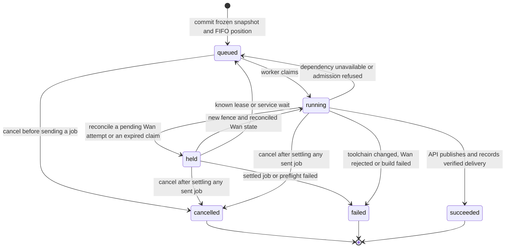
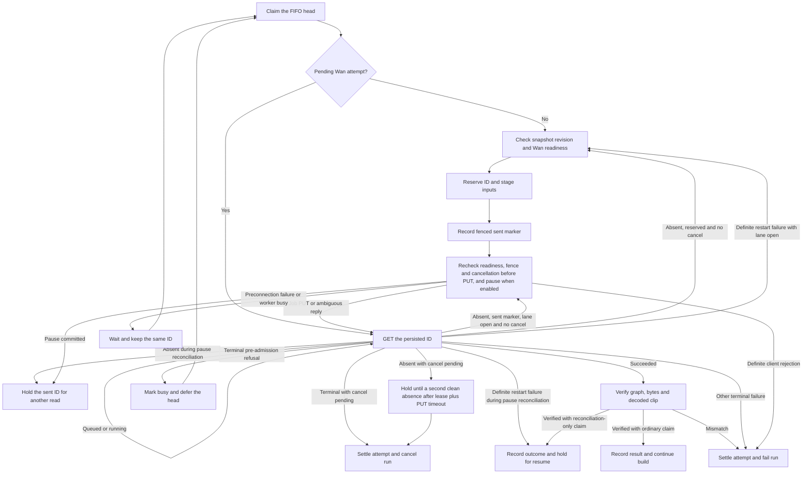

# Studio run queue

A run freezes one draft revision and its ordered boards, resolved asset versions,
and eligible motion alternatives. The API writes the canonical
`studio.run-snapshot/v1` JSON to the private production store and records its
SHA-256, its frozen library and a FIFO position in PostgreSQL. The worker uses
these records for the build. Draft and library edits after enqueue affect only
later runs. The build re-hashes referenced bytes before it asks Wan for a clip.

## Public HTTP

| Method and path | Behavior |
| --- | --- |
| `GET /v1/stories/{id}/estimate` | With `read`, see potential preflight problems, a cold-cache range and the current queue wait. |
| `POST /v1/stories/{id}/runs` | With `runs:queue`, send `If-Match` with the draft revision and a visible-ASCII `Idempotency-Key` of 1–255 characters. The response is 201 and carries the run location and its ETag. |
| `GET /v1/stories/{id}/runs` | With `read`, list runs in enqueue order. Pass the last page's `next_cursor` with the same story. |
| `GET /v1/runs/{id}` | With `read`, see progress, completed stages, checks, Wan attempt IDs and check overrides. The ETag is the run's own revision. |
| `GET /v1/runs/{id}/snapshot` | With `read`, fetch the frozen `studio.run-snapshot/v1` bytes with the recorded SHA-256 as a strong ETag. A matching `If-None-Match` returns 304 after verifying the stored bytes. Run snapshots use this scoped route. |
| `POST /v1/runs/{id}/cancel` | With `runs:queue`, send the run ETag as `If-Match`. The response shows the new state or a pending `cancel_requested` flag. |
| `POST /v1/runs/{id}/checks/{check}/overrides` | A signed-in person sends the run ETag and `{"artifact": "<sha256>", "reason": "..."}` for a failed `layered.decal_gate` artifact or an `uncertain` [film visibility result](film-visibility.md). |
| `GET /v1/runs/{id}/delivery` | With `read`, fetch a finished delivery. Stream its proxy through the authenticated [media route](studio-api.md#private-playback). |

A run read outside the caller's productions answers `404`, the same as an unknown run, on every run route (`GET /v1/runs/{id}`, its snapshot, its delivery, the story's run list and the go-live review read). Earlier builds answered `403` for some of these: a client must treat both as "not available to this caller".

A run with no snapshot, such as a recovered import, returns 404
`run.snapshot_missing`. A lost pinned blob returns 503 `run.snapshot_lost`.
A hash or locator mismatch returns 503 `run.snapshot_changed`. Reads are
bounded to 16 MiB. A larger stored snapshot returns 503 `run.snapshot_too_large`,
and the enqueue route refuses a new snapshot above that limit with HTTP 422.

A draft opened from [candidate feedback](feedback.md) adds its answer reference
to the queued run document. A repeated enqueue with the same story, actor, key and revision returns 200 and
the same run ID, including after a draft edit. Reusing that key with a different
revision returns 422 `idempotency.mismatch`. A new key with a stale draft or run
ETag returns 409 `conflict.revision`. Preflight reports unavailable methods as
422. Draft CRUD and enqueue stay available during worker outages. Build preflight
checks pending voice and photo jobs and requires current whole-frame I2V
photos. The [media workers](media-jobs.md) claim the voice, image and matte lanes
independently.

The estimate reports GPU and CPU wall-time ranges in seconds. Method rows name
the method, the number of I2V jobs or S2V chunks and that method's GPU range.
Layered I2V reuses pinned motion loops, so it estimates zero GPU jobs. The
baseline comes from The Winter Menu's E0 clips and layered CPU measurements.
These cold-cache estimates carry uncertainty from outside lease occupancy,
thermal delays, reuse and retries. Waiting time sums ahead-of-run
Studio work in this serial lane. An active run may be nearly done. A held or
unavailable queue can give a null wait range. The API shows `gpu_unavailable`
when no worker has checked in or renewed a claim within 90 seconds. Every estimate has
`uncertain: true` and a basis.

Cancellation clears any admission cooldown. If Wan may have received a job,
the worker checks its recorded ID. It drains an active job under the existing
lease and settles a refused or terminal job immediately. If Wan returns
`404 job_not_found` for a `sent` ID, the worker holds the run and records the
first absence. A second clean absence must be at least one claim lease plus the
Wan PUT timeout later (90 + 20 seconds) before cancellation releases the FIFO
lane. Inconclusive or active status reads restart the absence check. The original
claim can cancel immediately when it catches cancellation before its first PUT.
A PUT whose final fence check passed before cancellation can still reach Wan
afterward. Wan controls admission and deduplicates that ID. The fenced delivery
publication step is the cancellation cutoff. Terminal canonical documents are immutable.
A check override is a separate immutable record with a person, reason and
timestamp. The release checks are outside the override route's scope.

## Worker configuration

Run `studio-worker` or `python -m haynes_studio.queue.worker`. Each process uses
one claim at a time and the serial build pipeline. Use `--once` to process at
most one claim.

| Environment | Value |
| --- | --- |
| `STUDIO_API_URL` | Internal origin of studio-api. Keep `/internal/v1/work/*` reachable by workers. |
| `STUDIO_WORKER_TOKEN` | The same generated secret registered from a file in [worker token administration](studio-api.md#worker-token-administration). Use distinct IDs and secrets for separate workers. |
| `STUDIO_WAN_URL` | Internal origin of the [Wan product API](wan-product-api.md). |
| `STUDIO_WAN_STORY_URL` | Full OpenProject work package URL recorded in Wan's job ledger. |
| `STUDIO_STORE_ROOT` | The canonical Studio store. Mount read-only on the worker. |
| `STUDIO_BUILD_STAGE_ROOT` | A separate, shared private directory. API and workers see the same per-run staging files. The worker needs write access here. |
| `STUDIO_BUILD_REVISION` | Match the API's `git:<commit>` so the worker serves the snapshot's build revision. |
| `STUDIO_BUILD_IMAGE_DIGEST` | Optional immutable image digest recorded in run provenance. |
| `STUDIO_MODEL_REGISTER` | Optional path overriding the [model licence register](../../src/haynes_studio/model_licences.json) shipped in the installed package. Use the same override on API and workers. |
| `STUDIO_ASR_HOST`, `STUDIO_ASR_PORT` | Host and port of the configured Wyoming ASR service. The default port is 10300. |
| `STUDIO_THREADS` | Set to 2. The worker uses one orchestrator and the existing two-thread media settings. |

The worker writes intermediate artifacts, cache entries and the candidate
delivery create-only in the staging directory. A replacement worker can use the
same staged artifacts. The API verifies and publishes only the delivery stage
and its blobs into the canonical store, then records the delivery, playback
index and run success in one transaction. After an interrupted transaction or
lost completion reply, a replacement verifies the same create-only files.
A definite verification refusal fails the run and releases the head.
Staging is retained for inspection.

## Claims and reconciliation

PostgreSQL chooses one global FIFO head. Enqueue order is assigned inside the
acceptance transaction. A singleton lane and `FOR UPDATE SKIP LOCKED` serialize
claims without letting a later run pass a locked, held or occupied head.
Worker requests carry a per-run increasing fence and the service principal
that claimed it. Claims expire after 90 seconds on the database clock. Workers
heartbeat after 15 seconds during blocking work and at side-effect boundaries.
An expired claim can reconcile, but only its replacement can mutate the run.
Both the API and worker can restart without moving the head or erasing attempts.

The internal routes are POSTs under `/internal/v1/work`. All authenticate the
worker before reading a request body or query. The worker needs a
[`run` lane grant](studio-api.md#worker-token-administration). POST
`/claim` with an empty body to select `run` (204 if there is no claimable head).
An unbound worker or a worker requesting a lane it lacks gets 403
`work.lane_forbidden` before claim processing. The worker renews with
`/heartbeat` and uses `/resume` only after checking a held claim. `/attempts` reserves a job
and `/attempts/{job_id}` records the fenced send marker or a proven outcome. `/publish`
fences publication. `/complete` verifies and registers the resulting delivery,
and `/fail` records failure, cancellation, a hold or a wait. Losing a lease
or a fence causes subsequent mutating operations to return 409.

Pause stops claiming queued work and preserves FIFO order and live claim
fences. A worker can finish its claim, including calling ASR after a clip.
An engine request already authorized under the claim may start after the pause
response. `GET /v1/queue/lanes` adds `live_claim` in both switch states. A lane is
quiet at the time of the read when `paused` is true and `live_claim` is false.
This read-only field is the default-off compatibility exception. Pause and
resume write responses keep their existing shape. The database-clock lease
lasts 90 seconds from its grant or last renewal.

With `STUDIO_PAUSED_RECONCILE=1`, a worker sends `X-Studio-Paused-Reconcile: 1`
on `/claim` to opt into paused reconciliation. A paused claim poll otherwise
returns 204. A compatible replacement can claim the running or held FIFO
head with an unsettled `sent` Wan attempt after the previous claim expires
or is released and any retry delay passes. The claim carries
`reconcile_only: true`. The worker reads the stored ID, waits for a known
active job and records its outcome without submitting or replaying a Wan job.
It holds an absent sent ID for another read. A verified result is recorded and
the run stays held until ordinary claiming resumes. A definite job failure or
cancellation may finish the run while paused.

When the switch is on, a Wan reservation checks pause. The first send marker
and the final fenced heartbeat before a Wan job PUT check pause under the lane
lock. If pause wins, the authorization returns `409 work.lane_paused`. A PUT
that passes the final check may start after the pause response. No database
transaction spans a Wan call. Follow the [worker traffic cutover](../process/studio-operator-runbook.md#activate-paused-reconciliation)
when enabling the switch.

Provisional coordinator ruling CR-19 resolves Q-410-01. Wan's product API owns
the compute lease and deduplicates by caller-selected job ID and request body.
After a lost reply the worker reads the recorded ID. If Wan reports it absent
while the lane is open, the worker can replay the exact same PUT with the original ID and stored body,
including when an earlier worker's request arrives late. The worker makes at
most one absent-ID replay per claim. A connection failure before any bytes were
sent gets its own code. A replacement still reads the durable ID before any PUT.
A lost reply to the Studio `sent` write triggers the same read on takeover. A
lost reply to a `busy` write is resolved from the persisted outcome or Wan's
terminal job record.

The worker checks `GET /v1/ready` for readiness and active video or Foley work
before every PUT. When Wan records a terminal refusal with `admission_code`
`gpu_busy`, `gpu_warm`, `engine_busy`, `lease_held`, `local_model_handover`
or `local_model_unavailable`, Studio marks the attempt `busy` and queues the
same run at the head. The next attempt gets a new ID because the refused
request did not reach the engine. Older job records use the exact legacy
messages for foreign ComfyUI work, busy GPUs and warm GPUs when the code
field is absent. `pre_admission_failed` and unfamiliar codes keep the run
and its recorded attempt held for inspection. A `worker_busy` HTTP response without a job record keeps
the same ID. Admission refusals back off for 60, 120 and at most 240 seconds on
the database clock. Success resets the refusal count. Other ordinary waits
use 15 seconds. A reported render hold or unexpected work observed during
inference can pause the build until Wan reports readiness. An explicit Wan
restart failure allows one fresh attempt per claim before yielding.

| Code | Queue behavior |
| --- | --- |
| `wan.submit_not_sent` | The connection failed before the PUT could be written. Recheck the saved ID and readiness after the wait. |
| `wan.ambiguous_submit` | Reconciliation still found no record after a same-ID replay. Keep the head and retry reconciliation. |
| `wan.cancel_waiting_for_absence` | Cancellation is pending for a sent ID. Hold the FIFO head and check the same ID for a second absence after the safety window. |
| `work.lane_paused` | Hold the run at the FIFO head. Keep a sent attempt with an unknown outcome for reconciliation. Resume the lane when ordinary work can continue. |
| `wan.foreign_engine_queue`, `wan.busy` | Honor the admission cooldown. Use a new ID only after a recorded terminal refusal. |
| `wan.pre_admission_failed`, `wan.admission_unknown` | Hold the run and retain its sent attempt for inspection. |
| `wan.id_conflict`, `wan.submit_rejected` | Fail the attempt and run on a conflicting ID or another definite PUT client error. |
| `wan.graph_mismatch`, `wan.result_invalid`, `wan.clip_invalid` | Fail the attempt and run with expected and actual evidence for the terminal result. Verification covers the graph pin, byte count, SHA-256, decode, dimensions, frame count and rate. |
| `work.revision_mismatch` | Fail the run if its frozen Studio revision differs from the worker. Queue a new run to capture the current immutable snapshot. Earlier verified clips in the same production are reused through the cache when their input and profile keys still match. |

The pinned I2V or S2V graph associates the recorded graph SHA-256 with the model
file hashes in the licence register.

## Recovery evidence for story 437

[Story 437](https://work.haynesnetwork.com/work_packages/437) exercises
independent API applications with a shared disposable PostgreSQL database
and store. The tests compete for the global run head, claim independent
lanes, fence superseded workers and resume an expired claim after an API
restart. They terminate a database connection during a claim and check
that the transaction rolls back, then retry through the API. An accepted
enqueue retried with its original key and revision keeps its run ID.

External engines and the identity provider are synthetic. A slow Wan poll
allows reads and media claims while the next run keeps its FIFO position.
After interrupted dispatch, the replacement looks up the saved Wan ID.
An expired image job with a dispatch marker fails with
`work.dispatch_unconfirmed` and is never automatically resubmitted. With
the run worker absent and Wan unavailable, a run stays queued with
`gpu_unavailable` while draft CRUD, existing delivery reads, the other
worker lanes and queue read routes remain available.

The installed check belongs to the coordinator. The one-API-pod procedure
in haynes-ops `docs/reference/studio-deployment.md` measures the internal
ingress during replacement, verifies Ready placement and continued idle
claims, and compares read-only evidence from the shared database and store.
Record the drill result, source test results, human playback and acceptance
separately.

The installed database grants and rollout evidence are recorded in
[story 431](https://work.haynesnetwork.com/work_packages/431) and
[story 434](https://work.haynesnetwork.com/work_packages/434). The queue
worker pin and startup checks are in
[story 956](https://work.haynesnetwork.com/work_packages/956). Import,
image digests, ranged playback and out-of-scope proxy refusal are recorded
in [story 957](https://work.haynesnetwork.com/work_packages/957). Signed-in
phone playback is still open in
[story 944](https://work.haynesnetwork.com/work_packages/944).

The human-only override, lost acknowledgement, slow poll and Wan restart
have source test coverage. An installed test of those cases needs its own
authorized fixture and records the image digests and build revision. The
one-API-pod procedure provides placement, ingress and shared-store evidence.
