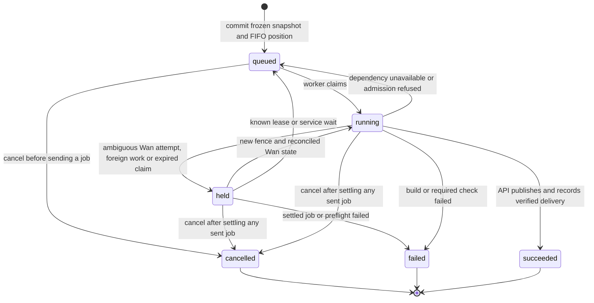
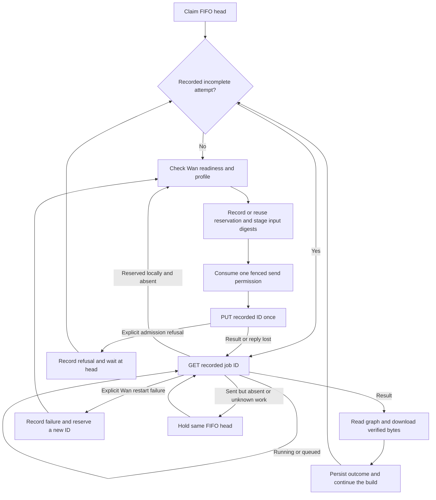

# Studio run queue

A run freezes one draft revision and its ordered boards, resolved asset versions,
and eligible motion alternatives. The API writes the canonical
`studio.run-snapshot/v1` JSON to the private production store and records its
SHA-256, its frozen library and a FIFO position in PostgreSQL. The worker uses
these records for the build. Draft and library edits after enqueue affect only
later runs. The build re-hashes referenced bytes before it asks Wan for a clip.

## Public HTTP

| Method and path | Behavior |
| --- | --- |
| `GET /v1/stories/{id}/estimate` | With `read`, see potential preflight problems, a cold-cache range and the current queue wait. |
| `POST /v1/stories/{id}/runs` | With `runs:queue`, send `If-Match` with the draft revision and a visible-ASCII `Idempotency-Key` of 1–255 characters. The response is 201 and carries the run location and its ETag. |
| `GET /v1/stories/{id}/runs` | With `read`, list runs in enqueue order. Pass the last page's `next_cursor` with the same story. |
| `GET /v1/runs/{id}` | With `read`, see progress, completed stages, checks, Wan attempt IDs and check overrides. The ETag is the run's own revision. |
| `POST /v1/runs/{id}/cancel` | With `runs:queue`, send the run ETag as `If-Match`. The response shows the new state or a pending `cancel_requested` flag. |
| `POST /v1/runs/{id}/checks/{check}/overrides` | A signed-in person sends the run ETag and `{"artifact": "<sha256>", "reason": "..."}`. The only supported check is a failed `layered.decal_gate`. |
| `GET /v1/runs/{id}/delivery` | With `read`, fetch a finished delivery. Stream its proxy through the authenticated [media route](studio-api.md#private-playback). |

A repeated enqueue with the same story, actor, key and revision returns 200 and
the same run ID, including after a draft edit. Reusing that key with a different
revision returns 422 `idempotency.mismatch`. A new key with a stale draft or run
ETag returns 409 `conflict.revision`. Preflight reports unavailable methods as
422. Draft CRUD and enqueue stay available during worker outages. Voice and photo job
tracking arrives in story [430](https://work.haynesnetwork.com/work_packages/430),
which supplies live job facts to the queue's metadata preflight.

The estimate reports GPU and CPU wall-time ranges in seconds. Method rows name
the method, the number of I2V jobs or S2V chunks and that method's GPU range.
Layered I2V reuses pinned motion loops, so it estimates zero GPU jobs. The
baseline comes from The Winter Menu's E0 clips and layered CPU measurements.
These cold-cache estimates carry uncertainty from outside lease occupancy,
thermal delays, reuse and retries. Waiting time sums ahead-of-run
Studio work in this serial lane. An active run may be nearly done. A held or
unavailable queue can give a null wait range. The API shows `gpu_unavailable`
when no worker has checked in or renewed a claim within 90 seconds. Every estimate has
`uncertain: true` and a basis.

Cancelling stops new work for the run. If Wan may have received a job, the run
stays at the head until the worker reconciles that job. The worker lets Wan
settle it under the existing service lease. Cancellation closes at the fenced
delivery publication boundary. Terminal canonical documents are immutable.
A check override is a separate immutable record with a person, reason and
timestamp. The release checks are outside the override route's scope.

## Worker configuration

Run `python -m haynes_studio.queue.worker`. Each process uses one claim at a
time and the serial build pipeline. Use `--once` to process at most one claim.

| Environment | Value |
| --- | --- |
| `STUDIO_API_URL` | Internal origin of studio-api. Keep `/internal/v1/work/*` reachable by workers. |
| `STUDIO_WORKER_TOKEN` | Owner-provisioned worker bearer secret. Use distinct worker IDs and tokens for separate worker identities. Workers use Studio HTTP for all metadata. |
| `STUDIO_WAN_URL` | Internal origin of the [Wan product API](wan-product-api.md). |
| `STUDIO_WAN_STORY_URL` | Full OpenProject work package URL recorded in Wan's job ledger. |
| `STUDIO_STORE_ROOT` | The canonical Studio store. Mount read-only on the worker. |
| `STUDIO_BUILD_STAGE_ROOT` | A separate, shared private directory. API and workers see the same per-run staging files. The worker needs write access here. |
| `STUDIO_BUILD_REVISION` | Match the API's `git:<commit>` so the worker serves the snapshot's build revision. |
| `STUDIO_BUILD_IMAGE_DIGEST` | Optional immutable image digest recorded in run provenance. |
| `STUDIO_MODEL_REGISTER` | Path to the image's pinned [model licence register](model-licences.json). |
| `STUDIO_ASR_HOST`, `STUDIO_ASR_PORT` | Host and port of the configured Wyoming ASR service. The default port is 10300. |
| `STUDIO_THREADS` | Set to 2. The worker uses one orchestrator and the existing two-thread media settings. |

The worker writes intermediate artifacts, cache entries and the candidate
delivery create-only in the staging directory. A replacement worker can use the
same staged artifacts. The API verifies and publishes only the delivery stage
and its blobs into the canonical store, then records the delivery, playback
index and run success in one transaction. After an interrupted transaction or
lost completion reply, a replacement verifies the same create-only files.
A definite verification refusal fails the run and releases the head.
Staging is retained for inspection.

## Claims and reconciliation

PostgreSQL chooses one global FIFO head. Enqueue order is assigned inside the
acceptance transaction. A singleton lane and `FOR UPDATE SKIP LOCKED` serialize
claims without letting a later run pass a locked, held or occupied head.
Worker requests carry a per-run increasing fence and the service principal
that claimed it. Claims expire after 90 seconds on the database clock. Workers
heartbeat after 15 seconds during blocking work and at side-effect boundaries.
An expired claim can reconcile, but only its replacement can mutate the run.
Both the API and worker can restart without moving the head or erasing attempts.

The internal routes are POSTs under `/internal/v1/work`. All authenticate the
worker before reading a request body or query. The worker begins with
`/claim` (204 if there is no claimable head), renews with `/heartbeat` and
uses `/resume` only after checking a held claim. `/attempts` reserves a job
and `/attempts/{job_id}` authorizes one send or records its outcome. `/publish`
fences publication. `/complete` verifies and registers the resulting delivery,
and `/fail` records failure, cancellation, a hold or a wait. Losing a lease
or a fence causes subsequent mutating operations to return 409.

The Wan API is the authority for GPU profiles, admission and its shared compute
lease. Studio verifies the job identity and canonical request hash. It trusts
the returned graph hash only when it matches the pinned I2V or S2V graph for
the request. Model file hashes are the licence register's pins for that graph.
The worker verifies the downloaded bytes against Wan's count and SHA-256, then checks the decoded
frame count, dimensions and rate before giving the clip to the renderer.

A reserved attempt can be sent after reconciliation confirms the ID is absent.
The fenced send permission authorizes one PUT per ID. After a lost reply or
slow status read the worker queries the recorded ID. A missing sent ID leaves the run held, since the sender or Wan may still
finish recording the request. Wan's explicit restart failure allows one new
attempt for that clip. If Wan restarts again during the same claim, the worker
waits before another replacement. Busy admissions use a new ID only after a
known refusal and renewed readiness. The persisted queue head backs off for 15 seconds
after a wait or hold. A reported render hold or foreign work pauses the lane.
Unknown ComfyUI work with no authoritative clearance remains held for operator
inspection. The lane stays held during that inspection.

## Installed proof for story 437

[Story 437](https://work.haynesnetwork.com/work_packages/437) records installed
evidence separately from source test results and creative acceptance.

- Run the migration Job with the preprovisioned roles, and show the head
  revision and effective runtime grants. Confirm the runtime user cannot
  mutate a snapshot, attempt ID or credential table. Confirm claims use HTTP
  with a worker token and refuse anonymous, browser and agent credentials
  before parsing a malformed body or query.
- Through two API replicas, enqueue two revisions and retry an idempotency key.
  Edit the draft and verify both SHA-256 values, FIFO order and scoped reads.
- Verify two worker identities compete for one head, an expired fence is
  rejected, and an API or worker restart leaves every accepted run recoverable.
- With an approved bounded fixture, observe lost submit acknowledgement, slow
  poll, expiry and Wan restart. Show recorded IDs, reads before any new
  submission, and digests. Verify unknown work holds the lane and a lease
  refusal or loss of talosw01 pauses builds while draft CRUD stays up.
- Verify a completed private delivery through the authenticated phone proxy,
  including a Range read, and verify access is refused outside the production.
  Verify cancelled work stops submissions and only a person can override a
  permitted visual check.
- Record image digests, revision and timing together with the private artifact
  locations and hashes. Keep installed, usable and Tom's verdict separate.
